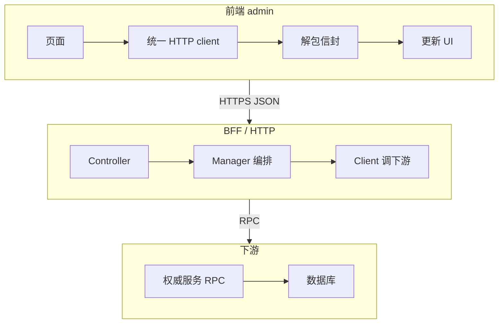

> **契约篇**。前面三篇分别是 [语言](/blog/java-language-for-frontend/)、[框架](/blog/spring-boot-for-frontend/)、[Bean](/blog/spring-bean-for-frontend/)。这一篇不再堆新概念，而是把请求从页面打到门面再回来的**协议**讲清楚。
>
> 文中前端 / admin、BFF、下游服务都是**脱敏后的契约教学示例**。分页字段 `data.module`、用 200 包业务失败，都是**这一份示例约定**，不是业界普遍规范。没有对照过某份私有源码。

---

## 0. 定位

```
语言篇  你会写 Java
框架篇  你懂 Spring 怎么把对象和 HTTP 接起来
Bean篇  你知道容器里躺着的是实例
契约篇  前端和后端靠同一份协议协作
```

前后端是两个运行时。沟通不是函数调用，是约定：

- 正文怎么包一层信封
- 错误码两边同一套 **wire 值**
- 登录失败是 HTTP 401 还是信封里的业务码——必须写死，不能靠「行业常识」

---

## 1. 请求全景

一次「保存权益」的教学路径：



BFF **不一定**自己写 Mapper。数据常常在下游。返回信封 → 前端解包 → UI。

---

## 2. 一次保存 / 发布的旅程

教学用的路径集中放一处，避免散落魔法字符串：

```ts
// 脱敏教学示例
export const BENEFIT_API = {
  saveAndPublish: "/api/v1/benefits/save-and-publish",
  remove: (id: string) => `/api/v1/benefits/${encodeURIComponent(id)}`,
};
```

```java
@RestController
@RequestMapping("/api/v1/benefits")
public class BenefitController {
    private final BenefitManager benefitManager;

    public BenefitController(BenefitManager benefitManager) {
        this.benefitManager = benefitManager;
    }

    @PostMapping("/save-and-publish")
    public ApiResult<BenefitDto> saveAndPublish(@Valid @RequestBody SaveBenefitForm form) {
        return ApiResult.success(benefitManager.saveAndPublish(form));
    }
}
```

Manager 做校验和编排，再调 `BenefitClient`（RPC）。**不要假装 `@Transactional` 会把下游 RPC 一起回滚**——本地库和远程是两条边界。成功才 `ApiResult.success`；前端 `unwrap` 后再画 UI。

---

## 3. `ApiResult<T>`：类型安全的解包

后端工厂（与框架篇同一套教学信封）：

```java
public enum ResultCode { SUCCEEDED, FAILED, UNKNOWN }

public record ApiResult<T>(ResultCode resultCode, String errorCode, String errorMsg, T data) {
    public static <T> ApiResult<T> success(T data) {
        return new ApiResult<>(ResultCode.SUCCEEDED, null, null, data);
    }
    public static <T> ApiResult<T> fail(String code, String msg) {
        return new ApiResult<>(ResultCode.FAILED, code, msg, null);
    }
    public static <T> ApiResult<T> unknown(String code, String msg) {
        return new ApiResult<>(ResultCode.UNKNOWN, code, msg, null);
    }
}
```

JSON 例：

```json
{
  "resultCode": "SUCCEEDED",
  "errorCode": null,
  "errorMsg": null,
  "data": { "id": "b-1", "title": "满减" }
}
```

删除成功时 `data` 可以是 `null`。前端必须允许成功且无 body。

### 3.1 只认 `resultCode`，缺了不是失败

下面这份 TS 把「根本不是信封」和「业务三态」分开。**缺失 / 陌生值 / 字段冲突不当成 FAILED**，也不诱导去点「再试一次写入」。

```ts
type ResultCode = "SUCCEEDED" | "FAILED" | "UNKNOWN";

type Ok<T> = { kind: "ok"; data: T | null };
type Failed = { kind: "failed"; errorCode: string; errorMsg: string };
type Pending = { kind: "pending"; errorCode?: string; errorMsg?: string };
type ProtocolError = { kind: "protocol"; reason: string };

type Unwrapped<T> = Ok<T> | Failed | Pending | ProtocolError;

function isRecord(v: unknown): v is Record<string, unknown> {
    return typeof v === "object" && v !== null;
}

export function unwrapEnvelope<T>(json: unknown): Unwrapped<T> {
    if (!isRecord(json) || !("resultCode" in json)) {
        return { kind: "protocol", reason: "not-an-envelope" };
    }
    const code = json.resultCode;
    if (code !== "SUCCEEDED" && code !== "FAILED" && code !== "UNKNOWN") {
        return { kind: "protocol", reason: "unknown-resultCode" };
    }
    // 若同时带了派生布尔，必须和 resultCode 一致，否则当协议错误，避免各读各的
    if ("success" in json && json.success === true && code !== "SUCCEEDED") {
        return { kind: "protocol", reason: "conflicting-flags" };
    }
    if (code === "SUCCEEDED") {
        return { kind: "ok", data: (json.data as T) ?? null };
    }
    if (code === "FAILED") {
        return {
            kind: "failed",
            errorCode: String(json.errorCode ?? ""),
            errorMsg: String(json.errorMsg ?? ""),
        };
    }
    return {
        kind: "pending",
        errorCode: String(json.errorCode ?? ""),
        errorMsg: String(json.errorMsg ?? ""),
    };
}
```

规则：

| 情况 | 怎么处理 |
|---|---|
| HTTP/网络失败、非 JSON | 不是业务信封，走网络层，不要 `unwrap` |
| JSON 没有 `resultCode` | `protocol`，不是 FAILED |
| 陌生 `resultCode` | `protocol` |
| 派生布尔和 `resultCode` 打架 | `protocol` |
| `SUCCEEDED` | 读 `data`，允许 null |
| `FAILED` | 业务失败，按 `errorCode` 分流 |
| `UNKNOWN` | **未决**：可能已经成功，禁止盲重视写入 |

---

## 4. 错误码：以线上值为准

两端枚举**名字**可以不同，**wire 上的字符串**必须一致。教学里的兼容层（虚构，不是某家 RPC 商标）：

```ts
enum TimeoutWire {
    TIMEOUT = "TIMEOUT",
    // 旧协议曾下发这个值，前端映射到同一处理分支
    LEGACY_TIMEOUT = "LEGACY_TIMEOUT",
}
```

可以靠 OpenAPI / JSON Schema 生成类型、再加契约测试，减少两份手抄漂移。**不是只能手抄。**

`errorMsg` 有时被旧协议复用成「去登录的 URL」。现代设计请拆开：`message`、`redirectUrl`、`action`。前端：

- 按 `errorCode` 分流：未登录 / 无权限 / 乐观锁冲突 / 一般提示
- **不要 Toast 一段 URL**
- **不要直接 `location.href = errorMsg`**
- 即便有 `redirectUrl`，也要过第 7 节的白名单

---

## 5. 分页信封

本例 `data` 是分页容器，列表在 `module`：

```json
{
  "resultCode": "SUCCEEDED",
  "data": {
    "module": [
      { "id": "1" }, { "id": "2" }, { "id": "3" }, { "id": "4" }, { "id": "5" },
      { "id": "6" }, { "id": "7" }, { "id": "8" }, { "id": "9" }, { "id": "10" }
    ],
    "totalCount": 42,
    "pageNo": 1,
    "pageSize": 10,
    "hasNext": true,
    "nextStartRowKey": "10"
  }
}
```

第一页 10 条、总共 42、`hasNext: true`，数量是对得上的。**`module` 不是所有后端列表的通用字段。** 别的系统可能是 `records` / `items` / `list`。不要写 `data.map`，除非契约就是数组。

---

## 6. 删除

路径里的动态段要编码：

```ts
await post(BENEFIT_API.remove(id)); // encodeURIComponent 已在拼路径时做
```

用 `POST /delete` 还是 `HTTP DELETE` 是契约选择，选一种写进文档。链路仍是 Controller → Manager → Client。返回 `ApiResult<Void>`（成功 `data: null`）。

Controller 只从统一出口出信封。全局异常处理：**超时 / 未知不能一律 FAILED**（框架篇第 9 节）。

---

## 7. HTTP 状态、来源页、可信回跳

### 7.1 两层状态

这份**兼容示例**可能用 HTTP 200 包业务 FAILED（未登录也走信封）。这不是推荐所有鉴权都 200。网关、反向代理、鉴权中间件仍会 401/403。client 要**同时看** `response.ok` 和信封。

### 7.2 `X-Page-Url` 和 Referer

登录成功要跳回「刚才那一页」（含 hash 路由）：

- 首选：前端每个请求注入 `X-Page-Url: window.location.href`（包含 hash）
- 回退：浏览器 `Referer`
- 再回退：当前请求 URL（通常没有前端 hash）

`Referer` 是 **forbidden 请求头**，页面脚本不能 `headers.set("Referer", ...)`。要用 `fetch(url, { referrer, referrerPolicy })`。跨域时策略可能只剩 origin，**永远没有 fragment**。自定义头要过 CORS `Access-Control-Allow-Headers`，预检会多一次 OPTIONS。

**不要把 token、敏感 query 拼进会被上报的页面 URL。**

### 7.3 白名单（前后端都做）

错误示范：`host.endsWith("example.com")` 会放行 `evil-example.com`。

```ts
function isTrustedGuideUrl(raw: string, trustedSite = "example.com"): boolean {
    let u: URL;
    try {
        u = new URL(raw.trim());
    } catch {
        return false;
    }
    if (u.protocol !== "https:") return false;          // 生产建议仅 https
    if (u.username || u.password) return false;
    if (u.port && u.port !== "443") return false;
    if (raw.length > 2048) return false;
    const host = u.hostname.toLowerCase();
    const ok =
        host === trustedSite || host.endsWith("." + trustedSite);
    // example.com 与 foo.example.com 过；evil-example.com、example.com.evil 不过
    return ok;
}
```

示例域用 `example.com`。拒绝 `evil-example.com`、`example.com.evil`。query 保持编码，不要二次解码成开放重定向。

---

## 8. UNKNOWN：可能已经成功

超时不等于 FAILED。写操作收到 UNKNOWN / 协议未决时：

- **禁止**自动再提交一笔会改状态的请求
- 用 `requestId` / 幂等键去**查询**，或等后台对账 / 异步确认
- 在幂等与协议允许时，可以安全重试**查询**；不要把「全世界只能让用户手工刷新」写成唯一动作，但 UI 上引导「先看结果再决定」通常最稳
- 只读 GET 和写入不同；已知 FAILED 也未必适合自动重试（乐观锁冲突要刷新，不要盲打）

幂等本身见专栏 [幂等](/blog/idempotency/)。

---

## 9. Mock 和真实后端

示例命令（不是某内部包管理器）：

```bash
npm run dev          # 本地 mock
MOCK=none npm run dev  # 关掉 mock，打真实 BFF
```

Mock 和实现漂移是风险，**不是应接受的常态**。以审定契约为准：不一致时先确认谁错，不要默认「后端一定对」或「改 mock 让页面绿」。Schema、生成 types、mock、契约测试应对齐同一份定义。

---

## 10. 自测

<details>
<summary>1. JSON 没有 <code>resultCode</code>，当成 FAILED 去 Toast 可以吗？</summary>

不可以。那是协议错误或根本不是信封。缺失状态当未决 / protocol，不要诱导写入重试。
</details>

<details>
<summary>2. 登录失败把 URL 放进 <code>errorMsg</code>，直接 Toast 或跳转？</summary>

不要 Toast URL。跳转必须走独立字段并过白名单。这是旧协议兼容，不是推荐设计。
</details>

<details>
<summary>3. 为什么还要 <code>X-Page-Url</code>？Referer 不够吗？</summary>

Referer 脚本设不了、跨域常只剩 origin、没有 hash。SPA 回跳现场要自己带当前页（含 fragment），并当成不可信输入校验。
</details>

<details>
<summary>4. 列表一定是 <code>data.module</code> 吗？</summary>

只是本例。先读契约。数量要和 <code>pageSize</code> / <code>totalCount</code> 对得上。
</details>

<details>
<summary>5. Mock 绿了就能发吗？</summary>

不能。Mock 只保证前端自洽。联调以真实实现 + 契约为准。
</details>

---

## 11. 四篇 checklist

| 篇 | 你该能做到 |
|---|---|
| 语言 | 类、集合、异常、Stream、多态写得出 |
| 框架 | 起一个 Boot 服务，Controller → Service → Mapper，本地事务边界清楚 |
| Bean | 说清 Class / 定义 / 实例，不把事务神话成「只有 Service 能用」 |
| 契约 | 解包三态、错误码分流、回跳校验、UNKNOWN 不盲写 |

读完这四篇，**还不能**等价于「已经能独立交付生产中后台」。还要补专栏里的事务、锁、幂等、查询、[二方包](/blog/maven-second-party-package/)。

---

## 12. 收束

契约是前后端唯一的共同语言。信封、错误码、分页字段、鉴权跳转，全部写进文档和测试，而不是写进口头习惯。

---

## 13. 术语表

| 术语 | 一句话 | 前端锚点 |
|---|---|---|
| 契约 | 双方遵守的请求/响应形状 | 一份 OpenAPI 或共享 types |
| `resultCode` | SUCCEEDED / FAILED / UNKNOWN | 只认这一字段做三态 |
| UNKNOWN | 未决，可能已成功 | 禁止盲写重试 |
| `errorCode` | 线上字符串 | 不要对枚举名 |
| `errorMsg` / `redirectUrl` | 文案 vs 跳转 | 旧协议可能混在 msg 里 |
| `ApiResult` / 分页 `module` | 本例信封 | 列表走 `data.module` |
| BFF | HTTP 门面 | 前端只打这一层 |
| `X-Page-Url` | 当前页（含 hash） | 请求拦截器注入 |
| Referer | 浏览器来源头 | forbidden header，无 fragment |
| 开放重定向 | 把不可信 URL 当跳转 | 白名单精确匹配域名 |
| 幂等键 / requestId | 同一笔业务的身份证 | 查询和重试用 |
| Mock | 本地桩 | 不能替代契约测试 |

上一篇：[Spring Bean 进阶](/blog/spring-bean-for-frontend/) · 语言 / 框架：[Java](/blog/java-language-for-frontend/) · [Spring Boot](/blog/spring-boot-for-frontend/)
