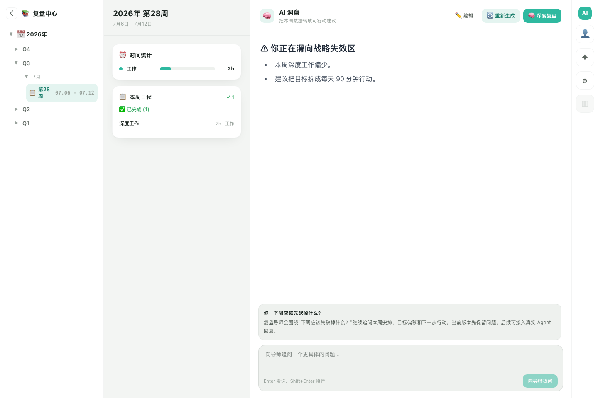
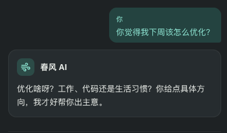
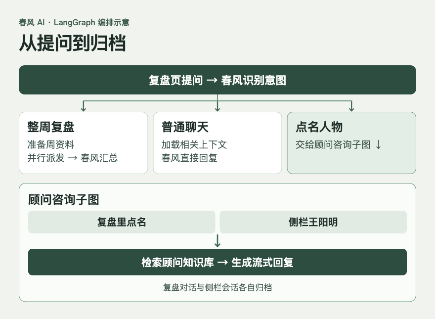
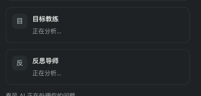

安排日历的复盘中心最早有几个 Tab。点生成周报，效率大师、健康顾问、目标教练和反思导师可以各写一份意见。读完想接着问「那下周我先改什么」，页面上留下的是一篇报告。这次改造就从这句追问开始。用户可以说「帮我复盘这周」，再问「下周先改什么」，也可以点名「请王阳明用知行合一帮我看看」。这三句话在同一个对话框里，后面要做的事情却各不相同。

## 1. 最初的多 Agent 是怎么做的

最初我们把三类能力都叫多 Agent。生活助理、效率导师和复盘导师是在同一套工具上切换提示词。王阳明、曾国藩、毛泽东有各自的知识库，可以单聊，也可以三路并行后综合。周度多专家复盘则由独立的 AI 服务生成报告。三条路径各有入口，用户从复盘转到咨询时，对话和周资料要重新组织。

旧周报的代码很直接。前端传来所选周的日程、目标和统计，服务端补上用户画像，查出启用的导师。每位导师有各自的系统提示词，收到的周资料相同。`agents.map(async …)` 发起各路模型调用，`Promise.all` 等这些任务结束。每路各自捕获异常，成功的结果立即入库，并通过 SSE 发给页面。最后再调用一次模型，把成功的意见综合成周报。页面按 Tab 展示各路结果。旧页面已经有追问框，但提交只在页面本地追加固定的占位回复。



*旧版界面测试，使用模拟数据。点开大图可看到当时追问框返回的占位文本。*

旧代码里，导师的结果在完成时 `insights.push(saved)`，数组按**返回顺序**排列。生成总结时，代码用 `agents[idx]?.name` 取姓名，名单却按**配置顺序**排列。假设目标教练先于效率大师返回，前端仍然能用事件里的导师 ID 显示正确的人，传给总结模型的标题却可能贴错。哪怕返回顺序稳定，一位导师失败也可能让下标错位。这是从代码推导出的风险。

用导师 ID 对齐数据，旧实现就能修好这个问题。我们学习 LangGraph，是因为问答式页面接下来要维护的分支越来越多。整周复盘才召集导师，普通追问让春风接着答，点名人物才调用他的知识库。同一周关掉页面再打开，还得知道上一句是谁说的，以及哪一轮已经保存。改动从生成一个文档，变成运行并保存一轮有分支的对话。

## 2. 先在实验里把图跑起来

我们用一个比正式复盘更容易检查的任务练手。复盘本周，从记录里找出两件重要的事，再把它们安排到下周。实验的日程、发现和空闲时段都是固定数据，可以先验证图的执行顺序。

`StateGraph` 接受一份状态定义，用 `addNode` 注册可执行步骤，再用边连接它们。实验里的 `review` 模拟复盘，`availability` 查询空闲时段，两者都从 `START` 出发。`.addEdge(['review', 'availability'], 'plan')` 的数组表示等两个前置节点都完成，再开始排时间。`plan → choose` 是一条固定边，等排出计划才处理用户选择。提交成功后通过 `commit → END` 结束。 [LangGraph Graph API](https://docs.langchain.com/oss/javascript/langgraph/graph-api)

实验里的 `createWorkflow(ports, checkpointer)` 把节点、边和依赖装起来，调用 `.compile({ checkpointer })` 得到可执行的图。`ports` 是实验提供的复盘、查时间和写日程函数。业务入口再用 `graph.invoke(input, config)` 提交一次任务，或者用 `graph.stream` 边执行边消费事件。比如输入 `{ taskId: 'task-01' }` 后，第一批实际运行的是 `review` 和 `availability`。定义流程、组装可执行对象、发起一次运行，是三个不同的时点。

## 3. State、StateSchema 和 Reducer 怎么交接数据

State 是这次图运行中各步骤共同维护的数据。`StateSchema` 声明有哪些字段、每个字段是什么类型、默认值是什么，以及多个更新怎么合并。节点拿到一份输入，返回自己要更新的字段。比如 `availability` 返回 `{ findings, slots }`，`plan` 返回 `{ actions, status: 'planned' }`，状态里的 `taskId` 和其他已有字段照常保留。 [LangGraph 的 State 和 Reducer](https://docs.langchain.com/oss/javascript/langgraph/graph-api-state)

实验里的 `findings` 是给下游使用的结构化发现。假设复盘节点产出 `{ id: 'goal:1', title: '整理阅读笔记', evidence: '本周笔记未归档' }`，查空闲的节点也产出一条关于时间的发现。两路都写 `findings` 时，普通字段无法在同一步接收两份更新。我们把这个字段声明为 `ReducedValue`，Reducer 用已有发现和本次更新生成一份新列表。不同 ID 同时保留，同一 ID 后一次更新覆盖旧版本，最后按 ID 排序。等到 `plan` 运行，它就能用目标发现挑选行动，再用 `slots` 排时间。

实验里专门留下了两个用例。两路向没有 Reducer 的字段写入，图会报错。配置 Reducer 后，两个不同 ID 都能传到 `plan`，重放同一个 ID 也只保留一条。后来周复盘的 `opinions` 和 `advisorFailures` 沿用同一个思路，用导师 ID 把结果和任务关联起来。

## 4. 固定边、条件边和 Command 各在什么时候用

`addEdge` 表达固定后继。实验的 `commit` 做完就结束，一条 `addEdge('commit', END)` 足够。`addConditionalEdges` 在节点完成后运行路由函数，读状态并返回下一站，适合「先写好判断，再选择分支」。`Command` 则由节点返回，把状态更新和跳转放在一起。实验里用户点取消时，`choose` 返回 `new Command({ update: { status: 'cancelled' }, goto: END })`，一边记录取消，一边结束图。改时间走 `plan`，确认走 `commit`。 [LangGraph 的控制流](https://docs.langchain.com/oss/javascript/langgraph/graph-api-control-flow) · [Send 和 Command](https://docs.langchain.com/oss/javascript/langgraph/graph-api-send-command)

实验在注册 `choose` 时传入 `{ ends: ['plan', 'commit', END] }`，声明 `Command` 可能跳到的节点，供图校验和绘制。实际选择看这次返回的 `goto`。如果同时给 `choose` 写一条静态的 `addEdge('choose', 'commit')`，即使它返回取消，静态边仍会调度 `commit`。像 `commit` 这种只返回回执和状态、下一步由固定边定义的节点，也就没有声明 `ends` 的需要。

### 4.1 春风怎么判断是复盘还是闲聊

春风的路由节点先看当前问题、语言、所选周、可用导师，以及最近三轮问答的短摘录。生产用 `withStructuredOutput` 和 `ReviewIntent` schema 让模型返回结构化意图，程序再校验结果并补全业务参数。例如模型返回 `{ kind: 'delegate' }`，程序从当前可用的导师名单产生 `advisorIds`。条件边读这个经过校验的 `route`，把整周复盘送到 `retrieveContext`。闲聊走 `retrieveChatContext`，取本周日程、年度目标和近期对话，再交给春风回复。模型判断话的意思，代码定义允许走哪些路，以及每条路能拿什么数据。

| 用户在复盘页说的话 | 这轮怎么走 | 需要什么资料 |
| --- | --- | --- |
| 「帮我复盘这周」 | `delegate`，并行请可用导师，再由春风汇总 | 所选周日程、年度目标，按需补画像和相关记忆 |
| 「项目类完成了几项？」接着问「那未完成的呢？」 | `direct`，沿用上轮统计范围，由代码计数 | 本周项目类日程及完成状态 |
| 「你觉得下周怎么优化？」 | 春风直接接话，按语境走聊天或局部分析 | 周日程、年度目标、可用的周报摘要及相关对话 |
| 「请王阳明用知行合一看看我的阅读安排」 | `consultAdvisor`，由王阳明回答 | 顾问知识库中的受控主题，以及生成回复需要的本周资料 |



*早期本地试用时，一句「你觉得我下周该怎么优化」得到的是泛泛的澄清。看到这段回复后，我们明确了普通聊天也要读取本周日程、年度目标和相关对话。*

「我刚写完这周的复盘」和「请帮我复盘这周」都出现了「复盘」，一个是在分享近况，一个是在发起任务。路由提示词用中、英、日文样例表达这个区别，也给意图不明的情况保留 `clarify`。点名顾问的分支还会核对角色。问题里有明确的人名时，模型选中的角色必须和它一致。没有名字的「举个例子」只有紧接同一顾问的咨询时才沿用这个角色，其他情况由春风处理或先澄清。

搜索也从这里分出去。「找一下我上周的读书记录」走账号内搜索，「查一下 LangGraph 的 Send 文档」走公开搜索。公开搜索用本轮问题做查询，路由阶段读到的对话历史只帮助判断去哪里查。

图里的分叉发生在一轮对话开始时。进入整周复盘后，春风先准备资料，再按参与导师分派任务。



## 5. 用 Send 分派任务，只重试失败的导师

假设用户问「帮我复盘这周」，这轮选了效率大师、目标教练和反思导师。为方便走读，下面用三条合成资料。它们分别是已完成的阅读笔记、未完成的练习，以及年度阅读目标。生产会先把账号内的周资料准备成统一的 `facts`，再按导师职责筛选。目标教练重点看目标与相关日程，反思导师优先看未完成事项。某条事实跟两个角色都相关时，可以出现在两份输入里。

生产图里，这轮复盘的每个节点都有明确的输入和产物。

1. `prepareTurn` 读取同周会话的状态与本轮问题。保留已归档的 `turns`，清空本轮意见、失败和临时资料。
2. `routeQuestion` 根据本轮问题、最近问答和可用导师写入校验后的 `route`。
3. `retrieveContext` 根据 `route` 和所选周准备这轮共用的 `facts`。
4. `analyzeAdvisor` 读取一位导师及其资料切片，更新以导师 ID 为键的 `opinions` 或 `advisorFailures`。
5. `synthesize` 对照选中的导师、两份结果映射和原始事实，生成总结以及完整、部分完成或失败状态。
6. `recordTurn` 把问题、最终回答和本轮产物存成一条可恢复的问答记录。

`Send` 表示把一份输入交给指定节点处理。选中三位导师，条件边就返回三个 `Send`。同一个 `analyzeAdvisor` 在本轮有三个任务实例，每个实例只拿自己的资料。下面的 TypeScript 示例保留这段生产行为，并用固定文本代替模型。保存为 `review-demo.mts`，安装 `@langchain/langgraph@1.7.1` 和 `zod@4.6.7` 后，可以用 Node.js 24 运行。 [LangGraph 的 Send](https://docs.langchain.com/oss/javascript/langgraph/graph-api-send-command)

<div style="display: grid; grid-template-columns: minmax(0, 1fr);">

```ts
import { END, ReducedValue, Send, START, StateGraph, StateSchema } from '@langchain/langgraph';
import * as z from 'zod';

const AdvisorId = z.enum(['efficiency', 'goal', 'reflection']);
const Fact = z.object({ id: z.string(), title: z.string() });
const Assignment = new StateSchema({
  advisorId: AdvisorId,
  facts: z.array(Fact),
  forceFailure: z.boolean(),
});

const byId = () => new ReducedValue(
  z.record(z.string(), z.string()).default(() => ({})),
  { reducer: (previous, update) => ({ ...previous, ...update }) },
);

const ReviewState = new StateSchema({
  advisors: z.array(AdvisorId),
  forceFailure: z.boolean(),
  facts: z.array(Fact).default([]),
  opinions: byId(),
  advisorFailures: byId(),
  summary: z.string().default(''),
});

const scope = { efficiency: 'E01', goal: 'G01', reflection: 'E02' };
class TemporaryModelError extends Error {}

const graph = new StateGraph(ReviewState)
  .addNode('retrieveContext', () => ({
    facts: [
      { id: 'E01', title: '整理阅读笔记' },
      { id: 'E02', title: '复盘练习尚未完成' },
      { id: 'G01', title: '每月精读一本书' },
    ],
  }))
  .addNode('analyzeAdvisor', ({ advisorId, facts, forceFailure }, runtime) => {
    const attempt = runtime.executionInfo?.nodeAttempt ?? 1;
    console.log(advisorId, attempt);
    if (advisorId === 'reflection' && (attempt === 1 || forceFailure)) {
      if (attempt === 1) throw new TemporaryModelError('模拟超时');
      return { advisorFailures: { [advisorId]: '暂时不可用' } };
    }
    return { opinions: { [advisorId]: facts[0].title } };
  }, {
    input: Assignment,
    retryPolicy: {
      maxAttempts: 2,
      retryOn: error => error instanceof TemporaryModelError,
    },
  })
  .addNode('synthesize', ({ advisors, opinions, advisorFailures }) => {
    const completed = advisors.filter(id => Object.hasOwn(opinions, id));
    const missing = advisors.filter(id => Object.hasOwn(advisorFailures, id));
    return { summary: `${completed.length}/${advisors.length} 位有效，缺席 ${missing.join('、') || '无'}` };
  })
  .addEdge(START, 'retrieveContext')
  .addConditionalEdges('retrieveContext', ({ advisors, facts, forceFailure }) =>
    advisors.map(advisorId => new Send('analyzeAdvisor', {
      advisorId,
      facts: facts.filter(fact => fact.id === scope[advisorId]),
      forceFailure,
    })),
    ['analyzeAdvisor'],
  )
  .addEdge('analyzeAdvisor', 'synthesize')
  .addEdge('synthesize', END)
  .compile();

for (const forceFailure of [false, true]) {
  const result = await graph.invoke({
    advisors: ['efficiency', 'goal', 'reflection'],
    forceFailure,
  });
  console.log(result.summary);
}
```

</div>

两次运行的导师调用次数都是 **1、1、2**，各路输出的先后顺序可以不同。第一次反思导师在第二次尝试成功，汇总为 `3/3 位有效，缺席 无`。第二次把它设为持续失败，汇总为 `2/3 位有效，缺席 reflection`。春风等到各项任务有了最终结果才汇总，但页面可以提前显示已完成的卡片。 [LangGraph 的节点重试](https://docs.langchain.com/oss/javascript/langgraph/fault-tolerance)

按导师 ID 合并还有一个细节。同一个会话会保留上一轮状态，给合并型 Reducer 返回 `{}` 时，旧意见仍然在。我们在 `prepareTurn` 用 `new Overwrite({})` 清空本轮结果映射，已归档的 `turns` 则继续保留。这样，同一位导师在新问题上有一份新的结果，上一轮的回答仍能读回。 [LangGraph 的 Overwrite](https://docs.langchain.com/oss/javascript/langgraph/graph-api-state#bypass-reducers-with-overwrite)

生产对错误做了进一步区分。临时模型错误最多尝试两次。已确认的输出无效直接进入该导师的失败状态。部分导师成功时，春风注明覆盖人数后继续综合。全员失败时给出明确状态。若导师有有效意见而春风的总结生成失败，可以用已经核验过引用的导师意见整理备用摘要。取消和未知异常仍可能让整轮中止。

## 6. 暂停、恢复和幂等解决的是三件事

### 6.1 interrupt 等用户，Thread 找回进度

实验排出两项行动后，`choose` 调用 `interrupt({ kind: 'review_plan', actions: state.actions })`，把计划交给调用方，等用户选择。Checkpointer 保存图运行到这一步的状态快照，也就是 checkpoint。Thread 是一组连续快照所在的执行线索，`thread_id` 是查找它的键。用 `MemorySaver` 练习时数据存在当前进程，想关掉进程再回来，就要用持久化的 Checkpointer。 [LangGraph 的暂停恢复](https://docs.langchain.com/oss/javascript/langgraph/interrupts) · [检查点和线程](https://docs.langchain.com/oss/javascript/langgraph/checkpointers)

用户说「把第一项改到周三」时，调用方拿原来的 `thread_id`，执行 `graph.invoke(new Command({ resume: decision }), config)`。`choose` 会从函数开头再执行一次，到 `interrupt()` 时拿到用户的决定，然后返回 `Command({ update, goto: 'plan' })`。重新排期后再次暂停，等待确认。这轮调整里，第一项改到周三，第二项保留周二，复盘和查空闲都只执行过一次，账本在确认前为空。实验用 `ports.observe` 记下节点进入次数。因为 `choose` 会重新进入，这个计数和成功写入日程的条数分别统计。

### 6.2 进程中断后重跑节点，写过的动作怎么识别

另一个实验把检查点放到 SQLite，模拟日历另存一份账本。确认后，`commit` 先成功创建第一项，写第二项前故意报错。这时检查点显示下一步仍然是 `commit`，账本却已有第一项。换一个进程，用同一个 `thread_id` 执行 `graph.invoke(null, config)`，图会重进 `commit`。第一项用 `taskId:actionId` 找到原回执，第二项正常创建。最终账本有两条，同一个幂等键带不同内容会被拒绝。

前一节的 `retryPolicy` 处理的是运行中一次临时的模型错误。这个实验的 `invoke(null, config)` 则是在一次运行已经失败之后，从已保存的进度重新执行待办节点。如果整个并行步骤出错，Checkpointer 也能保存同一步里其他节点已经完成的写入，让续跑时复用。日历账本的幂等键处理另一层问题。只要外部写入成功、图里的更新尚未保存，就要能用同一键拿回业务回执。 [LangGraph 的故障恢复](https://docs.langchain.com/oss/javascript/langgraph/fault-tolerance) · [检查点中的 pending writes](https://docs.langchain.com/oss/javascript/langgraph/checkpointers)

这组练习验证的是人工确认和写入恢复。上线的周复盘主要负责读取资料、分析和保存问答。生产使用已有的 PostgreSQL 保存检查点，前端断线重发时按回合 ID 查已完成的结果，具体做法在后面。

## 7. 从固定数据换成真实导师，先管好输出

一个 Node 是图里的执行步骤。`retrieveContext` 可以调用已有服务，`analyzeAdvisor` 可以调一次模型，`consultAdvisor` 还可以运行一张检索加生成的小图。实验用固定数据验证交接，接真实模型时保留节点职责，把原来确定的 `findings` 换成需要校验的观察和行动。下游用结构化产物继续工作。

预发有一轮复盘，四位导师只有一位产出了有效意见。我们回头检查输出校验，发现还需要把验证粒度落到每条观察和行动上。一段可解析的 JSON 里，可能同时有一条可用的建议、一条空引用，以及一条引用不存在资料的建议。整份丢掉，连有依据的部分也会消失。

假设导师只拿到前面示例里的 `E01` 和 `G01`，模型给出这三条。

| 条目 | 模型返回的引用 | 处理结果 |
| --- | --- | --- |
| 下周给已整理的阅读笔记留出回顾时间 | `E01` | 保留，显示「整理阅读笔记」 |
| 把阅读调整到早晨 | 空列表 | 过滤，缺少可追溯的依据 |
| 周末已完成两次阅读 | `E99` | 过滤，本次输入里找不到这个来源 |

校验依据是**这个节点收到的事实集合**。输出至少要留下有效的观察和行动，才能作为整周导师意见交给春风。界面显示日程简写，内部继续保留 ID。查到 `E01` 只能证明这条建议有出处可追溯，用户仍然可以点开核对这份材料是否真的支持结论。

## 8. 让人物顾问和 RAG 接进同一条对话

复盘里点名王阳明，与侧栏直接打开王阳明，调用的是同一个两节点子图。`retrieve` 按顾问查知识库，`respond` 用命中的原文和本轮对话生成回复。检索会查该顾问的有效语料，合并词面和向量的排序结果，再把少量候选交给生成节点。这样复盘和侧栏复用了知识库、生成和引用契约。 [LangGraph 的子图](https://docs.langchain.com/oss/javascript/langgraph/use-subgraphs)

用户在复盘问「请王阳明用知行合一看看我的阅读安排」，路由会选出王阳明及受控主题，传给知识库的检索词是「知行合一」。日程、目标和同角色近期问答则分别作为生成上下文。侧栏已经选定王阳明，用本轮原话检索，归档历史只进生成环节。曾国藩和毛泽东也使用同一套顾问入口，各自检索自己的语料。新增一个同类型顾问，主要要定义身份、提示词、可检索语料和路由主题，图里已有的 `consultAdvisor` 可以按顾问 ID 调用同一流程。复盘会话和侧栏会话各自归档。

项目里还有几类数据容易被统称为 Memory，实际读法不一样。

| 数据 | 怎么读 | 服务于什么 |
| --- | --- | --- |
| 复盘会话 | 按账号和所选周恢复检查点里的问答 | 同一周继续复盘和追问 |
| 侧栏会话 | 按账号、角色和会话 ID 读现有归档 | 接上这位顾问的近期对话 |
| 账号长期记忆 | 按当前问题和周资料线索，查账号下的相关记忆 | 为需要个人背景的复盘与分析补充事实 |
| 顾问知识库 | 按顾问检索原文切片 | 为人物观点提供出处 |

普通春风聊天的近期上下文也有预算。当前实现最多考虑近 15 轮，最近三轮留较长摘录，较早轮次只保留更短的片段，再单独带上可用的周报摘要。这里用的是分层截断。用户在消息里问「下周呢」时，模型还能看到近期所指的内容，同时每次提交的上下文大小有上限。

## 9. thread_id、turnId 和 SSE 各管哪一段

同一账号的同一周对应一个复盘 `thread_id`，用来定位图状态。`turnId` 则标识一条用户提问。比如服务端已经保存复盘，网络在结束帧发送前断开。前端用原来的 `turnId` 和问题重发，服务端先找到已保存的回答，直接读回，省去这轮模型调用和额度消耗。如果同一个 ID 被换成另一个问题，服务端会返回冲突。若前一次尚未写成完整回合，重发仍可能重新执行。

线程内并发由 PostgreSQL 租约保护。同一周两次提交撞在一起时，正在运行的请求持有租约，另一个请求收到冲突。持有方持续续租，失去租约会停止本轮运行。这与实验中通过 `invoke(null)` 续跑节点是两种不同的入口。线上这里提供的是**已完成回合的重发读回**。 [LangGraph 的线程和检查点](https://docs.langchain.com/oss/javascript/langgraph/checkpointers)

前端从 SSE 接收不同含义的帧。准备周资料、确认参与导师、各导师逐步返回、春风最后汇总，都可以按实际进度显示在同一轮对话里。导师卡片用 ID 对应任务，正文处理方式则取决于事件类型。



*早期本地界面的进度截屏。目标教练和反思导师分别显示「正在分析」。*

| 事件示例 | 前端拿到后怎么做 |
| --- | --- |
| `context_start`、`review_route` | 展示正在准备资料、这轮由谁回答 |
| `agent_preview`、`reply_preview` | 用最新一份已经成形的结构化内容替换预览 |
| `reply_delta` | 把新增的文本片段追加到当前回复 |
| `advisor_citations` | 单独更新可展开的著作出处 |
| `turn_done` | 用已保存的完整回合结束这一轮 |

周复盘会在图结束后重读状态，核对已保存的最后一轮是否与请求的 `turnId` 对应，再发 `turn_done`。页面会核对同一个 ID。只收到几段正文、连接就结束时，页面可以显示失败，并让用户重试。 [LangGraph 的自定义流事件](https://docs.langchain.com/oss/javascript/langgraph/streaming)

侧栏顾问沿用另一套完成事件 `message_done`。发布前我们复现过一条竞态。服务端先通知完成，再保存回复。客户端收到通知立刻断开，保存就可能跟着被取消。修复把王阳明的完成事件移到归档之后。预发用收到完成即断开、立即读历史的方式验证，再用只带会话 ID 的请求追问首轮合成练习的名字。这个测试覆盖了正常写入时的断连竞态。侧栏归档本身出错时仍走现有降级处理，和复盘接口对最终回合的校验有不同的语义。

## 10. 看见流程，和验证结果，是两种检查

实验里的 `ports.observe` 让我们知道哪些节点重新进入过。LangGraph 的 `streamMode: 'updates'` 可以看到哪些状态字段发生了变化，生产的自定义事件再把适合展示的进度传给用户。如果某一轮耗时太长，追踪记录可以分开看路由、取资料、各导师的尝试次数和最后的汇总。LangSmith 提供的是这一层的追踪与评测工具。周复盘本身可以通过 LangGraph 的状态、事件和测试来验证。 [LangSmith 可观测性](https://docs.langchain.com/langsmith/observability) · [LangSmith 评测](https://docs.langchain.com/langsmith/evaluation)

评测要先写清预期。实验能直接断言「只改第一项，确认前写入为零」。生产可以检查「闲聊不召集导师」「反思导师失败时另外两份结果还在」「刷新后问举个例子，顾问沿用上一轮身份」。这些用例能查出流程错误。建议有没有帮用户抓住重点、引用能不能支持观点，要另外拿同一批日程和问题对比，让人工或模型按同一套标准打分，再单独看耗时和调用量。

第一次生产候选通过了登录和复盘历史读取，但第一次真实人物咨询在进入图之前就失败了。最后查到生产服务缺少生成与检索所需的模型配置。我们先退回旧版本，补好配置后直接从正式接口跑过真实咨询，再恢复新版 Web。能读旧数据和能完成一轮新咨询，覆盖的是两段不同的链路。

后来发布共用顾问子图时，我们选了三轮受控对话。一轮从复盘点名王阳明，另外两轮在侧栏提问和追问。每轮都返回五条可核对的出处。复盘刷新后可以重新展开出处，侧栏能读回自己的四条消息，第二轮也能只靠会话 ID 找回上下文。这样的验收能回答用户是否能接着聊。至于多导师分析有没有比春风直接回答更好、慢了多少、要多花多少模型调用，还需要拿同一批问题做对照。
