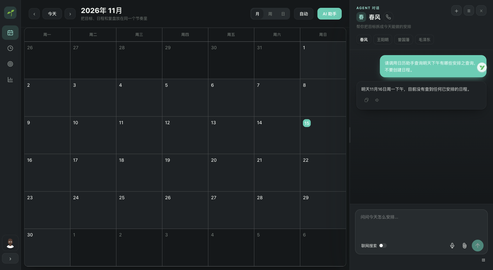
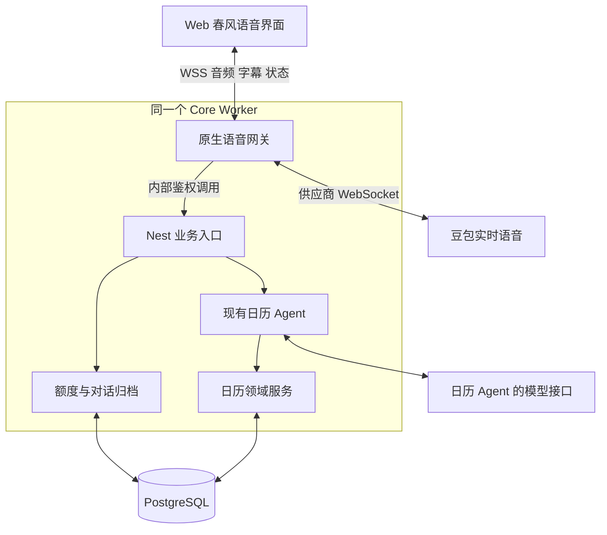
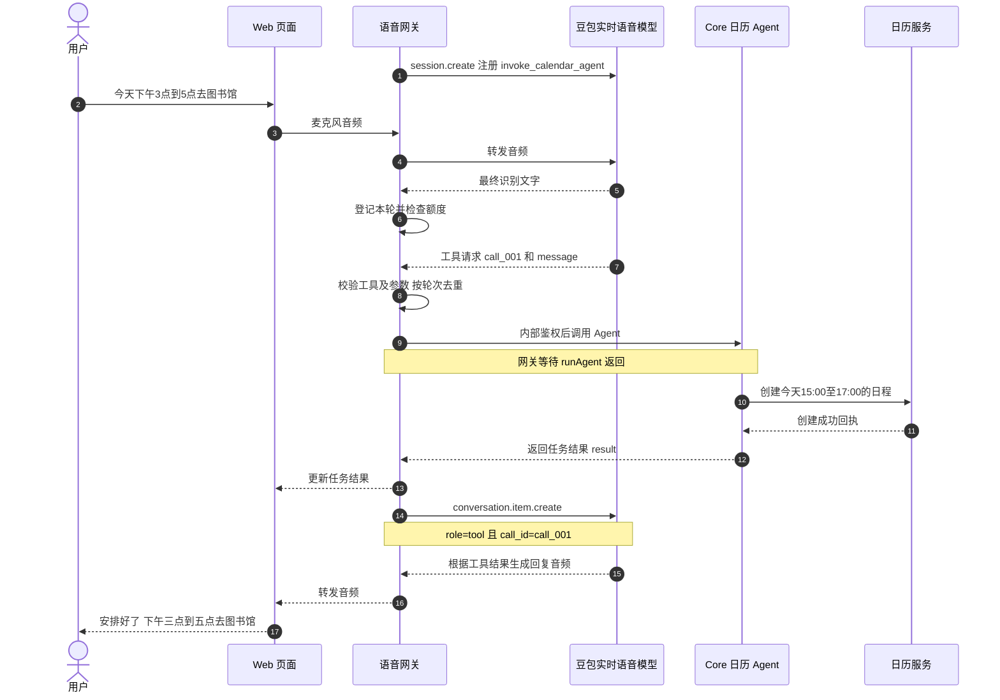
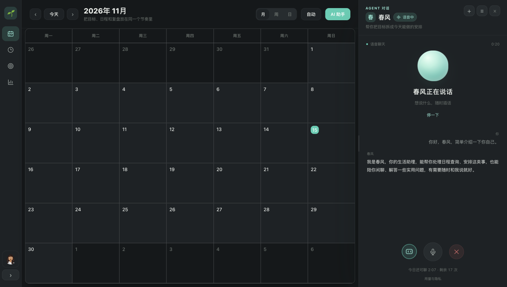
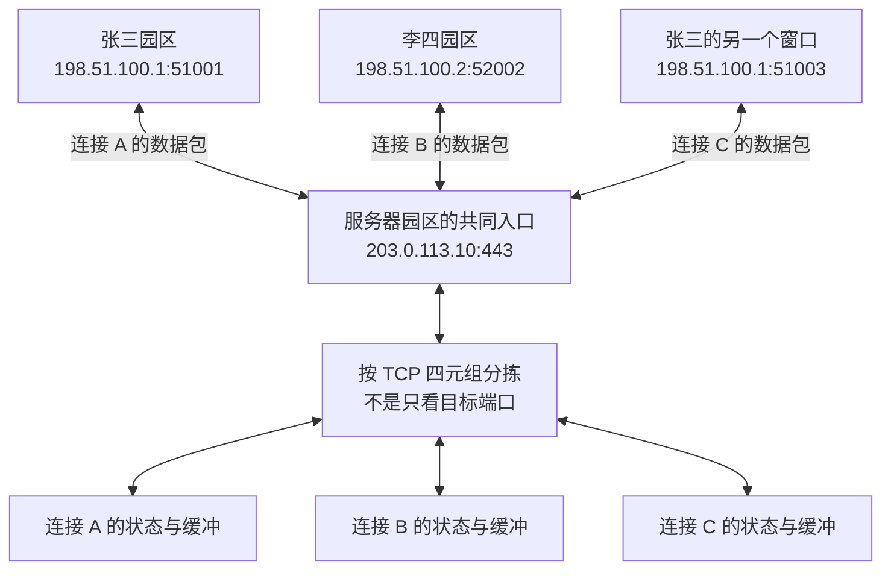
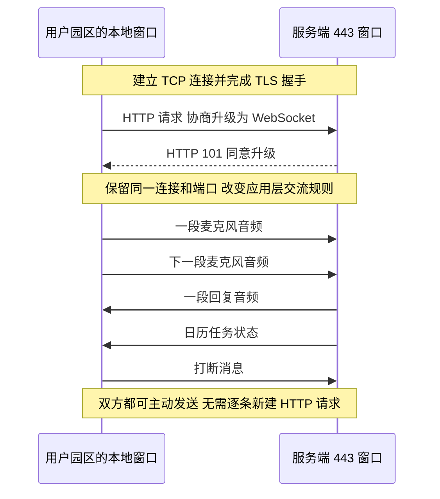

春风的 Web 语音入口让用户在聊天中直接安排日历：先聊近况，再说一句“帮我安排今天下午三点到五点去图书馆”，已有的日历 Agent 就能接着处理。本文以 2026 年 11 月 15 日上线的豆包版本为基础，说明架构分工、工具调用和结果回传，再介绍音频处理与运行机制。协议和长连接的生活类比放在文末作为补充。

这条链路有三个主要角色：豆包负责听和说，语音网关负责连接、轮次和消息传递，日历 Agent 负责理解日历请求并执行操作。文字和语音共用对话线程与助手额度。

## 1 整体架构与职责分工

用户点击春风旁边的电话图标，页面申请麦克风权限，建立到 Core 的 WebSocket 连接。Core 校验身份、对话归属和额度之后，再连接豆包。



*春风入口与日历查询结果，正式环境测试界面。*

闲聊时，音频和回复在浏览器、语音网关、豆包之间往返。用户提出日历请求时，豆包通过 `invoke_calendar_agent` 发出工具调用，网关把请求交给 Core 内已有的日历 Agent。Agent 返回查询结果、创建回执、追问或失败状态，网关同时更新页面，并把结果交回豆包组织语音回复。

语音网关与 Nest 业务入口运行在同一个 Core Worker 中。图中的边界表示职责分工；日历 Agent 使用自己的模型接口，具体日历操作交给领域服务。



这里没有在语音层另写一套“创建日程”逻辑。日期解析、缺失信息追问和日历操作继续由现有 Agent 及领域服务处理。用户说“改到三点”，需要结合之前的对话和日程结果来判断；如果把这些规则再复制到语音模型中，两种入口就很容易给出不同的行为。

### 1.1 长连接与业务请求如何分工

WebSocket 升级请求在 Core 的原生 Worker 层处理，先于普通 HTTP 包装逻辑。这个入口保留升级后的连接，处理心跳、供应商消息、通话结束和资源清理。

通话使用浏览器到网关、网关到豆包的两段 WebSocket。身份校验、时长分配、轮次计费和日历执行通过独立的业务请求处理，不为整段通话持续持有数据库事务。

日历任务用短事务和跨实例锁登记，随后释放连接再等待模型执行。等待 Agent 的过程不会堵住后续语音和打断消息。

当前未引入 Durable Object、持久任务队列或 WebRTC，也不支持原供应商会话的无缝迁移。通话连接与任务结果有各自的生命周期，后文分别说明断线、打断和执行去重的处理。

## 2 语音模型如何把事情交出去

对豆包暴露的业务工具只有一个：`invoke_calendar_agent`，参数是要交给日历助手处理的请求文字。豆包提出工具请求，网关调用 Core 中的 Agent；Agent 返回后，网关再把结果写回豆包原来的实时会话。**Agent 不直接连接豆包，也不主动发起 HTTP 回调。**

下面用一次“安排去图书馆”的请求把这条链路展开：从注册工具开始，经过结构化调用、业务执行，最后用原来的 `call_id` 回传结果并生成语音。

### 2.1 具体例子 安排今天下午去图书馆

假设用户说：“帮我安排今天下午 3 点到 5 点去图书馆。”下面以信息齐全、创建成功且连接保持正常的一轮为例。代码保留关键协议字段，省略音频配置等细节；示例编号和结果用于解释流程，不是一次真实日历写入记录。

#### 第一步 建立通话时注册工具

网关在创建豆包会话时发送工具定义，告诉模型日历事情可以交给哪个工具，以及参数格式。这里注册的是说明和参数结构，不是把 Agent 代码发送给模型。

```js
// 简化后的豆包会话创建消息
{
  type: "session.create",
  session: {
    tools: [{
      type: "function",
      name: "invoke_calendar_agent",
      description: "需要查询、创建或修改日程时，调用日历助手",
      parameters: {
        type: "object",
        additionalProperties: false,
        required: ["message"],
        properties: {
          message: { type: "string" }
        }
      }
    }]
  }
}
```

#### 第二步 豆包发出结构化工具请求

用户说：“帮我安排今天下午 3 点到 5 点去图书馆。”音频经网关传给豆包；最终识别结果形成后，网关登记轮次并检查额度。豆包判断需要办日历事情时，在同一条供应商 WebSocket 上发出工具事件：

```js
{
  type: "response.function_call_arguments.done",
  items: [{
    call_id: "call_001",
    name: "invoke_calendar_agent",
    arguments: JSON.stringify({
      message: "帮我安排今天下午3点到5点去图书馆"
    })
  }]
}
```

字幕表示“用户说了什么”，这个事件表示“请执行这个工具”。网关通过事件类型和工具名识别请求，不通过匹配“图书馆”或“创建”等关键词来执行。这里的 `call_id` 是豆包这次工具调用的关联编号，后续回传结果时必须使用它。

#### 第三步 网关调用 Core 中的日历 Agent

供应商适配器把事件转换成统一工具调用，会话层校验名称和参数，并复用同一轮已经开始的任务。传给 Agent 时，优先使用最终识别出的用户原话，保留“今天”等相对日期，避免语音模型二次改写日期。请求同时携带线程、时区和近期上下文，因此后续“改到三点”仍可接着处理。下面是简化后的调度代码：

```js
async function handleToolCall(call) {
  const args = JSON.parse(call.arguments);

  if (call.name !== "invoke_calendar_agent") {
    throw new Error("不支持的工具");
  }

  // 当前实现优先使用这一轮最终识别出的用户原话。
  const message = latestUserTranscript || args.message;

  const result = await runAgent({
    message,
    threadId,
    sessionId,
    turnKey,
    timezone: "Asia/Shanghai"
  });

  // Agent 返回后，交给供应商适配器封装工具结果。
  for (const event of adapter.result(call.id, result)) {
    sendProvider(event);
  }
}
```

实际组装时，`runAgent` 被注入为 `body => callCore('agent', body)`。网关通过同一个 Worker 的 `base.fetch(new Request(...))` 进入 Core 业务入口，请求携带用户 JWT，以及时间戳和请求体的 HMAC 签名。Core 校验签名、用户身份、春风线程归属和已计次轮次，再登记执行标识并调用 Agent。用户身份不由模型参数指定，供应商密钥只保存在服务端。

`call_id` 负责让豆包对上工具结果；`sessionId + turnKey` 负责让业务层识别同一轮请求。两者用途不同，不能仅靠模型提供的 `call_id` 防止重复创建。

#### 第四步 日历 Agent 执行具体日历工具

Agent 结合用户时区和上下文，将“今天下午 3 点到 5 点”解析为对应日期的 15:00—17:00，再调用日历工具。领域服务写入成功后，工具把回执交给 Agent，Agent 整理成结果，由 Core 返回网关。

这里有两层工具：豆包调用“日历助手”入口，日历 Agent 再选择查询、创建或修改等具体工具。如果必要信息不足，Agent 返回追问；用户补充后进入新一轮，沿用同一线程继续处理。

#### 第五步 网关用原来的 call_id 回传结果

网关此前正在等待 `await runAgent(...)`。调用返回后，供应商适配器将结果放入工具消息，通过原来的豆包 WebSocket 发回。下面展示豆包的消息格式，结果内容作了简化：

```js
{
  type: "conversation.item.create",
  items: [{
    call_id: "call_001",
    role: "tool",
    content: [{
      type: "input_text",
      text: JSON.stringify({
        status: "answered",
        answer: "已创建今天15:00到17:00的去图书馆日程。"
      })
    }]
  }]
}
```

**请求和结果都使用 `call_001`，豆包因此知道这是刚才那次工具调用的返回值。** `role: "tool"` 表示这是工具输出，不是用户的新发言；`input_text` 中是序列化后的业务结果，不是音频。

这就是结果“回传”的完整含义：Agent 把业务结果返回调用方，网关封装为工具消息，通过现有连接交回豆包。返回的是文字结果，由豆包负责组织后续语音。

#### 第六步 豆包根据结果继续说话

豆包收到工具结果后继续生成回复音频，例如：“安排好了，今天下午三点到五点去图书馆。”音频经网关转发给浏览器播放，页面同时呈现任务结果。

追问、失败和结果未知也通过这条路径返回。页面和播报必须以业务结果为准，只有成功回执才能支持“安排好了”的说法；不能仅凭识别出文字或发出工具请求就报告完成。

#### 这个例子的调用与结果回传时序

下图串起上述六步，展示额度和权限检查通过、创建成功且连接正常的路径。网关与 Agent 属于同一 Core Worker 的不同职责，内部业务入口的鉴权与登记合并在调用箭头中。



对应代码的核心是“接到工具请求 → 等待 Agent 返回 → 用原调用编号回传”。完整实现分别位于 `providers.mjs` 的工具定义、事件归一化和结果封装，`session.mjs` 的工具调度，以及 `bridge.mjs` 和 `voice.controller.ts` 的内部调用与业务执行入口。

## 3 浏览器怎样持续收音和播放

工具结果回到豆包后，还需要浏览器把返回音频真正播放出来。前端由 `VoicePage` 管理连接、字幕、任务结果和额度，`VoiceCallView` 呈现界面，`VoiceAudio` 管理麦克风采集和扬声器输出。



*语音通话与实时字幕，预发版本界面。*

输入采用单声道 16 kHz、16 位 PCM，每 20 毫秒发送一帧。每帧是 320 个采样点、640 字节音频数据，再用 Base64 放入 WebSocket 消息。采集优先使用 AudioWorklet；加载失败或超时时，兼容路径使用 ScriptProcessor，并重新分帧、定速发送，避免把一批声音突然挤给供应商。

输出显式配置为 24 kHz PCM。浏览器把返回数据转成音频缓冲，通过单独的播放 AudioContext 输出；播放 context 使用设备原生采样率，而不是强行沿用输入的 16 kHz。点击电话图标时就尝试激活音频 context，播放被浏览器暂停时再提供恢复入口。

我们在联调里遇到过“页面显示正在说话，但用户听不到”的反馈。收到回复文字、收到音频帧、音频节点实际输出声音，是三个不同的检查点。因此现在有播放暂停提示和扬声器测试，不能仅凭字幕出现就判断声音正常。

## 4 打断 断线和重复请求如何处理

### 4.1 打断播报与业务执行分开处理

用户插话时，前端清掉待播放音频，网关抑制旧回复的后续片段。当前打断表示停止播报，不表示取消日历操作。

如果日历 Agent 已经创建日程，用户随后插话或挂断，不能把这个日程当成自动取消。需要撤销时，应当发起新的、明确的业务操作，并根据工具结果确认。

连接断开或工具超时也不能直接解释为“没有创建”：后端可能已经写入，只是回执没有送达。结果不确定时标记为待核实，通过日历或已保存记录核对，不自动重放创建请求。断线后可以开始新通话，但无法保证原通话继续播报或后台任务无限运行。

### 4.2 执行去重与消息去重

工具执行记录和用户看到的聊天记录是两种数据。语音层归档用户发言与语音答复，Agent 层归档任务与执行结果；若把两份记录都作为普通消息展示，就会出现重复气泡，即使实际日程只有一条。因此需要分别处理执行与展示的去重。

**工具执行层**先在通话内复用同一轮的任务 Promise，即使模型换一个工具调用 ID，也不重复执行。服务端再根据已经校验过的 `sessionId + turnKey` 生成持久请求键；已登记的原请求不会因为重试换了传输编号就重新执行。跨实例锁和短期未完成任务租约用于拦截并发请求。

**会话读取层**按持久化的 session、turn 和消息角色关联记录。同一轮存在实际语音消息时，隐藏对应的内部工具记录；没有语音答复时，仍保留工具答复作为结果回退。过滤发生在分页之前，也用于 Agent 上下文和历史搜索。内部记录没有被删除，仍可用于核对执行状态。

这里没有按“文字一样”去重。用户在不同轮次明确提出相同请求，仍是不同轮次。这套机制保护的是同一轮、同一请求的重放，不是对所有相似日程作语义去重，也不能据此宣称整个系统具备无条件的 exactly-once 保证。

## 5 每日次数和时长怎样限制

当前开放账号的规则是：语音每轮计一次，与文字共用每日 30 次助手额度；语音通话每日累计最多 300 秒。

计次发生在用户发言形成最终识别结果时，在放行回复和工具处理之前。闲聊也计次，日历工具不再额外扣一次。它不取决于回复是否成功，因此用户提出一轮请求后，即使下游服务失败，这一轮也可能已经消耗额度。

| 持久记录 | 作用 |
| --- | --- |
| `voice_sessions` | 记录用户、线程、额度日期、开始时间、已授予秒数及关闭状态 |
| `voice_turns` | 用会话和轮次组成唯一键，记录计次轮次与归档请求标识 |
| 既有聊天归档 | 保存语音问答、工具请求及执行结果 |

时长通过短租约分配，每次最多授予 15 秒，接近到期时再续期。服务端依据已授予的总时长判断余额，正常挂断会退还尚未使用的部分。

这限制的是通话经过的时间，不只统计用户真正说话的音频长度。异常断线时，未及时完成清理的部分可能按已授予租约占用额度；有界租约避免它无限增长。同一账号也不能同时开多通有效语音会话。

## 6 补充 用物流运输理解协议和长连接

前文的业务流程建立在持续的 WebSocket 通信之上。若想进一步理解“连接一直保持着，为什么大量用户还能共用 443 端口”，可以把网络想象成物流运输：IP 是园区地址，端口是收发窗口，数据包是分批运送货物的车辆，TCP 连接是两个窗口之间登记的运输会话。道路由大家共享，连接不意味着专门修了一条路。

| 网络概念 | 生活中的对应物 |
| --- | --- |
| IP 地址 | 物流园的地址 |
| 端口 | 园区里的收发窗口编号 |
| TCP 连接 | 两个窗口之间持续维护的运输记录 |
| 数据包 | 分批运送货物的车辆 |
| TCP 序号与确认 | 货物编号与签收进度，用于排序和发现缺失 |
| TLS | 加密封装货物，并校验运输中是否被篡改 |
| HTTP | 按请求和响应交流的订单规则 |
| WebSocket | 会话建立后，双方都可以主动发货的规则 |

### 6.1 为什么很多用户可以共用 443 端口

假设服务器是一座物流园，443 是加密业务收发窗口。张三建立长期运输关系后，窗口仍可接收李四和王五的货物。每件货物都能关联到完整的收发地址，不会只因为收货窗口相同就混在一起。

TCP 用源 IP、源端口、目标 IP、目标端口组成的四元组区分连接。例如下面三条连接的目标相同，但来源不同；即使是同一台客户端，也可以使用不同的本地端口建立不同连接。地址为说明用的示例地址。

| 连接 | 客户端地址与端口 | 服务端地址与端口 |
| --- | --- | --- |
| A | 198.51.100.1:51001 | 203.0.113.10:443 |
| B | 198.51.100.2:52002 | 203.0.113.10:443 |
| C | 198.51.100.1:51003 | 203.0.113.10:443 |



图中是同一入口的逻辑示意，不表示所有流量必须由一个串行窗口处理。传统服务器有一个监听 socket 接受新连接，接受后得到各自的已连接 socket；它们的服务端本地端口仍然可以都是 443。监听入口继续接新用户，已有连接各自收发数据。Cloudflare 则由平台管理这些底层连接。

**长连接保留的是一条连接的状态，不是把 443 端口锁给一个用户。** TCP 四元组区分网络连接；JWT 等应用认证信息再确定用户身份和日历权限，二者不能互相替代。

### 6.2 HTTP 升级为 WebSocket 改变了什么

以 HTTP/1.1 升级建立加密 WebSocket 为例，从上到下是 HTTP 或 WebSocket、TLS、TCP、IP。HTTP/2 和 HTTP/3 有各自的承载机制，这里的类比只展开前一种路径。

```text
应用层：HTTP 请求与响应 → 协商升级后使用 WebSocket 帧
安全层：TLS 加密
传输层：TCP 提供可靠、有序的字节流
网络层：IP 负责寻址和转发
```

普通 HTTP 像按订单发货：用户发来“查询今天的日历”，服务器返回日历；下一次查询再发请求。HTTP/1.1 可以复用同一条 TCP 连接，并不需要每完成一张订单就关闭运输关系。

WebSocket 则先通过 HTTP 请求约定更换交流规则。服务端同意并返回 101 后，同一条 TCP 连接及其 TLS 加密继续使用，后续传输 WebSocket 数据帧。客户端与服务端端口都不因这次升级而改变。



因此，“普通公路升级为高速公路”容易让人误以为升级保证提高带宽或降低延迟。更准确的类比是：**沿用原来的运输关系，从按订单一问一答，改为双方有消息就可以发送。** 长连接描述连接保持多久，全双工描述双方能否同时发送，二者是不同概念。

### 6.3 数据为什么要分批运送

一句话会拆成很多段音频，再封装为 WebSocket 帧，经 TLS 加密和 TCP 分段，由 IP 网络传输。消息边界与数据包边界并不一一对应：一条应用消息可能需要多个数据包，单个 TCP 段也可能包含相邻消息的部分内容。

TCP 像物流调度系统，为字节编号、跟踪确认、重传丢失的数据，并把乱序到达的数据重新整理。它还根据网络拥堵和接收方能力调整发送。WebSocket 再从有序字节流中解析出完整消息。这个比喻中的“车辆”只是数据传输的示意，不是一条固定专用路线。

### 6.4 长连接怎样支撑多个用户

事件驱动的服务器可以在连接 A 有数据时处理 A，连接 B 没有数据时只保留状态，不必为每条连接安排一个线程持续忙等。连接仍然消耗内存、缓冲、加密状态等资源；活跃的实时音频还会持续消耗 CPU 和带宽。

春风每通语音包含“浏览器到网关”和“网关到豆包”两段连接。例如同时 1,000 人通话，逻辑上约有 2,000 段 WebSocket 连接和 1,000 个豆包会话，但不需要为此保持 1,000 个数据库事务。额度管理、归档和日历操作按需访问数据库。

能支持多少同时通话用户，需要结合网关压测、豆包账号并发配额、日历 Agent 吞吐和数据库压力确定。当前每日时长与轮次限制控制单用户用量，不等于已经验证了大规模并发容量。扩容要关注这些资源，不能用“443 只有一个端口”推断只能服务一个用户。

**长连接保留的是每个用户独立的连接状态，服务器通过 IP 和端口组成的四元组区分连接，因此多个用户可以共用同一个 443 端口，互不独占。**

