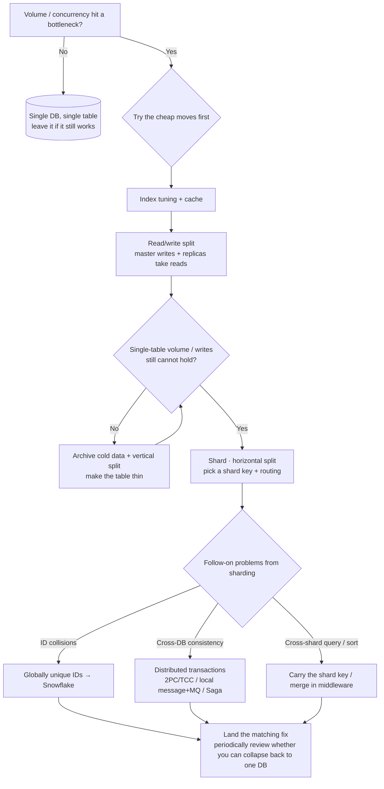

> A general-purpose tech explainer. The examples stay neutral — orders, users, inventory — and do not name a company, framework, or product implementation.
> Four tightly related topics: **sharding → read/write splitting → globally unique IDs (Snowflake) → distributed transactions**. They often show up together as a toolkit for "too much data, too much concurrency".

---

## Contents

0. [Overview: what to do when volume and concurrency grow](#0-overview-what-to-do-when-volume-and-concurrency-grow)
1. [Sharding](#1-sharding)
2. [Read/write splitting](#2-readwrite-splitting)
3. [Globally unique IDs and Snowflake](#3-globally-unique-ids-and-snowflake)
4. [Distributed transactions](#4-distributed-transactions)
5. [Decision cheat sheet](#5-decision-cheat-sheet)

---

## 0. Overview: what to do when volume and concurrency grow

Start with a "what first, what later" roadmap so you do not jump straight to a heavy scheme:

```
Single database, single table (the bottleneck)
↓ read concurrency / connections blow up
① indexes + cache + read/write split         ← cheap, do this first
↓ the table is still huge
② archive (move cold data) + vertical split    ← make the table "thin"
↓ row count is still huge / writes are the bottleneck
③ sharding (horizontal split)            ← last resort, highest cost
└─new problems → you now need: globally unique IDs + distributed transactions
```

#### Decision flowchart (see the order in one pass)



> The judgment order in the diagram: **use the cheap moves first (indexes / cache / read-write split / archive); only then shard**. Once you shard, you must also solve unique IDs, cross-database transactions, and cross-shard queries.

**The iron rule**: do not shard if you can avoid it; prefer cheap moves (indexes / cache / read-write split / archive). Shard only when that is not enough. Once you shard, you must also solve ID uniqueness and cross-database transactions.

---

<a name="sharding"></a>

## 1. Sharding

### 1.1 Why you need it

As a single table grows you hit three kinds of bottleneck:


| Bottleneck | What it looks like |
| -------- | ---------------------------------- |
| Storage | The table is huge; disk / single-DB capacity is nearly full |
| Connections | Concurrency is high; one database's connections are exhausted and requests queue |
| Queries | The table is so large that even indexes cannot keep queries fast |

### 1.2 What it is

- **Table sharding**: one table is split into N tables with the same schema, placed by a rule (`order_0` ~ `order_15`).
- **Database sharding**: those tables are then spread across multiple database instances.
- The two are often done together — "sharding". Logically it is still "the orders table"; physically it lives in many databases and many tables.

```
Logically: select * from orders where user_id = ?
Physically: orders_03    ← middleware takes user_id modulo N and routes to the real table
```

### 1.3 Vertical split vs horizontal split


|      | Vertical split                       | Horizontal split         |
| ---- | ------------------------------ | ---------------- |
| Basis | Split columns by business / function | Split rows |
| Example | A fat user table becomes base / address / auth | orders_0 / 1 / 2... |
| Goal | Make the table "thin" | Spread volume |
| Context | Do this first | "Sharding" usually means this |

### 1.4 Shard keys and routing

The shard key decides "which row lands on which table". Common routing rules:


| Rule | How | Traits (why, below) |
| ---------- | --------------------- | --------------------------- |
| Modulo | `user_id % 16` by remainder | Simple and even; **scaling requires a rehash** |
| Range | By interval / time | Scale-out friendly; **can hotspot** |
| Consistent hashing | Consistent hashing | Less data movement on scale-out; slightly harder to implement |

#### Why "modulo: scaling requires a rehash"

Modulo routing is: **16 tables = `user_id % 16`, remainders 0–15 each map to one table**.
Once the shard count grows from 16 to 32, **the modulus changed** (`%16` → `%32`). The same `user_id` is likely to get a different remainder → its data is computed onto "a different table". In other words, **changing the shard count moves the landing spot of a lot of existing data**, so you must relocate old data under the new rule (rehash / redistribution). That is where the "scaling requires a rehash" cost comes from.

> The upside is symmetry, evenness, and cheap math. The downside is **any change in shard count forces a full redistribution** — the most brittle way to scale.

#### Why "range: scale-out friendly, can hotspot"

You split by a **contiguous interval**, e.g. `user_id 0–1000 → table 0, 1001–2000 → table 1`, or `year 2024 → table 0, 2025 → table 1`:

- **Scale-out friendly**: to add a new interval you only add a table that takes "the next incoming range". **Old data barely moves** (no rehash); adding a table is cheap.
- **Hotspot risk**: data tends to pile up on "the recent end" — new users / latest orders all land on **the newest table**, while old tables sit idle. A few tables are hot and the rest are cold; you cannot spread load the way modulo does.

#### Why "consistent hashing: less movement, slightly harder"

Consistent hashing places shards on a **hash ring**. After a key is hashed it walks the ring clockwise to the nearest node.

- **Less movement**: adding a machine only migrates the data **between that machine and its counterclockwise neighbor**. Every other node **stays put** — far better than a full modulo rehash.
- **Slightly harder**: you have to maintain the ring, virtual nodes / ownership, and the migration cadence when nodes come and go. Routing is more work than modulo.

**In short**: modulo is easiest but painful to scale; range scales easily but can hotspot; consistent hashing is the middle (less movement, more thinking). **Pick by how often you will scale and how fast the data grows**.

**Two tests for a shard key**: ① you can attach it to every query; ② it is the most common filter (usually a user dimension such as `user_id`).

### 1.5 Middleware "transparency" and its cost

Day to day, the app still writes as if there were one table: middleware routes, stitches, and aggregates by shard key. But you **must carry the shard key**, or it has to broadcast to every shard and merge.

**The cost**:


| Hard problem | Mitigation |
| -------------------- | ------------------------------------------------------ |
| Cross-shard queries are slow | Always carry the shard key; keep a mapping / index table |
| Globally unique IDs collide | Use Snowflake IDs (chapter 3) |
| Cross-shard transactions | Keep one user's data on one shard; use a distributed transaction only when you must (chapter 4) |
| Cross-shard sort / page / aggregate | Middleware merges, "fetch extra and top up" |
| Scale-out | Consistent hashing, dual-write migration |

> **Takeaway**: sharding has the highest rewrite and ops cost. It is a last resort.

---

<a name="read-write"></a>

## 2. Read/write splitting

### 2.1 Why

Most products are **read-heavy, write-light**. When concurrency rises the bottleneck is often reads — one primary cannot absorb the read load, connections fill up, and even writes get dragged down.

### 2.2 What it is

Deploy multiple instances. **Writes go to the primary (Master), reads go to replicas (Slaves)**. You can have many replicas to share read concurrency:

```
        writes → primary (Master)
user -->
        reads  → replica 1/2/3 (many copies)
```

### 2.3 How data syncs

Primary/replica replication: write the primary → push changes to replicas via the primary's change log → replicas replay.

```
Write: primary executes SQL
Sync:  primary log is pushed to each replica
Read:  replicas consume the log and converge toward the primary
```

> Because replay is **asynchronous**, a replica is always a little "older" than the primary (milliseconds to seconds). That is "replication lag".

### 2.4 Consistency and lag

The typical problem: **you just wrote, then immediately read, and you do not see it** (the replica has not caught up). Fixes:


| Scene | What to do |
| ----------------------- | ----------------------- |
| You must read back what you just wrote | Force that request / session onto the primary |
| Second-level lag is acceptable | Read from a replica |
| Consistency is extremely strict | Prefer the primary for everything |

### 2.5 When it is a bad fit

- Write-heavy, read-light (little gain, extra replicas to pay for)
- Strong consistency (payment debit, de-duplication)
- A single table is already huge (replicas do not solve "too much data"; you need sharding / archival)

### 2.6 Versus sharding


|      | Read/write split | Sharding |
| ---- | -------------- | ------------------ |
| Solves | Read concurrency, connections | Storage capacity, data scale |
| Shape | Many copies of the same table | Split into many tables / databases |
| Routing | reads → replica, writes → primary | shard-key modulo |
| Cost | Low | High |
| Order | Do this first | Do this last |

---

<a name="id"></a>

## 3. Globally unique IDs and Snowflake

### 3.1 Why you need them

Orders / users / ledgers all need a **globally unique identifier** that is: unique, roughly time-ordered, and not dependent on a central DB. After **sharding**, per-shard auto-increment will collide.

### 3.2 Limits of database auto-increment

- After sharding, each shard increments on its own → collisions on merge;
- A central issuer → a hotspot / single point under high concurrency.

### 3.3 Common options


| Option | How | Traits |
| --------- | --------------- | -------------------- |
| DB auto-increment | Single database | Simple; unfit for shards / high concurrency |
| Redis INCR | INCR | Fast; depends on the cache |
| Timestamp + random | Concatenate | Simple, easy to collide, long |
| UUID | Generated locally | Unique but unordered, bad for indexes |
| **Snowflake** | Time + machine + sequence | ⭐ Ordered + local + high throughput |

### 3.4 Snowflake bit layout

A 64-bit long:

```
| 1 bit     | 41 bit          | 10 bit         | 12 bit    |
| sign (0)  | timestamp (ms)  | machine / worker ID | sequence |
```

- **Timestamp**: IDs grow with time → monotonic, index-friendly;
- **Machine bits**: unique across machines / processes;
- **Sequence bits**: increment inside the same millisecond (4096 per machine per ms).

### 3.5 Pits and boundaries


| Pit | What happens | Mitigation |
| ------------- | ------------------ | ----------------------------- |
| Clock rollback | A clock going backwards can reuse IDs | Remember last time; wait or reject on rollback |
| Machine-bit cap | Node count is limited (e.g. 1024) | Allocate nodeId carefully |
| Not strictly global-ordered | Only per-machine order is guaranteed | Usually enough |
| Fixed 64-bit | Some scenes need a string | Convert to string |

---

<a name="tx"></a>

## 4. Distributed transactions

### 4.1 What they are, and why they are hard

One action changes data across several databases / services and you want **all-or-nothing (atomicity)**. A single database can do this with locks + logs. Across databases there is no unified transaction manager to decide atomically, and the network can time out or commit only in part — that is the hard part.

Example: place an order, deduct inventory, deduct balance, add points — different databases. Any failure must roll everything back.

### 4.2 Local vs distributed


|        | Local transaction | Distributed transaction |
| ------ | -------- | ---------------- |
| Scope | One database | Many databases / services |
| Relies on | DB ACID | Coordination / compensation |
| Performance | High | Extra overhead |
| Consistency | Strong | Often only "eventual" |

> Iron rule: **do not do this if you can avoid it** — keep related data in one database, or accept eventual consistency.

### 4.3 Comparing the options


| Option | Idea | Pros | Cons |
| ----------------- | ----------------------------------------------------------------- | ---------------------- | -------------------------------------- |
| **2PC (two-phase)** | The coordinator asks each participant "can you commit?"; all yes → commit, else rollback | Simple, strongly synchronous | Coordinator is a single point; resources stay locked; a network partition can stall |
| **TCC** | Try-reserve / Confirm / Cancel | Finer control than 2PC | You write three interfaces; it invades the business |
| **Local message + MQ** | Write the business row + a local message table in one local transaction, publish to MQ, downstream consumes, retry + reconcile on failure | High performance, low invasion, scalable | Eventual consistency in seconds to minutes; needs compensation |
| **Saga** | A long flow is split into local steps, each with a forward action + a compensation; on failure, roll back in reverse | Fits long flows | You hand-write every compensation; usually eventual |

> **The most common choice is "local message + MQ"**: relatively easy to land, with retries and reconciliation, and it fits most businesses that can tolerate second-level consistency.

---

<a name="choose"></a>

## 5. Decision cheat sheet

| Scene | Recommendation |
| ------------------------------ | --------------------------------------------- |
| Single DB, single table, modest volume | Local transactions and DB auto-increment; do not over-engineer |
| High read concurrency | Cache + read/write split first |
| A single table is huge | Shard (last resort) |
| After sharding you need unique, ordered, high-throughput IDs | Snowflake |
| Cross-database and you need strong sync | 2PC / TCC |
| Decoupled, second-level consistency is fine | Local message + MQ (most common) |
| A long, multi-step flow | Saga |
| Complexity you can dodge | Keep the data in one database / split into messages; open fewer distributed transactions |

---

## Appendix: one-line crib

| Concept | One line |
| -------- | --------------------------------- |
| Vertical split | Split a table "thin" by business |
| Horizontal split | Split a table into N pieces by row (sharding) |
| Shard key | The field that decides which table a row goes to; required on queries |
| Read/write split | Primary writes, replicas read; many copies share reads |
| Replication lag | Async copy; a read may be slightly stale; force the primary in special cases |
| Snowflake | Time + machine + sequence packed into 64 bits; unique and ordered |
| Distributed transaction | Many databases change together, all succeed or all fail |
| 2PC / TCC | Relatively strong consistency, but heavy / invasive |
| Local message + MQ | Land a local table first, then publish; eventual consistency (most common) |
| Iron rule | Do not shard if you can avoid it; do not go distributed if a local transaction will do |

---

## Changelog


| Version | Date | Author | What changed |
| ---- | ---------- | ------ | --------------------------------------------------------------------------------- |
| V1 | 2026-10-10 | AI | Merged four notes into one: overview + sharding + read/write split + unique IDs (Snowflake) + distributed transactions + cheat sheet |
