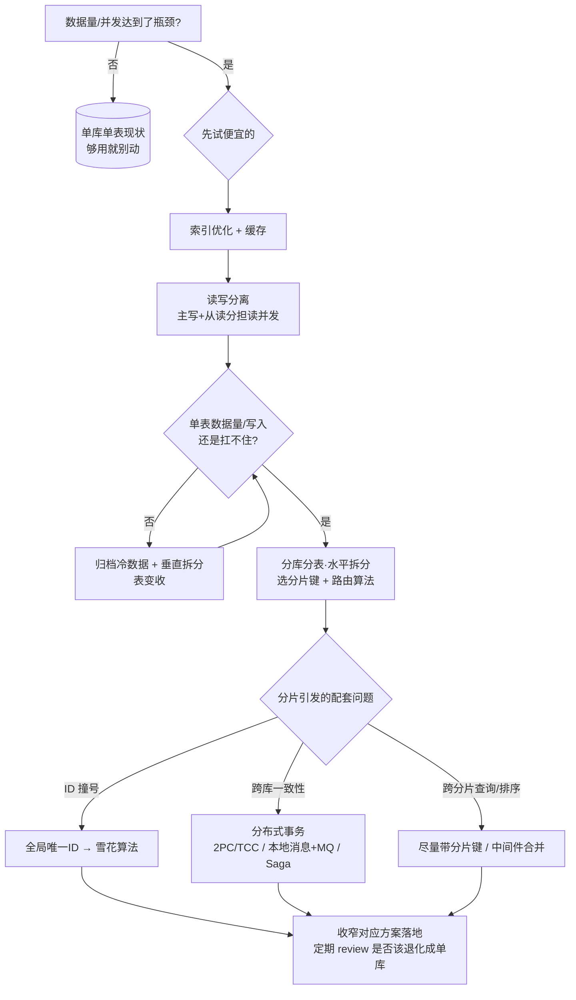

> 通用技术科普合集，用「订单 / 用户 / 库存」这类中性例子讲解，不涉及具体公司、框架与业务实现。
> 内含四块密切相关的主题：**分库分表 → 读写分离 → 全局唯一 ID（雪花）→ 分布式事务**，它们经常伴随出现，组成一套面对"数据量大、并发高"的改造手段。

---

## 目录

0. [总览：数据量/并发上来了怎么办](#零总览数据量并发上来了怎么办)
1. [分库分表](#一分库分表)
2. [读写分离](#二读写分离)
3. [全局唯一 ID 与雪花算法](#三全局唯一-id-与雪花算法)
4. [分布式事务](#四分布式事务)
5. [决策速查：怎么选](#五决策速查怎么选)

---

## 零、总览：数据量/并发上来了怎么办

先给一张"先做什么、后做什么"的路线图，避免一上来就上重型方案：


单库单表（瓶颈）
↓ 读并发/连接大
① 索引 + 缓存 + 读写分离         ← 成本低，先做
↓ 单表数据量仍大
② 归档（冷数据迁走）+ 垂直拆分    ← 把表变"收"
↓ 行数依旧巨大/写入瓶颈
③ 分库分表（水平拆分）            ← 最后手段，成本最高
└─带来新问题 → 需要：全局唯一ID + 分布式事务

```

#### 决策流程图（一次性看懂"先做哪个")



> 上图的判断顺序：**先用便宜的（索引/缓存/读写分离/归档），不行才上分库分表**；分片一旦上了，就要配套解决 ID 唯一、跨库事务与跨分片查询这三类问题。

**核心铁律**：能不分就不分、优先用便宜的（索引/缓存/读写分离/归档）；实在不够才上分库分表；一旦分片，就要配套解决 ID 唯一性和跨库事务。

---

<a name="sharding"></a>

## 一、分库分表

### 1.1 为什么需要

单库单表随数据量增长会遇到三类瓶颈：


| 瓶颈     | 表现                               |
| -------- | ---------------------------------- |
| 存储瓶颈 | 表太大，磁盘/单库容量快满          |
| 连接瓶颈 | 并发高，一个库连接被打满、请求排队 |
| 查询瓶颈 | 表太大，索引也不能让查询快         |

### 1.2 是什么

- **分表**：一张表拆成结构相同、按规则分布的 N 张表（`order_0 ~ order_15`）。
- **分库**：把拆出的表再分布到多个数据库实例。
- 两者常一起做，即"分库分表"。逻辑上仍是"那张 order 表"，物理上拆到了多库多张。

```
逻辑上：select * from orders where user_id = ?
物理上：orders_03    ← 中间件按 user_id 算出余数，自动路由到真实那张表
```

### 1.3 垂直拆分 vs 水平拆分


|      | 垂直拆分                       | 水平拆分         |
| ---- | ------------------------------ | ---------------- |
| 依据 | 按业务/功能拆字段              | 按数据行拆       |
| 例子 | 用户大表拆成 base/address/auth | orders_0/1/2...  |
| 目的 | 表变"收"                       | 数据量分散       |
| 语境 | 先做                           | "分库分表"多指它 |

### 1.4 分片键与路由

分片键决定"哪个分片进哪张表"，常用路由规则：


| 规则       | 做法                  | 特点（原因见下）            |
| ---------- | --------------------- | --------------------------- |
| 取模 mod   | `user_id % 16` 按余数 | 简单均匀；**扩容要 rehash** |
| 范围 range | 按区间/时间分         | 扩容友好；**可能热点不均**  |
| 一致性哈希 | 一致性哈希            | 扩容迁移少；实现稍复杂      |

#### 为什么"取模：扩容要 rehash"

取模路由的 key 分片是：**16 张表 = `user_id % 16`，余数 0~15 各对应一张表**。
一旦分片数从 16 涨到 32，**取模的模数变了**（`%16`→`%32`），同一个 `user_id` 的余数很可能从 15 变成另一个数字 → 它的数据就会算到"不同的表"。换句话说，**改分片数会让大量已有数据的落点变化**，必须把老数据按新规则重新搬家（rehash / 数据重分布）。这就是"扩容要 rehash"的成本来源。

> 代价是对称、均匀、好算，但**分片数一变就要全量重新分布**，是最"脆"的扩容方式。

#### 为什么"范围：扩容友好、可能热点不均"

按"**连续区间**"分，如 `user_id 0~1实现 → 表0，1001~2000 → 表1`，或 `时间 2024→2025 → 表0，...`：

- **扩容友好**：要加新区间，只要新增一张表承接"新来的一段"即可，**老数据基本不动**（不用 rehash），加表成本低。
- **热点不均**：数据往往"新近"扎堆——新增的用户/最新订单都集中在**最新那张表**，老表几乎闲置。即**某几张表很热、其它很冷**，不能像取模那样把压力打散。

#### 为什么"一致性哈希：迁移少、实现稍复杂"

一致性哈希把分片放到一个**哈希环**上，数据哈希后沿环顺时针找到最近的节点。

- **迁移少**：加一台机器，只需把**该机器与逆时针方向相邻节点之间**的数据迁移给它，其余节点**不用动**——比取模"全量 rehash"好太多。
- **实现稍复杂**：要维护哈希环、记录虚拟节点/数据归属，路由计算比取模麻烦；还要处理节点增删时的迁移节奏。

**小结**：取模最省事但扩容痛；范围好扩容但会热点不均；一致性哈希折中（迁移少但费脑子）。**具体选哪个要看"扩容频率"和"数据增长速度"**。

**选分片键看两点**：①每次查询都带得上；②选择最常出现的查询条件（通常尽量靠用户维度 `user_id`）。

### 1.5 中间件的"透明"与代价

平时业务像写单表：中间件按分片键路由、拼接、聚合。但**必须带分片键**，否则只能广播全分片再合并。

**代价**：


| 难题                 | 缓解                                                   |
| -------------------- | ------------------------------------------------------ |
| 跨分片查询慢         | 尽量带分片键；建映射/索引表                            |
| 全局唯一 ID 撞号     | 用雪花 ID（见第三章）                                  |
| 跨分片事务           | 尽量把同一用户绑一个分片；必要时分布式事务（见第四章） |
| 跨分片排序/分页/聚合 | 中间件合并，"取多补一"                                 |
| 扩容                 | 一致性哈希、双写迁移                                   |

> **心得**：分库分表改造和运维成本最高，是"最后手段"。

---

<a name="read-write"></a>

## 二、读写分离

### 2.1 为什么

多数业务**读多写少**。并发上来，瓶颈常出在"读"——一主一库扛不住大量读，连接被占满连写都被拖累。

### 2.2 是什么

部署多个实例，**写走主库（Master）、读走从库（Slave）**，从库可多个，分担读并发：

```
        写 → 主库(Master)
用户 -->
        读 → 从库1/2/3 (多副本)
```

### 2.3 数据怎么同步

主从复制：写主库 → 通过主库的变更日志把变更推给从库 → 从库重放。

```
写：主库执行 SQL
同步：主库日志推给各从库
读：从库消费日志，与主良趋近一致
```

> 因为是**异步重放**，从库总是比主库略"旧"一点点（毫秒~秒级），这就是"主从延迟"。

### 2.4 一致性与延迟应对

典型问题：**刚写完立刻读，可能读不到**（从库没同步完）。解决：


| 场景                       | 处理                    |
| -------------------------- | ----------------------- |
| 写后立刻要读回自己写的内容 | 该请求/该会话强制走主库 |
| 能接受秒级延迟             | 读从库                  |
| 一致性要求极严             | 尽量都走主库            |

### 2.5 什么场景不适合

- 写多读少（分离收益小，费副本）
- 强一致要求（支付扣款、判重）
- 单表已极大（只靠副本解决不了"数据大"，要走分库/归档）

### 2.6 与分库分表的区别


|      | 读写分离       | 分库分表           |
| ---- | -------------- | ------------------ |
| 解决 | 读并发、连接   | 存储容量、数据量级 |
| 结构 | 同一张表多副本 | 拆成多张表/库      |
| 路由 | 读→从、写→主 | 分片键取模         |
| 成本 | 低             | 高                 |
| 顺序 | 先做           | 最后做             |

---

<a name="id"></a>

## 三、全局唯一 ID 与雪花算法

### 3.1 为什么需要

订单/用户/流水都需要**全局唯一标识**，并且要：**唯一、趋势有序、不依赖单独中心 DB**。尤其在**分库分表**后，各分片各自自增多半会撞号。

### 3.2 数据库自增的局限

- 分片后各自自增 → 合并撞号；
- 发号中心 → 高并发下成热点/单点。

### 3.3 常见方案对比


| 方案         | 原理               | 特点                    |
| ------------ | ------------------ | ----------------------- |
| 数据库自增   | 单库               | 简单，不适合分片/高并发 |
| Redis 自增   | INCR               | 快，依赖缓存            |
| 时间戳+随机  | 拼                 | 简单但易撞、长度大      |
| UUID         | 本地生成           | 唯一但无序、索引差      |
| **雪花算法** | 时间+机器+序列拼接 | ⭐ 有序+本地生成+高吞吐 |

### 3.4 雪花算法位结构

64 位 long：

```
| 1 bit   | 41 bit        | 10 bit      | 12 bit   |
| 符号位(0) | 时间戳(毫秒)    | 机器/工作ID  | 序列号    |
```

- **时间戳**：让 ID 随时间递增 → 单调有序、索引友好；
- **机器位**：跨机器/进程唯一；
- **序列位**：同一毫秒内自增（单机单毫秒 4096 个）。

### 3.5 坑与边界


| 坑             | 说明                  | 应对                          |
| -------------- | --------------------- | ----------------------------- |
| 时钟回拨       | 时钟倒退会让 ID 重复  | 记录上次时间，回拨时等待/拒绝 |
| 机器位上限     | 节点数受限（如 1024） | 合理分配 nodeId               |
| 非严格全局有序 | 只保证单机有序        | 一般足够                      |
| 定长 64 位     | 部分场景要转字符串    | 转字符串处理                  |

---

<a name="tx"></a>

## 四、分布式事务

### 4.1 是什么、为什么难

一个动作跨多个库/服务改数据，希望**全成或全败（原子）**。单库靠锁+日志能做到，但跨库没有统一事务管理器原子裁定，且网络可能超时/部分提交，所以难。

例子：下单扣库存 + 扣余额 + 加积分，不同库，任一失败都要回滚。

### 4.2 本地 vs 分布式


|        | 本地事务 | 分布式事务       |
| ------ | -------- | ---------------- |
| 范围   | 单库     | 多库/服务        |
| 靠什么 | DB ACID  | 协调/补偿        |
| 性能   | 高       | 有额外开销       |
| 一致性 | 强       | 多只能"最终一致" |

> 铁律：**能不做就不做**——把相关数据放同一库，或用最终一致。

### 4.3 各方案对比


| 方案              | 思路                                                              | 优点                   | 缺点                                   |
| ----------------- | ----------------------------------------------------------------- | ---------------------- | -------------------------------------- |
| **2PC 两阶段**    | 协调者问各参与者"能提交吗"，全可→提交，否则回滚                  | 简单、强同步           | 协调者单点；全程锁资源；网络分区会卡住 |
| **TCC**           | Try-预留 / Confirm-确认 / Cancel-取消                             | 比 2PC 好控、粒度细    | 要写三套接口，侵入业务                 |
| **本地消息 + MQ** | 先写业务+本地消息表(同一本地事务)，发 MQ，下游消费，失败重试+对账 | 高性能、低侵入、可扩展 | 秒~分钟级最终一致，需补偿              |
| **Saga**          | 长流程拆本地步骤，每步正向+补偿；失败逆序回滚                     | 适合长流程             | 每步手写补偿，多数最终一致             |

> **最常用是"本地消息 + MQ"**：相对落地、带重试和对账，适合能容忍秒级一致的大多数业务。

---

<a name="choose"></a>

## 五、决策速查：一口气选


| 场景                           | 推荐                                          |
| ------------------------------ | --------------------------------------------- |
| 单库单表、量不大               | 本地事务、数据库自增即可，别折腾              |
| 读并发大                       | 先缓存 + 读写分离                             |
| 单表数据量巨大                 | 分库分表（最后手段）                          |
| 分片后要让它唯一、有序、高性能 | 雪花算法生成 ID                               |
| 跨库但要求强同步               | 2PC / TCC                                     |
| 解耦、可容忍秒级一致           | 本地消息 + MQ（最常用）                       |
| 长流程多步骤                   | Saga                                          |
| 本身复杂可规避                 | 尽量把数据放同一库 / 拆成消息，少开分布式事务 |

---

## 附：速记表


| 概念        | 一句话                                 |
| ----------- | -------------------------------------- |
| 垂直拆分    | 按业务把表拆"收"                       |
| 水平拆分    | 按行把表拆 N 份（分库分表）            |
| 分片键      | 决定行去哪张表的字段，查询必备         |
| 读写分离    | 主写从读，多副本分担读                 |
| 主从延迟    | 异步复制，读可能略旧，特殊场景强制走主 |
| 雪花算法    | 时间+机器+序列 拼 64 位，唯一有序      |
| 分布式事务  | 多库同改，全成或全败                   |
| 2PC / TCC   | 相对强一致，但重/侵入                  |
| 本地消息+MQ | 先落本地表再发消息，最终一致（最常用） |
| 铁律        | 能不分就不分；能本地事务就不分布式     |

---

## 变更记录


| 版本 | 日期       | 修改人 | 修改内容                                                                          |
| ---- | ---------- | ------ | --------------------------------------------------------------------------------- |
| V1   | 2026-10-10 | AI     | 合四篇为一：总览 + 分库分表 + 读写分离 + 全局唯一ID(雪花) + 分布式事务 + 决策速查 |

```

```

