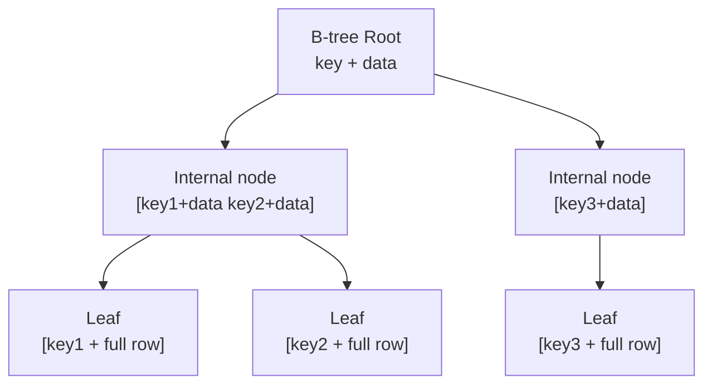
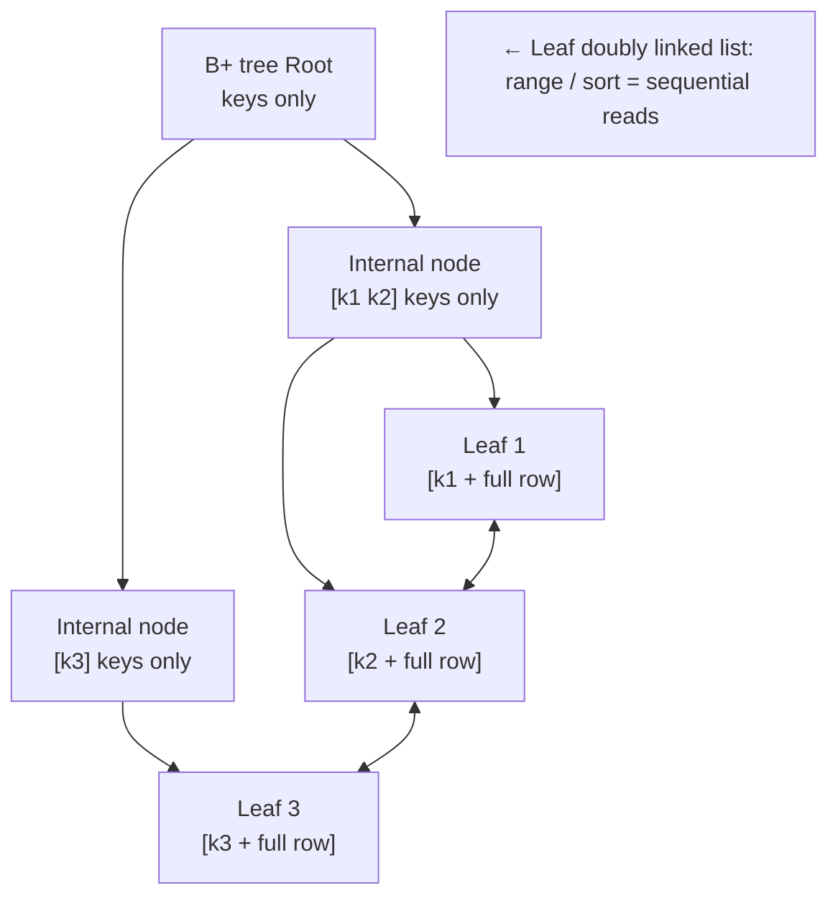

> Slow queries have two paths — **first use indexes to make in-table queries fast; only when the data volume is truly large, split the table with database and table sharding**. This post goes from the basics up: indexes first, then sharding, then how the two work together.
>
> **Series**: Transactions → Locks → Idempotency → DDD → Query performance. [Database transactions](/en/blog/db-transaction) · [Optimistic and pessimistic locks](/en/blog/optimistic-pessimistic-lock) · [Idempotency](/en/blog/idempotency) · [Domain-driven design (DDD)](/en/blog/domain-driven-design) · This post.

---

## 1. The frame: two layers of tools when a query is slow

A slow SQL statement is, at heart, **"having to read too many rows"** (a full table scan). There are two ways to make it fast:

```
First tool  · indexes   → keep queries inside one table off a full scan (O(log n) lookup)
Second tool · sharding  → when volume is too large, split one table into many; each shard is smaller and faster
```

**Decision order**: **add indexes first; shard only when that is truly not enough.** Sharding brings distributed transactions, cross-database joins, and messier consistency — do not shard for sharding's sake. Same as with DDD: get the boundaries and rules clear before you touch the infrastructure.

---

## 2. First tool: database indexes (make in-table queries fast)

### 2.1 What is an index?

An index is a "sorted lookup structure" built on some columns of a table. It turns a **full table scan** (read every row, O(n)) into a **B+ tree lookup** (O(log n)).

```sql
-- No index: EXPLAIN shows type=ALL (full table scan)
SELECT * FROM account WHERE mobile = '13801234567';
-- After index(mobile): type=ref, B+ tree lookup + table lookup for the full row
```

> In one line: **an index trades space and write cost for query speed.**

### 2.2 Why the B+ tree

**Premise: the bottleneck is disk I/O, not CPU.** One random disk read is a few milliseconds, and disks read by "page" (InnoDB default 16KB/page). So the only design goal of an index is: **among millions of rows, locate the one you want with the fewest disk reads**. Each **level of the tree ≈ one disk read** — the problem becomes **"keep the tree as short as possible"**.

**① Why not a binary search tree / AVL / red-black tree (too tall)**  
These are great in memory, but they fall apart on disk: each node holds **only 1 key** and cannot fill a page → tree height = O(log₂N), 1 million rows ≈ **20 levels** → finding one row takes about **20 disk reads**. ❌

**② B-tree: pack "many keys" into one node → the tree gets shorter**  
A B-tree lets one node hold hundreds of keys (exactly filling a page) → **fan-out grows** → 1 million rows sit at height **3–4**. ✅ But a B-tree also "stores data in internal nodes", so there is still room to compress.

**③ B+ tree: three more moves**

| B+ tree move | Effect |
|---|---|
| **Internal nodes store keys only, no data** | Nodes are smaller → one page holds more keys → **the tree is flatter and shorter** |
| **Data (the full row) lives only in leaf nodes** | Internal nodes are pure "navigation"; you only see data at the bottom |
| **Leaves are a doubly linked list** | **Range / sort / pagination = sequential reads along the list**, no walking back up |

**Move ③ is the decisive one** (range queries are the most common database workload):

```
SELECT ... WHERE id BETWEEN 100 AND 200
B-tree : every hit walks back to the parent → random I/O back and forth ❌
B+ tree: locate the leaf for id=100, then read the next 100 rows along the leaf [list] = sequential I/O ✅
```

**Sidebar: B-tree vs B+ tree in one picture**

**B-tree** — internal nodes also store data (larger nodes, taller tree); range queries must walk back up:



**B+ tree** — internals store keys only (navigation), all data sits in leaves, leaves are linked:



> Compare the two pictures: **a B-tree wedges data into internal nodes → pages fill poorly, the tree is taller, and ranges walk back up**;  
> **a B+ tree keeps only keys inside (flatter) + all data in leaves + leaves chained with `<-->`** → the tree is "short" (a few million rows = 3 disk reads) and range / sort / pagination become sequential reads. Those two points line up exactly with the "table lookup" and "covering index" in 2.4.1.

**Numeric intuition** (InnoDB 16KB/page; height of the primary-key B+ tree = number of disk reads):

| Volume | Height | Disk reads |
|---|---|---|
| A few hundred thousand rows | 2 | 2 |
| **A few million rows** | **3** | **3** |
| Hundreds of millions of rows | 4–5 | 4–5 |

> A million rows, only 3 disk reads — that is the power of a B+ tree's "short tree + sequential reads".

**What about hash?**

| | Equality `=` | Range / sort / leftmost prefix |
|---|---|---|
| B+ tree | ✅ | ✅ |
| Hash | ✅ faster | ❌ (equality only) |

So a relational store's primary index is a B+ tree. Hash is only a special helper (for example the MEMORY engine on equality lookups).

> In one line: the B+ tree is built for "a short tree on disk + sequential reads" — internals store keys only so the tree stays short (a few levels, one disk read each); data lives in leaves + leaves are linked, so range / sort / pagination become sequential reads. It beats hash on equality *and* the B-tree on range.
>
> **🎯 Interview favorite: why is the primary index not a hash / not a B-tree? (and how many disk reads for one lookup?)** — The primary index must support range / sort / pagination: hash can only hit equality; a B-tree stores data in nodes, so the tree is taller and range queries walk back to the parent. The B+ tree uses "keys only inside + a leaf linked list" to cover both equality and range, and stays short enough that "a few million rows take 3 disk reads". So "table A has tens of millions of rows; a primary-key lookup ≈ about 3 disk I/Os".

### 2.3 Types of indexes

> Separate two dimensions; do not mix them: **"classification by role"** vs **"underlying structure"**. The B+ tree is the "underlying structure" (2.2), not a "type" at the same level as primary / secondary.

**By role (what people usually call "index types")**:

| Type | What it means |
|---|---|
| **Primary-key index (clustered)** | The primary key decides physical storage order; the leaf *is* the full row |
| **Secondary index (non-clustered)** | The leaf stores the **primary key**; looking up by it requires a **table lookup** |
| **Unique index** | Prevents duplicates + makes equality fast (echoes the unique constraint in the [idempotency](/en/blog/idempotency) post) |
| **Composite index** | Built on several columns together; relies on the **leftmost prefix** |
| **Covering index** | Every column the query needs is in the index → **no table lookup** |

**By underlying structure** (the engine's "motor"):
- **B+ tree**: InnoDB default; most of the indexes above use it → see 2.2.
- **Hash**: fast equality, no range / sort (MEMORY engine equality cases).
- **Full-text / spatial**: inverted index / R-tree, for search and coordinates.

> 🎯 Interview favorite: is a B+ tree an index type? — No. A B+ tree is the **underlying structure (implementation)** of an index; primary / unique / composite classified "by role" are what people usually call "index types". On the same table, the primary-key index and a unique index are often both B+ trees.

### 2.4 How to use indexes (⭐)

> The earlier sections covered "what it is / how it is implemented / which kinds exist". This section collects "how to use them": save I/O (covering), how to build (leftmost prefix), do not write them dead (invalidation), how to verify (EXPLAIN).

#### 2.4.1 Table lookup and covering indexes (how to save I/O)

```
Secondary index(mobile) finds primary key id=5
   ↓ still has to look up the clustered index by primary key for the full row (one extra I/O)   = table lookup
Covering index: SELECT id, mobile — both columns are in the index → return directly, no table lookup
```

- **Table lookup**: secondary index → then back to the primary table by primary key for the full row; one extra I/O.
- **Covering index**: put every column you need into the index and return from there — **the big move for high-frequency queries**.

> **🎯 Interview favorite: how does a covering index save I/O?** — The columns the query needs are all in the index (the leaf). After you locate the entry you return it; you do not go back to the clustered index for the full row, so you skip one random read.

#### 2.4.2 Composite indexes and the leftmost prefix (how to build the index)

```sql
CREATE INDEX idx_user_status_time ON t (user_id, status, created_at);
-- Hits: user_id / user_id+status / user_id+status+created_at
-- Misses: querying created_at alone / status+created_at (skipped the leftmost user_id)
```

**Get the essence first: a composite index = several columns sharing [one] B+ tree** (not one tree per column).

The sort rule of that tree is **columns in order**: sort by column 1; when column 1 ties, sort by column 2; and so on:

```
Leaf of a (user_id, status) composite index (sketch):
user_id=1, status=0
user_id=1, status=1        ← same user_id, then sort by status
user_id=1, status=2
user_id=2, status=0        ← user_id changed, status starts over
user_id=2, status=1
```

Because it is sorted "a first, then b":
- Query `a` / `a,b` / `a,b,c` ✅ (you can walk the already-sorted order)
- Query only `b` / `b,c` ❌ (the tree is not sorted starting at b; full table scan)

→ **The "leftmost prefix" is not an extra rule. It is the natural result of how this tree is sorted.**

Versus "one index per column": 3 single-column indexes = 3 trees, and you can usually use only one at a time; 1 composite index = 1 tree, `a` / `a,b` / `a,b,c` all work, and the write cost is only paid once.

> Before you build a composite index, think through **column order in the WHERE**: equality columns on the left, range columns on the right.

> **🎯 Interview favorite: for composite index `(a,b,c)`, which queries can use it?** — `a`, `a,b`, `a,b,c` can; skipping a column (for example only `b,c`, or no `a`) cannot, because the optimizer follows the leftmost prefix.

#### 2.4.3 When an index is not used (how not to write it dead)

| Scene | Example ❌ |
|---|---|
| **Function / arithmetic** on an indexed column | `WHERE DATE(created_at) = '2026-01-01'` |
| **Implicit type conversion** | `WHERE mobile = 13801234567` (`mobile` is a string column) |
| **Leading wildcard** | `LIKE '%abc'` (only `abc%` can use the index) |
| **OR to a non-indexed column** | `WHERE user_id=? OR name=?` (`name` has no index) |
| Composite index **without the leftmost prefix** | See 2.4.2 |
| **Sort direction / not covering** | `ORDER BY` disagrees with the index order, or needed columns are not in the index |

> 🎯 Interview favorite: what are the common ways an index goes unused? — Functions / arithmetic, implicit type conversion, a leading `%`, OR to a non-indexed column, walking around the leftmost prefix of a composite index.

#### 2.4.4 EXPLAIN: how to tell whether the index was used

`EXPLAIN SELECT ...` — look at the **`type`** column: `const` / `ref` / `range` means the index was used; `ALL` is a full table scan (basically unused). The `key` column shows which index was picked. **This is the first thing you do on a slow query.**

> 🎯 Interview favorite: how do you tell a slow query did not use an index? — `EXPLAIN` with `type=ALL` (full table scan) usually means it did not; `key` is empty or not the index you expected — then check 2.4.3 for why it was invalidated.

### 2.5 How indexes show up in code (put it to work)

> The theory is clear. This section is how to land it: **how to create indexes, and how to use EXPLAIN / the slow-query log to apply the theory**.

#### 2.5.1 SQL to create / drop an index

```sql
-- ① Define it when you create the table
CREATE TABLE account (
  id BIGINT PRIMARY KEY,
  mobile VARCHAR(20),
  status TINYINT,
  created_at DATETIME,
  INDEX idx_mobile (mobile),                 -- ordinary index
  UNIQUE KEY uk_mobile (mobile)              -- unique index (prevents duplicates; echoes idempotency)
);

-- ② Table already exists; add the index later (the usual production case)
ALTER TABLE account ADD INDEX idx_mobile (mobile);
CREATE INDEX idx_user_status_time ON t (user_id, status, created_at);  -- composite: equality column leftmost
ALTER TABLE account DROP INDEX idx_mobile;    -- drop an index

-- ③ Covering index: put the columns you query into the index to avoid a table lookup (high-frequency queries)
CREATE INDEX idx_cover ON account (id, mobile, status);
```

> When to create one: high-frequency `WHERE` / `ORDER BY` / join keys. **Do not sprinkle them everywhere** — every index amplifies writes (after sharding, each shard has its own copy; see section 7).

#### 2.5.2 Read "did we hit the index" from EXPLAIN

```sql
EXPLAIN SELECT * FROM account WHERE mobile = '13801234567';
-- Look at these columns:
--   type  : all=full scan (miss) / range,ref,const=used an index
--   key   : which index was actually used (NULL=none)
--   rows  : estimated rows scanned (smaller is better)
--   Extra : Using index=covering ✓ / Using filesort=extra sort ✗ / Using temporary=temp table ✗
```

> Read it in one line: **`type=ALL` or `key=NULL` → miss; `ref/range` + a real `key` → hit; `Extra=Using index` → best (even the table lookup is gone).**

#### 2.5.3 A real investigation loop (put the theory to work)

```
1. Slow-query log: SELECT * FROM order WHERE user_id=? ORDER BY created_at took 2s
2. EXPLAIN: type=ALL (full scan) + Extra=Using filesort   ← no index, plus an extra sort
3. Add the matching index: CREATE INDEX idx_user_time ON t_order (user_id, created_at)
     -- user_id equality on the left; created_at also serves ORDER BY (and removes filesort)
4. EXPLAIN again: type=ref + Extra=Using index → index used, and it can cover; 2s → a few ms
```

> That is the full "put it to work" loop: **find → locate with EXPLAIN → add an index → verify again**.

#### 2.5.4 A few ORM / code-level habits (whether the index can be used)

- ORM / MyBatis only assemble SQL and send it to the database — **the slowness is in the SQL itself**. The usual trap is applying a function or implicit type conversion to an indexed column and throwing the index away (see 2.4.3).

```java
// MyBatis: use #{} prepared placeholders (avoid implicit conversion killing the index)
// ❌ ${mobile} string-concatenates → equivalent to converting the column type; the index may be unused
// ✅ #{} prepared placeholder → type-safe, can use the mobile index
@Select("SELECT * FROM account WHERE mobile = #{mobile} AND status = #{status}")
Account findActiveByMobile(@Param("mobile") String mobile, @Param("status") int status);
```

```java
// JPA: declare indexes on the entity (DDL runs at startup)
// Composite index: equality column (user_id) leftmost, range column (created_at) on the right
// → serves ORDER BY and removes filesort
@Entity
@Table(name = "t_order", indexes = {
  @Index(name = "idx_user_time", columnList = "user_id, created_at")
})
public class Order { ... }
```

> The reading rule does not change: `EXPLAIN` for `type` / `key` / `Extra` (2.5.2). The investigation order is always **SQL / EXPLAIN first → then add an index → sharding last** (echoes section 3, "do not shard for sharding's sake").

---

## 3. When you should actually shard (do not shard for sharding's sake)

Indexes have a ceiling inside a single table — only when volume hits hundreds of millions and both writes and hot queries sit on one table does sharding come into play.

- **When to shard**: single-table volume is large (tens of millions to hundreds of millions), single-database connections / I/O are the bottleneck, and writes plus hot rows all crowd the same table (hotspot concentration).
- **When not to**: volume is not there yet, or the query is slow only because the index is unused — **fix indexes / SQL first; sharding is the last resort** (sharding too early = distributed transactions, cross-database joins, consistency, and ops complexity all arrive at once).
- Same mindset as the [transactions](/en/blog/db-transaction) post and [DDD](/en/blog/domain-driven-design): get the domain boundary and the consistency model clear, then split.

---

## 4. How to split: shard strategy + shard-key routing

### 4.1 Three shard strategies

| Strategy | How it works | Pros | Cons | Use |
|---|---|---|---|---|
| **range** | Cut by time / ID interval | Sequential reads, easy to grow | Hotspots concentrate (heat sits in the newest interval) | Time series, logs |
| **hash modulo** | `hash(key) % N` | Even, simple | Growth needs a rehash and a full migration | High-frequency business |
| **consistent hash** | Key lands on a hash ring | Adding / removing a node moves **only a little** | Needs virtual nodes; slightly less even | Grow without downtime |

> **🎯 Interview favorite: modulo or consistent hash?** — Want even data → modulo; **want no-downtime / cheap growth and to move only a little data** → consistent hash (pair it with virtual nodes to avoid skew). Small scale: modulo is enough.

### 4.2 Hit the shard key → route straight to one shard

```
shard = hash(user_id) % N          # or  user_id >> bits(gene)+...
SELECT * FROM t_user_$shard WHERE user_id = 123
```

- The shard key is the routing key. Compute the shard and land on one piece — **one network round trip**.
- The shard key should be **stable, unique, and queried often** (pick one of `user_id` or `order_id`).

> **🎯 Interview favorite: must every query carry the shard key? What if it cannot?** — The goal is "carry it whenever you can". If you cannot, use a mapping table / gene encoding to turn the condition into a shard key and then route; only low-frequency cases that truly cannot convert get a broadcast across all shards.

### 4.3 Landing sharding in Java (ShardingSphere + MyBatis)

Sharding is usually handed to **middleware (ShardingSphere)**: you write **ordinary SQL / MyBatis**, and the middleware routes to the physical table from config — **almost invisible at the code layer**.

**① Configure the shard rules (one `application.yml` block)**

```yaml
spring:
  shardingsphere:
    datasource:
      names: ds0, ds1
      ds0: { url: jdbc:mysql://host:3306/order_0 ... }
      ds1: { url: jdbc:mysql://host:3306/order_1 ... }
    rules:
      sharding:
        tables:
          t_order:                        # "logical table name": this is what code writes
            actualDataNodes: ds${0..1}.t_order_${0..1}   # ds0/1 × t_order_0/1
            tableStrategy:
              standard:
                shardingColumn: user_id    # shard key
                shardingAlgorithmName: order_inline
        sharding-algorithms:
          order_inline:
            type: INLINE                  # modulo routing: user_id % 2
            props:
              algorithm-expression: t_order_${user_id % 2}
```

**② Business code stays ordinary (invisible routing)**

```java
@Mapper
public interface OrderMapper {
    // Ordinary SQL — you do not care whether it lands on ds0.t_order_0 or ds1.t_order_1
    // Middleware sees WHERE user_id=? hit the shard key → routes to the matching shard
    @Select("SELECT * FROM t_order WHERE user_id = #{userId} AND id > #{lastId} ORDER BY id LIMIT 20")
    List<Order> pageByUser(@Param("userId") Long userId, @Param("lastId") Long lastId);
}
```

> If the query **misses the shard key**, it degrades to the broadcast / mapping fallback in section 5.

**③ No middleware? Manual sharding in raw SQL**

```java
// Every call must compute the table name and stitch SQL — easy to get wrong, opaque
String table = "t_order_" + (userId % 2);
orderDao.query("SELECT * FROM " + table + " WHERE user_id = ?", userId);
```

> Raw sharding skips the middleware, but you own routing / migration / merging yourself — fine for a small team; at scale you almost always bring in ShardingSphere.

> 🎯 Interview favorite: with ShardingSphere, do you still stitch table names by hand? — No. Code writes the "logical table name `t_order`"; middleware routes to the physical table by `shardingColumn`. The cost is that it hides routing / merging, but underneath it is still the 4.1–4.2 mindset.

---

## 5. Querying without the shard key (routing fallback)

For a **non-shard-key** query such as "find the owning user by order number", four options:

| Option | How it works | Fits | Cost |
|---|---|---|---|
| **Broadcast query** | Scan every shard in parallel + merge in middleware | Low frequency, no pattern | Most expensive; heavy index pressure |
| **Mapping / index table** | Extra `(order_no → user_id)` table; look it up first, then route | High frequency, few conditions | One extra query; the mapping table itself needs consistent hashing |
| **Gene encoding** | Encode a few "gene" bits of the shard key into the order number; bit-ops reverse it | High frequency, want to skip one lookup | Only one shard dimension |
| **Redundant storage** | Store the same data once per query dimension | Several high-frequency dimensions | Write amplification; consistency to handle |

> Mindset: **when you miss the shard key, first find a way to "turn it into a shard key you can route on", rather than scanning every shard.**

---

## 6. Cross-shard merge / sort / pagination + globally unique IDs

Multi-shard results have to be "merged":

```
- ORDER BY : each shard returns topN(offset+limit) already sorted; middleware merge-sorts, then cuts
- Deep pagination : ❌ LIMIT 100000,20 (every shard fetches 100k rows, then merge — blows up)
                     ✅ keyset cursor: WHERE id > last_id ORDER BY id LIMIT 20
- COUNT     : SUM of per-shard COUNT (or a pre-aggregated counter)
- GROUP BY  : each shard groups; middleware merges same-named groups and aggregates again
```

- **Globally unique primary keys**: auto-increment collides across databases → **Snowflake IDs** (timestamp + machine bits + sequence) or UUID.
- **Cross-shard write consistency**: a single-database transaction cannot cover cross-shard writes → local message table / eventual consistency (see [Database transactions](/en/blog/db-transaction)) + [idempotency](/en/blog/idempotency) / compensation + reconciliation as a backstop. This is the same chain as in [DDD](/en/blog/domain-driven-design): "domain event lands on the MQ → consumer is idempotent".

> **🎯 Interview favorite: why not use offset for deep pagination?** — Every shard must fetch `offset+limit` rows and then merge. An offset of 100,000 becomes 100,000 × shard-count I/O. A keyset only takes `limit` rows where `id > last id on the previous page`; the per-shard volume stays constant. It fits sequential paging (but only forward, no random jumps).

---

## 7. How indexes and sharding work together (this matters)

After you split the table, indexes still decide "is one shard fast" — the two cooperate:

- **Index the shard key**: once you route to one shard, lookup depends entirely on the shard-key index (`user_id` needs an index).
- **Index the mapping table too**: the "mapping / index table" in section 5 needs a unique index on the `(other dimension → shard key)` columns.
- **Covering index + keyset**: for cross-shard sort / pagination, a covering index on `id` lets you **fetch fewer rows**, then merge — do not make middleware haul entire columns.
- **Write cost doubles**: every write must maintain **every secondary index on that shard**; after sharding = one copy of those indexes per shard, so **write amplification is more obvious**. Do not sprinkle secondary indexes; only build what high-frequency queries actually need.

---

## 8. Recap / one picture

```
Slow query
  ├─ Indexes first: used? invalidated? covering?   ← fast inside one table (B+ tree / leftmost prefix / covering)
  ├─ Then: do you need to shard? only if volume / hotspots force it   ← do not shard for sharding's sake
  └─ After sharding: hit the shard key and go straight there; miss → mapping / gene; cross-shard → merge + keyset
       ↓ Indexes are still the same toolkit: index the shard key, index the mapping table, covering index + keyset, write amp doubles
```

**Three lines to take away**:
1. **Slow query: look at indexes first**: `EXPLAIN` for `type`, leftmost prefix, covering index, do not invalidate the index.
2. **Indexes have a ceiling; only then shard**: check volume and access patterns first; do not shard for sharding's sake.
3. **Sharding is "splitting the table", not "skipping indexes"**: the shard key / mapping table still need indexes; cross-shard merge relies on keyset + covering indexes to save I/O.

### Self-check
1. Why can range / sort queries not use a hash index? — Hash only supports equality.
2. How does a covering index save I/O? — The columns you need are all in the index; no table lookup.
3. Why keyset instead of offset for deep pagination? — Under sharding, offset makes every shard fetch a huge pile and then merge.
4. A table with hundreds of millions of rows is still slow. Is sharding the first reaction? — First check whether indexes are used correctly (leftmost prefix / covering / invalidation); only then talk about sharding.

---

## 9. Pitfalls

- Do not shard just because a table is slow: **fix indexes / SQL first**; sharding is the last resort (it is expensive).
- Deep pagination must mean keyset; saying "offset+limit" out loud is a sharding-beginner tell.
- The shard key / mapping table **must have indexes** — splitting the table does not retire index work.
- Do not stretch a single-database transaction over cross-shard consistency — cross-shard = eventual consistency ([transactions](/en/blog/db-transaction) + [idempotency](/en/blog/idempotency) / reconciliation).
- Do not sprinkle a pile of secondary indexes: after sharding each shard has its own copy, **write amplification doubles**.

---

## 10. Interview crib

- Indexes: **short B+ tree + leaf linked list**; covering index skips the table lookup; composite indexes follow the leftmost prefix; `EXPLAIN` for `type/key/Extra`.
- Sharding: **indexes first, shard second**; hit the shard key and go straight there; miss → mapping / gene; cross-shard merge uses keyset.
- Together: shard key / mapping table still need indexes; write amplification doubles, so do not sprinkle indexes.
- **The chain**: [transactions](/en/blog/db-transaction) handle atomicity, [locks](/en/blog/optimistic-pessimistic-lock) handle concurrency, [idempotency](/en/blog/idempotency) handles retries, [DDD](/en/blog/domain-driven-design) handles boundaries and events — this post handles "query it fast"; cross-shard writes still walk the eventual-consistency chain.
