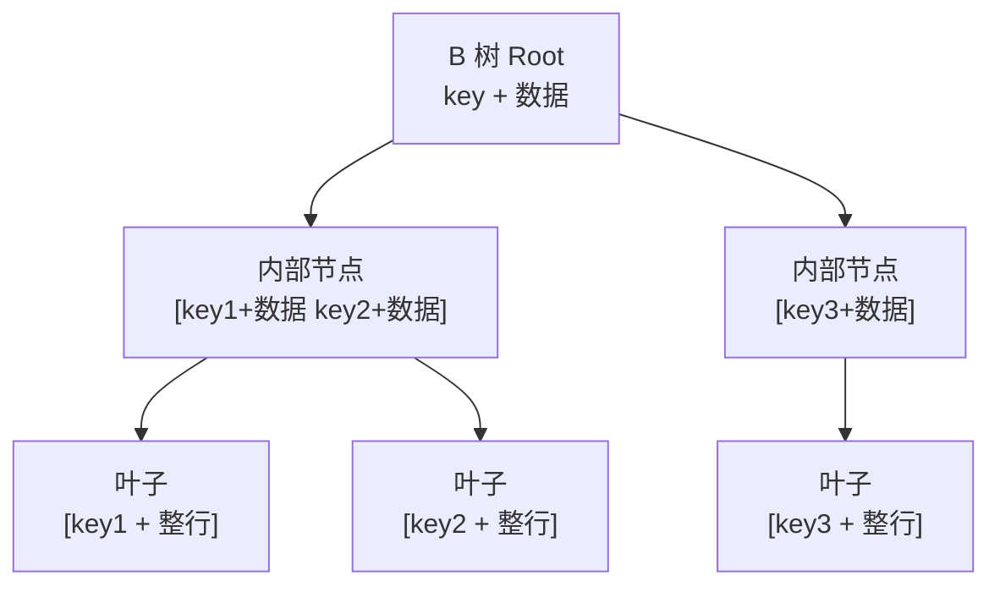
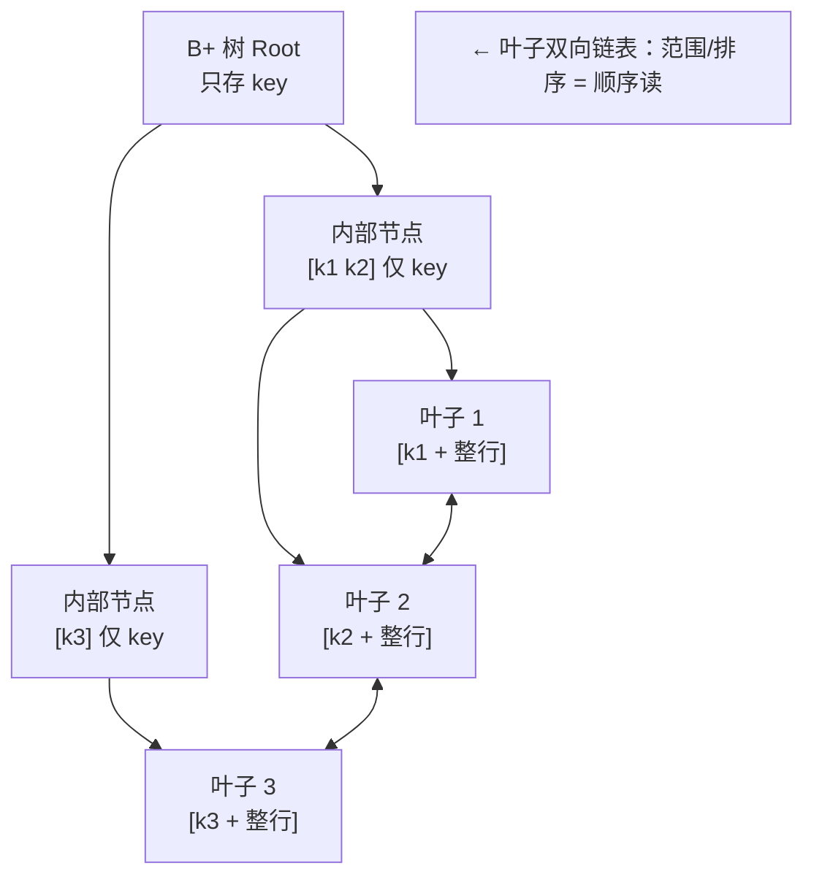

> 慢查询有两条路——**先靠索引把表内查询变快；数据量真大了，再分库分表拆表**。本篇按「由浅入深」：先索引，再分片，最后讲两者怎么配合。
>
> **系列**：事务 → 锁 → 幂等 → DDD → 查询优化。[数据库事务](/blog/db-transaction) · [乐观锁与悲观锁](/blog/optimistic-pessimistic-lock) · [幂等](/blog/idempotency) · [领域驱动设计（DDD）](/blog/domain-driven-design) · 本文。

---

## 一、框架：查询变慢的两层手段

一条 SQL 慢，本质是**「不得不读太多行」**（全表扫）。让它快有两条路：

```
第一手段 · 索引       → 让「一张表内」的查询不走全表扫（O(log n) 定位）
第二手段 · 分库分表     → 数据量太大，把「一张表」拆成多张，各片小、更快
```

**决策顺序**：**先上索引，真不够了再分片。** 分库分表会带来分布式事务、跨库 join、一致性变复杂——别为分而分。和 [DDD](/blog/domain-driven-design) 一样：先把边界与规则想清楚，再动基础设施。

---

## 二、第一手段：数据库索引（让表内查询快）

### 2.1 索引是什么？

索引 = 给表的某些列建的「排序查找结构」，把**全表扫**（读每一行，O(n)）变成 **B+ 树定位**（O(log n)）。

```sql
-- 没索引：EXPLAIN 看到 type=ALL（全表扫）
SELECT * FROM account WHERE mobile = '13801234567';
-- 建 index(mobile) 后：type=ref，B+树定位 + 回表拿整行
```

> 一句话：**索引是用空间 + 写开销，换查询速度。**

### 2.2 底层原理：为什么是 B+ 树

**前提：瓶颈是「磁盘 IO」，不是 CPU。** 一次随机磁盘读 ≈ 几毫秒，且磁盘按「页」读（InnoDB 默认 16KB/页）。所以索引设计的目标只有一个：**在几百万行里，用「最少次数的磁盘读」定位到那一行**。而树的**每一层 ≈ 一次磁盘读**——问题一下变成「**树要尽量矮**」。

**① 为什么不用二叉查找树 / AVL / 红黑树（树太高）**  
这些是内存利器，但在磁盘上露馅：每个节点只放 **1 个 key**、装不满一页 → 树高 = O(log₂N)，100 万行 ≈ **20 层** → 找一条要读约 **20 次磁盘**。❌

**② B 树：把「很多 key」塞进一个节点 → 树变矮**  
B 树让一个节点一次装几百个 key（正好占满一页）→ **扇出拉大** → 100 万行树高只有 **3~4 层**。✅ 但 B 树「内部节点也存数据」，还有可压缩的空间。

**③ B+ 树：再补三招**

| B+ 树三招 | 效果 |
|---|---|
| **内部节点只存 key，不存数据** | 节点更小 → 一页能装更多 key → **树更扁、高度更低** |
| **数据（整行）只在叶子节点** | 内部节点纯「导航」，查到底才有数据 |
| **叶子串成双向链表** | **范围/排序/翻页 = 顺着链表顺序读**，不用回溯 |

**第 ③ 招是决定性的一招**（范围查询是数据库最常见的负载）：

```
SELECT ... WHERE id BETWEEN 100 AND 200
B 树 ：每取一个就回溯父节点 → 来回随机读 ❌
B+ 树：先定位到 id=100 的叶子，然后顺着叶子【链表】顺序读后 100 条 = 顺序 IO ✅
```

**附：B 树 vs B+ 树结构一图看懂**

**B 树** —— 内部节点也存数据（节点更大、树更高），范围查询要回溯：



**B+ 树** —— 内部只存 key（导航）、数据全在叶子、叶子串成链表：



> 对照两张图：**B 树的内部节点里夹着数据 → 装不满页、树更高、范围要回溯**；  
> **B+ 树内部只有 key（更扁）+ 数据全在叶子 + 叶子用 `<-->` 串成链表** → 树「矮」（几百万行读 3 次盘）且范围/排序/翻页走顺序读。这两点，正好对上 2.4.1 讲的「回表」和「覆盖索引」。

**数字直觉**（InnoDB 16KB/页，主键 B+ 树高度 = 磁盘读次数）：

| 数据量 | 高度 | 磁盘读次数 |
|---|---|---|
| 十几万行 | 2 | 2 |
| **几百万行** | **3** | **3** |
| 几亿行 | 4~5 | 4~5 |

> 一百万个数据，只读 3 次磁盘——这就是 B+ 树「矮树 + 顺序读」的威力。

**哈希呢？**

| | 等值 `=` | 范围 / 排序 / 最左前缀 |
|---|---|---|
| B+ 树 | ✅ | ✅ |
| 哈希 | ✅ 更快 | ❌（只支持等值） |

所以关系库主索引是 B+ 树，哈希只作特殊辅助（如等值场景的 MEMORY 引擎）。

> 一句话：B+ 树为了「磁盘上的矮树 + 顺序读」——内部只存 key 让树更矮（几层读一次盘）；数据全在叶子 + 叶子串链表，让范围/排序/翻页变成顺序读。它既赢了哈希的「等值」，又赢了 B 树的「范围」。

> **🎯 面试常问：为什么数据库主索引不用哈希/不用 B 树？（且查一条要几次磁盘）** ——主索引要支撑范围/排序/分页：哈希只能等值命中；B 树节点存数据导致树更高、范围查询要回溯父节点。B+ 树靠「内部只存 key + 叶子链表」同时满足等值 + 范围，且树矮到「几百万行只要 3 次磁盘读」。所以「A 表千万行、主键查一条 ≈ 约 3 次磁盘 IO」。

### 2.3 索引的分类

> 先分清两个维度，别混：「**作用分类**」 vs 「**底层结构**」。B+ 树是「底层结构」（2.2），不是和主键/二级平级的一种「类型」。

**按作用分类（常说的「索引类型」）**：

| 类型 | 说明 |
|---|---|
| **主键索引（聚簇）** | 主键决定物理存储顺序；叶子即整行数据 |
| **二级索引（非聚簇）** | 叶子存**主键**，按它查要**回表** |
| **唯一索引** | 防重复 + 等值快（呼应[幂等](/blog/idempotency)里的唯一约束） |
| **联合索引** | 多列一起建，靠**最左前缀** |
| **覆盖索引** | 查询要的列全在索引里 → **不回表** |

**按底层结构实现**（引擎的「发动机」）：
- **B+ 树**：InnoDB 默认，上面这些索引大多用它 → 见 2.2。
- **哈希**：等值快、不能范围/排序（MEMORY 引擎等值场景）。
- **全文 / 空间**：倒排 / R 树，专门做搜索、坐标。

> 🎯 面试常问：B+ 树是一种索引类型吗？——不是，B+ 树是索引的**底层结构（实现方式）**；按「作用」分的主键/唯一/联合才是常说的「索引类型」。同一张表的主键索引、唯一索引底层常常都是 B+ 树。

### 2.4 索引如何使用（⭐）

> 前面讲清了「是什么 / 怎么实现 / 有哪些」，这里全收「怎么用」：省 IO（覆盖）、怎么建（最左前缀）、别写坏（失效）、怎么验证（EXPLAIN）。

#### 2.4.1 回表 & 覆盖索引（怎么让查询省 IO）

```
二级索引(mobile) 查到主键 id=5
   ↓ 还要按主键回聚簇索引取整行（多一次 IO）   = 回表
覆盖索引：SELECT id, mobile —— 这两列都在索引里 → 直接返回，不回表
```

- **回表**：二级索引 → 再按主键回主表取整行，多一次 IO。
- **覆盖索引**：把要查的列都塞进索引，直接返回——**高频查询的优化大招**。

> **🎯 面试常问：覆盖索引怎么省 IO？** ——查询要的列都在索引（叶子）里，定位完直接返回，不用再按主键回表取整行，省一次随机读。

#### 2.4.2 联合索引 & 最左前缀（索引该怎么建）

```sql
CREATE INDEX idx_user_status_time ON t (user_id, status, created_at);
-- 能命中：user_id / user_id+status / user_id+status+created_at
-- 不能命中：直接查 created_at / status+created_at（跳过了最左 user_id）
```

**先点透本质：联合索引 = 多列共用【一棵】B+ 树**（不是每列各建一棵）。

这棵树的排序规则是**多列依次排**：先按第 1 列排；第 1 列相同，再按第 2 列；依此类推：

```
(user_id, status) 联合索引的叶子（示意）：
user_id=1, status=0
user_id=1, status=1        ← user_id 相同，才按 status 排
user_id=1, status=2
user_id=2, status=0        ← user_id 一变，status 重新从头排
user_id=2, status=1
```

正因为是「先 a 后 b」这样排的：
- 查 `a` / `a,b` / `a,b,c` ✅（都能顺着排好的顺序定位）
- 只查 `b` / `b,c` ❌（树不是按 b 开头排的，只能全表扫）

→ **「最左前缀」不是额外规则，而是这棵树的排序结构带来的自然结果。**

和「每列单独建」的差别：3 个单列索引 = 3 棵树、每次基本只能用一棵；1 个联合索引 = 1 棵树、`a` / `a,b` / `a,b,c` 都能用，写开销也只有一份。

> 建联合索引前先想清楚 **WHERE 里列的顺序**：等值列放最左、范围列放右边。

> **🎯 面试常问：联合索引 `(a,b,c)`，哪些查询能用上？** ——`a`、`a,b`、`a,b,c` 能；跳列（如只查 `b,c` 或不带 `a`）不行，因为优化器走最左前缀。

#### 2.4.3 索引失效场景（该怎么避免写坏）

| 场景 | 示例 ❌ |
|---|---|
| 对索引列做**函数/运算** | `WHERE DATE(created_at) = '2026-01-01'` |
| **隐式类型转换** | `WHERE mobile = 13801234567`（mobile 是字符串列） |
| **前导模糊** | `LIKE '%abc'`（`abc%` 才能用上） |
| **OR 连接非索引列** | `WHERE user_id=? OR name=?`（name 无索引） |
| 联合索引**没用最左前缀** | 见 2.4.2 |
| **排序方向 / 覆盖不到** | `ORDER BY` 与索引顺序不一致、要查的列不在索引里 |

> 🎯 面试常问：常见的索引失效有哪些？——函数/运算、隐式类型转换、前导 `%`、OR 连非索引列、联合索引绕开最左前缀。

#### 2.4.4 EXPLAIN：怎么判断有没有走索引

`EXPLAIN SELECT ...` 看 **`type`** 列：`const` / `ref` / `range` 说明走索引，`ALL` 是全表扫（基本没吃上）；`key` 列能直接看到用了哪个索引。**慢查询第一件事就是它。**

> 🎯 面试常问：一条慢查询怎么判断没走索引？——`EXPLAIN` 的 `type=ALL`（全表扫）通常就是没吃上；`key` 为空或没用上预期索引，再去对 2.4.3 查失效原因。

### 2.5 索引在代码里怎么用（学以致用）

> 前面原理讲清了，这里落地下手：**怎么建索引、怎么用 EXPLAIN / 慢查询把原理用起来**。

#### 2.5.1 建 / 删索引的 SQL

```sql
-- ① 建表时直接定义
CREATE TABLE account (
  id BIGINT PRIMARY KEY,
  mobile VARCHAR(20),
  status TINYINT,
  created_at DATETIME,
  INDEX idx_mobile (mobile),                 -- 普通索引
  UNIQUE KEY uk_mobile (mobile)              -- 唯一索引（防重复，呼应幂等）
);

-- ② 表已存在，后补索引（生产最常用）
ALTER TABLE account ADD INDEX idx_mobile (mobile);
CREATE INDEX idx_user_status_time ON t (user_id, status, created_at);  -- 联合：等值列放最左
ALTER TABLE account DROP INDEX idx_mobile;    -- 删索引

-- ③ 覆盖索引：把要查的列塞进索引，避免回表（高频查询）
CREATE INDEX idx_cover ON account (id, mobile, status);
```

> 什么时候建：高频查询的 `WHERE` / `ORDER BY` / 关联字段。**别见缝插针**——每个索引都要写放大（分片后每片一份，见第七章）。

#### 2.5.2 用 EXPLAIN 把「有没有吃到索引」读出来

```sql
EXPLAIN SELECT * FROM account WHERE mobile = '13801234567';
-- 结果重点看这几列：
--   type  : all=全表扫(没吃上) / range,ref,const=走索引
--   key   : 实际用了哪个索引（NULL=没用）
--   rows  : 预估扫描行数（越小越好）
--   Extra : Using index=覆盖✓ / Using filesort=额外排序✗ / Using temporary=临时表✗
```

> 判断口诀：**`type=ALL` 或 `key=NULL` → 没吃上；`ref/range + key 有值` → 吃上了；`Extra=Using index` → 最优（连回表都省了）。**

#### 2.5.3 一个真实排查闭环（把原理用起来）

```
1. 慢查询日志发现：SELECT * FROM order WHERE user_id=? ORDER BY created_at 耗时 2s
2. EXPLAIN 一看：type=ALL(全表扫) + Extra=Using filesort   ← 既没索引、还在额外排序
3. 对症加索引：CREATE INDEX idx_user_time ON t_order (user_id, created_at)
     -- user_id 等值放最左；created_at 正好供 ORDER BY（顺带消掉 filesort）
4. 再 EXPLAIN 验证：type=ref + Extra=Using index → 走索引、还可覆盖，2s → 几 ms
```

> 这就是「学以致用」的完整闭环：**发现 → EXPLAIN 定位 → 加索引 → 再验证**。

#### 2.5.4 和代码层（ORM）的几条写法（索引能不能吃上）

- ORM/MyBatis 只负责把 SQL 拼好发给库——**慢点在看 SQL 本身**；常见坑是对索引列做函数 / 隐式类型转换，白白废掉索引（见 2.4.3）。

```java
// MyBatis：用 #{} 预编译占位（防隐式转换废索引）
// ❌ 写成 ${mobile} 直接拼字符串 → 等于把列做类型转换，索引可能失效
// ✅ 用 #{} 预编译占位 → 类型安全，能走 mobile 索引
@Select("SELECT * FROM account WHERE mobile = #{mobile} AND status = #{status}")
Account findActiveByMobile(@Param("mobile") String mobile, @Param("status") int status);
```

```java
// JPA：直接在实体上声明索引（启动自动建索引 DDL）
// 联合索引：等值列(user_id)放最左，范围列(created_at)放右 → 供 ORDER BY、消 filesort
@Entity
@Table(name = "t_order", indexes = {
  @Index(name = "idx_user_time", columnList = "user_id, created_at")
})
public class Order { ... }
```

> 判读口诀不变：`EXPLAIN` 看 `type` / `key` / `Extra`（2.5.2）。排查顺序永远是 **先 SQL/EXPLAIN → 再补索引 → 最后才分库分表**（呼应第三章「别为分而分」）。

---

## 三、何时才该分库分表（别为分而分）

索引在单表内优化是有上限的——数据量上亿、写入/热查询都压在一张表上时，才轮到分片。

- **什么时候才分**：单表量级大（千万~亿级）、单库连接/IO 成瓶颈、写入和热行都挤在同一张表（热点集中）。
- **什么时候别分**：量还不够大、或只是查询慢但索引没用好——**先补索引/优化 SQL，分片是最后手段**（过早分片 = 分布式事务、跨库 join、一致性、运维复杂度全上来了）。
- 和 [事务](/blog/db-transaction)、[DDD](/blog/domain-driven-design) 同一心智：先把领域边界与一致性模型想清楚，再动拆分。

---

## 四、怎么分：分片策略 + 分片键路由

### 4.1 三种分片策略

| 策略 | 原理 | 优点 | 缺点 | 用途 |
|---|---|---|---|---|
| **range 范围** | 按时间/ID 区间切 | 顺序读、扩容简单 | 热点集中（热点在最新区间） | 时序、日志 |
| **hash 取模** | `hash(key) % N` | 均匀、实现简单 | 扩容要重哈希、迁移全量 | 高频业务 |
| **一致性哈希** | key 落在哈希环 | 增删节点只迁移**少量** | 需要虚拟节点、均衡略差 | 需要不停机扩容 |

> **🎯 面试常问：取模和一致性哈希选哪个？** ——数据均匀选取模；**要不停机/低成本扩容、想迁移只动少量数据**选一致性哈希（配虚拟节点防倾斜）。规模小用取模即可。

### 4.2 命中分片键 → 路由直达单片

```
shard = hash(user_id) % N          # 或  user_id >> bits(基因)+...
SELECT * FROM t_user_$shard WHERE user_id = 123
```

- 分片键 = 路由键，算出 shard 直接落一片，**一次网络往返**。
- 分片键要**稳定、唯一、查询高频**（user_id、order_id 取一即可）。

> **🎯 面试常问：所有查询都要带分片键吗？做不到怎么办？** ——目标是「尽量带」。做不到的用映射表/基因法先把条件换算成分片键再路由；真没法换算的低频场景才同意广播扫全片。

### 4.3 分库分表在 Java 里怎么落地（ShardingSphere + MyBatis）

分片一般交给**中间件（ShardingSphere）**：你写**普通 SQL/MyBatis**，中间件按配置路由到对应物理表——**代码层几乎无感**。

**① 配置分片规则（application.yml 一段即可）**

```yaml
spring:
  shardingsphere:
    datasource:
      names: ds0, ds1
      ds0: { url: jdbc:mysql://host:3306/order_0 ... }
      ds1: { url: jdbc:mysql://host:3306/order_1 ... }
    rules:
      sharding:
        tables:
          t_order:                        # 「逻辑表名」：代码里写它
            actualDataNodes: ds${0..1}.t_order_${0..1}   # ds0/1 × t_order_0/1
            tableStrategy:
              standard:
                shardingColumn: user_id    # 分片键
                shardingAlgorithmName: order_inline
        sharding-algorithms:
          order_inline:
            type: INLINE                  # 取模路由：user_id % 2
            props:
              algorithm-expression: t_order_${user_id % 2}
```

**② 业务代码照常写（无感路由）**

```java
@Mapper
public interface OrderMapper {
    // 这就是普通 SQL，不用管实际落到 ds0.t_order_0 还是 ds1.t_order_1
    // 中间件看到 WHERE user_id=? 命中分片键 → 路由到对应片
    @Select("SELECT * FROM t_order WHERE user_id = #{userId} AND id > #{lastId} ORDER BY id LIMIT 20")
    List<Order> pageByUser(@Param("userId") Long userId, @Param("lastId") Long lastId);
}
```

> 若查询**未命中分片键**，就退化成第五章的广播 / 映射兜底。

**③ 不引中间件呢？原生手动分表**

```java
// 每次都要手动算表名、手拼 SQL —— 易错、不透明
String table = "t_order_" + (userId % 2);
orderDao.query("SELECT * FROM " + table + " WHERE user_id = ?", userId);
```

> 原生分表省了中间件，但路由 / 迁移 / 归并全得自己扛——小团队可以，规模大了几乎必上 ShardingSphere。

> 🎯 面试常问：用了 ShardingSphere 还要手动拼表名吗？——不用。代码里写的是「逻辑表名 `t_order`」，中间件按 `shardingColumn` 路由到物理表。代价是它封装了路由/归并，但底层就是 4.1~4.2 那套心智。

---

## 五、未命中分片键怎么查（路由兜底）

按「用订单号找归属用户」这种**非分片键**查询，四种方案：

| 方案 | 原理 | 适用 | 代价 |
|---|---|---|---|
| **广播查询** | 并行扫全片 + 中间件合并 | 低频、无规可循 | 最贵、索引压力大 |
| **映射表/索引表** | 另建 `(订单号→user_id)` 表，先查它拿分片键再路由 | 高频、条件少 | 多一次查询；映射表本身要一致性哈希 |
| **基因法** | 把分片键几位「基因」编码进订单号，位运算直接反解 | 高频、想省一次查 | 只支持单一分片维度 |
| **冗余存储** | 同一份数据按多维度各存一份 | 多维度高频 | 写放大、一致性要处理 |

> 心智：**未命中分片键时，先想办法「换成能路由的分片键」，而不是直接扫全片。**

---

## 六、跨片归并 / 排序 / 分页 + 全局唯一 ID

多片结果要「归并」：

```
- ORDER BY : 各片先排返回 topN(offset+limit)，中间件归并排序再截取
- 深度分页  : ❌ LIMIT 100000,20(各片都取10万条再合并，爆炸)
              ✅ keyset 游标: WHERE id > last_id ORDER BY id LIMIT 20
- COUNT     : 各片 COUNT 求和(或用预聚合计数器)
- GROUP BY  : 各片分组，中间件合并同名组再聚合
```

- **全局唯一主键**：自增跨库冲突 → **雪花 ID**（时间戳+机器位+序列）或 UUID。
- **跨分片写一致性**：单库事务管不到跨片 → 本地消息表/最终一致（见[事务](/blog/db-transaction)）+ [幂等](/blog/idempotency)/补偿 + 对账兜底。这和 [DDD](/blog/domain-driven-design) 里「领域事件落 MQ → 消费端幂等」是同一条链。

> **🎯 面试常问：为什么深度分页不用 offset？** ——每片都要取 `offset+limit` 条再合并，offset 大到 10 万就变成 10万×片数的 IO。keyset 只取 `id > 上页最后的 id` 的 limit 条，每片量恒定，适合顺序翻页（但只能顺翻、不能乱跳）。

---

## 七、索引与分片的配合（很关键）

分完表后，索引照样决定「单片内快不快」——二者是配合关系：

- **分片键必建索引**：路由到单片后，能不能定位全靠分片键索引（`user_id` 要有 index）。
- **映射表也要索引**：第五章的「映射表/索引表」，它 `(另一维度 → 分片键)` 的列得建唯一索引。
- **覆盖索引 + keyset**：跨片排序/翻页，能用 `id` 覆盖索引**少取行**、再归并——别让中间件把整列扛下来。
- **写的代价翻倍**：每条写都要维护这一片上的**所有二级索引**；分片后 = 每片各一份索引，**写放大更明显**。所以别见缝插针建索引，只建高频查询真正要的。

---

## 八、小结 / 一图回顾

```
查询慢
  ├─ 先看索引：走没走？失效没？覆盖没？   ← 表内快（B+树 / 最左前缀 / 覆盖）
  ├─ 再看要不要分片：量大/热点才拆         ← 别为分而分
  └─ 分了之后：命中分片键直达；未命中靠映射/基因；跨片靠归并+keyset
       ↓ 别忘了索引还是那套：分片键要索引、映射表要索引、覆盖索引+keyset、写放大翻倍
```

**三句话带走**：
1. **慢查询先看索引**：`EXPLAIN` 看 `type`、最左前缀、覆盖索引、别让索引失效。
2. **索引有上限，才轮到分片**：先查量级与访问模式，别为分而分。
3. **分片是「拆表」，不是「绕过索引」**：分片键/映射表照样要索引，跨片归并靠 keyset + 覆盖索引省 IO。

### 自测
1. 为什么范围/排序查询不能用哈希索引？——哈希只支持等值。
2. 覆盖索引怎么省 IO？——要查的列都在索引里，免回表。
3. 深度分页为什么用 keyset 而不是 offset？——offset 在分片下每片都取超大量再合并。
4. 一张表上亿行还慢，第一反应是分片吗？——先查索引是否用对（最左前缀/覆盖/失效），不够再谈分片。

---

## 九、避坑

- 别见表慢就分片：**先补索引/优化 SQL**，分片是最后手段（成本高）。
- 深度分页一定要说 keyset，张口「offset+limit」就是分片新手。
- 分片键/映射表**必须建索引**——拆表不省索引的活。
- 别把单库事务套到跨片一致性上——跨片 = 最终一致（[事务](/blog/db-transaction) + [幂等](/blog/idempotency)/对账）。
- 别见缝插针建一堆二级索引：分片后每片各一份，**写放大翻倍**。

---

## 十、面试速记

- 索引：**B+ 树矮树 + 叶子链表**；覆盖索引免回表；联合索引走最左前缀；`EXPLAIN` 看 `type/key/Extra`。
- 分片：**先索引、后分片**；命中分片键直达；未命中靠映射/基因；跨片归并用 keyset。
- 配合：分片键/映射表照样要索引；写放大翻倍，别见缝插针。
- **串链**：[事务](/blog/db-transaction)管原子、[锁](/blog/optimistic-pessimistic-lock)管并发、[幂等](/blog/idempotency)管重试、[DDD](/blog/domain-driven-design)管边界与事件——本文管「查得快」；跨片写仍要走最终一致那条链。
