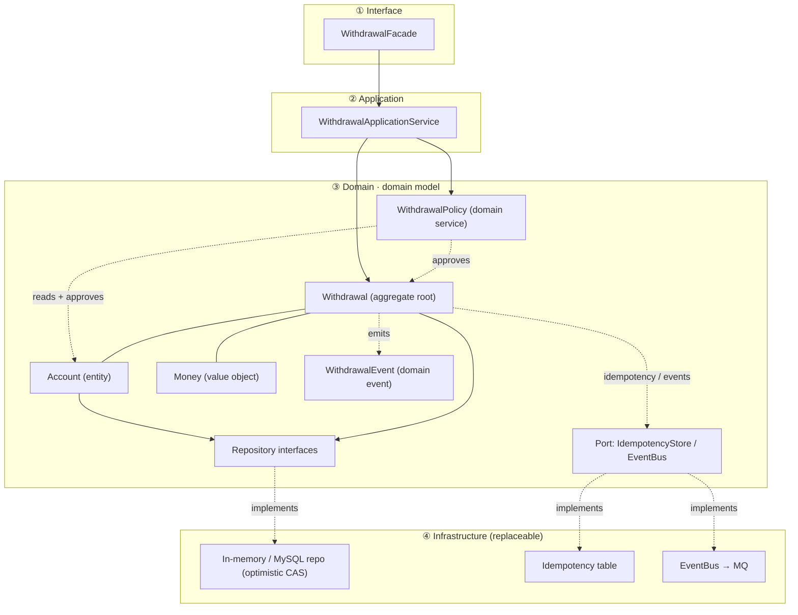
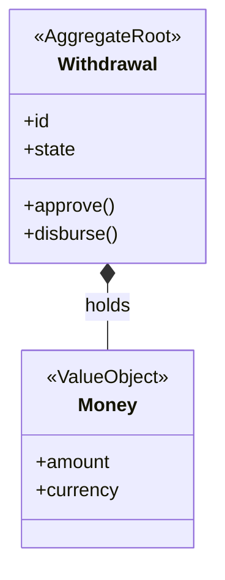
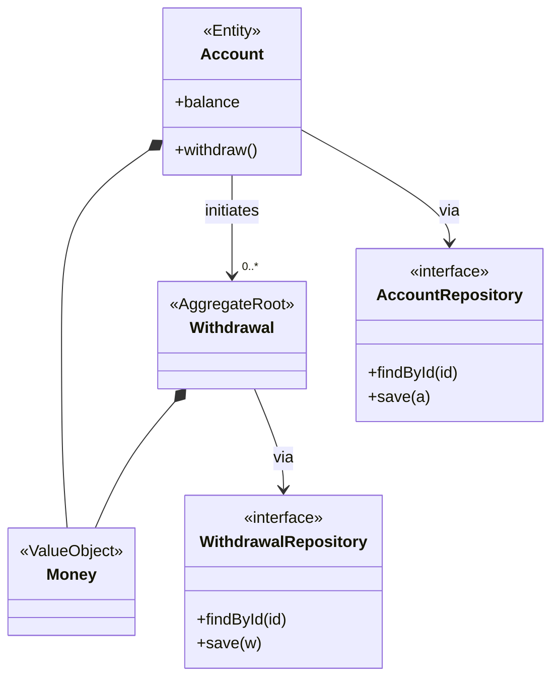
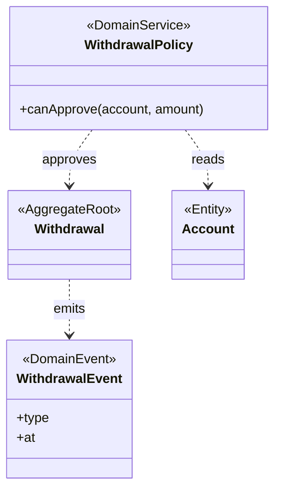
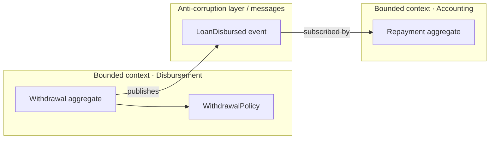
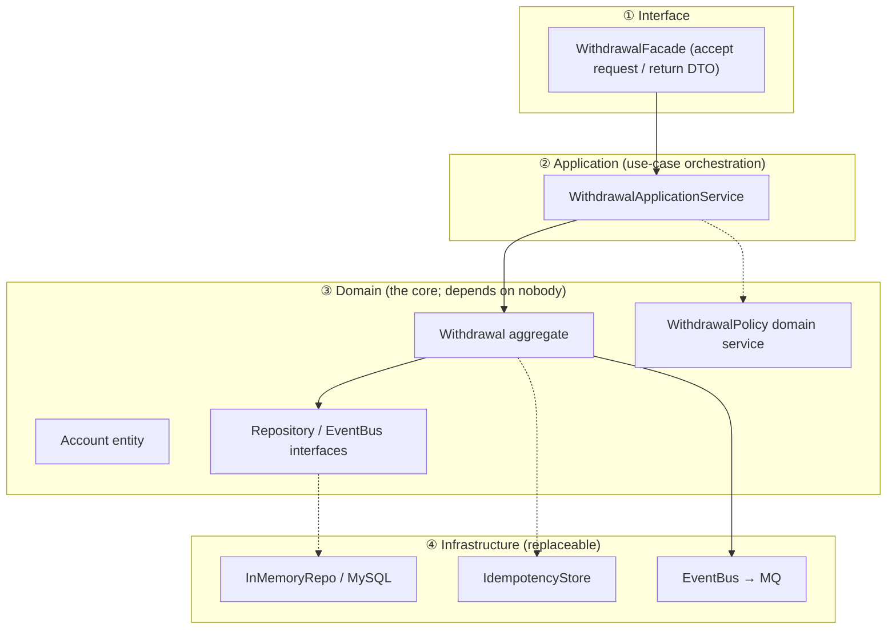
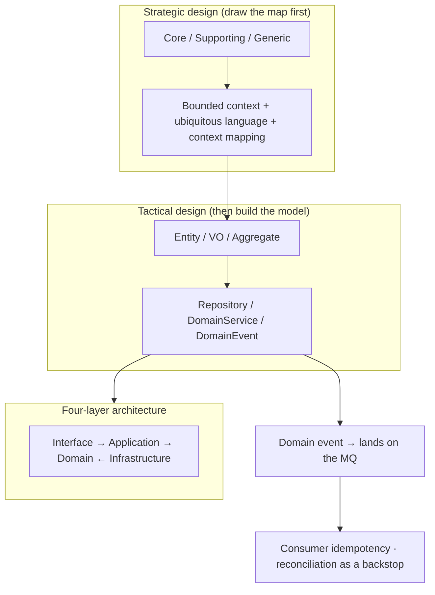

> Goal: understand DDD **strategic design** and **tactical design**, learn how to draw a domain-model diagram, and land a real business with the **DDD four-layer architecture**.
>
> How to learn: use a **cash-loan withdrawal** as the through-line, walk "cut the boundary → build the model → land four layers → draw the picture", then look back at the whole with the recap.
>
> **Series**: Transactions → Locks → Idempotency → DDD → Query performance. [Database transactions](/en/blog/db-transaction) · [Optimistic and pessimistic locks](/en/blog/optimistic-pessimistic-lock) · [Idempotency](/en/blog/idempotency) · This post · [Database query performance](/en/blog/db-query-performance).

---

## 1. Background: what DDD is solving

**Symptom**: many projects start clean, then grow a God class that "can do everything", with business rules scattered across Controllers and utility classes — **change one place, fear three others**.

**Root cause**: it is easy to be **led by database tables / the framework / Controllers**, instead of growing with **the business itself**.

**DDD (Domain-Driven Design)** claims this: split **"business complexity"** from **"technical complexity"**, and let the code structure follow the **domain model**.

In one line: **get the domain model right first. The database, the framework, and I/O are only its implementation details.**

---

## 2. Strategic design: cut the boundary first, then talk about code

> Strategic design answers **"which business is most valuable, where the boundary is drawn, and how the boundaries collaborate"** — this is **drawing the map**. No code yet.

### 2.0 Plant a through-line first: cash-loan withdrawal

The whole post hangs every concept on this business:

> **Scene**: a cash-loan user starts a "withdraw 4000" — the system must **approve** (is the balance enough / over the limit?) → **deduct quota** → **disburse** → notify accounting to book it. **Account balance is 5000; the user timed out and retried once on one device.**

Remember these three "roles": `Withdrawal`, `Account`, `Money`. Everything later is them.

### 2.1 Step one: rank what matters — Core / Supporting / Generic

Do not cut boundaries on day one. First ask **"which piece of business is most valuable"**:

| Subdomain type | Meaning | Investment |
|---|---|---|
| **Core domain** | Decides product competitiveness; hard for others to copy (e.g. cash-loan **risk / credit**) | Put **modeling energy here**; go deep |
| **Supporting domain** | Internal capability that supports the core (org / accounts / approval flow) | Build it yourself, but do not over-invest |
| **Generic domain** | Industry-common, mature solutions exist (e.g. **payments / messaging / IDs**) | Buy it or use a generic piece; do not reinvent |

> **Frontend analogy**: tell which part of the app is "the main business / the selling point" and which is "sign-up / avatar" generic furniture — **do not spread modeling energy evenly**. Only the core domain is worth a DDD remodel; go deep on core, save effort on generic. That is the first strategic decision.

### 2.2 Step two: cut the boundary — Bounded Context

Inside one business, different roles can mean completely different things by the same word ("withdrawal" on the disbursement side is not "withdrawal" on the accounting side). A **Bounded Context** draws an **autonomous boundary**: terms are unified and the model is coherent *inside* the boundary; **boundaries do not share a model**.

- In cash-loan: the `Disbursement` context and the `Accounting` context are **two bounded contexts** — their "balance" and "customer" do not mean the same thing, so they should not share one class.
- **Frontend analogy**: an independently maintained **microfrontend module** — its own state, its own API, no sharing of internal models with other modules.

**Ask yourself 3 questions** to judge a boundary:
1. Which concepts will evolve on their own, and where is the edge? (`Withdrawal` should not be welded to the accounting table)
2. Which concepts share one set of rules? (may several contexts share the definition of "money"?)
3. Which way do cross-boundary dependencies point? (does disbursement depend on accounting, or the other way around?)

### 2.3 Set the Ubiquitous Language

**Inside one bounded context**, product, backend, and frontend speak the same words: class names in code = words in the doc = words in the meeting.

- Example: this context has no `items`. Call it `Withdrawal`, `Disbursement`. Do not invent `WithdrawalMgr` or `UtilService`.
- **Frontend analogy**: the team's shared product slang / API contract names — do not let you say "withdrawal" while I say "cashing".

### 2.4 Set collaboration — Context Mapping

How do boundaries work together? A few accepted patterns:

- **Anti-Corruption Layer**: when upstream hands you a concept you do not want to understand, put a translation / isolation layer on the boundary so their model does not pollute your domain.
- Shared Kernel / Customer-Supplier / Published Language: different strengths of "the communication contract between boundaries".
- **Frontend analogy**: two microfrontends keep their own data shapes and map once at the boundary.

> **After the four strategic steps**: you have a **map** of "which business is valuable + where the boundary is + a shared language inside the boundary + how boundaries cooperate". Still not one line of code.

---

## 3. Tactical design: the core building blocks of a domain model

> The map is drawn; now you build the model. Tactical design answers **"how the code in each cell of the map is written"**. Each piece of the six-pack answers one design pressure.

| Building block | Definition / tell | Cash-loan example |
|---|---|---|
| **Entity** | Has a unique identity, changes, has a lifecycle — "who it **is**" | `Withdrawal` (has an id; state moves apply → approve → disburse) |
| **Value Object** | No id, immutable, equal by attributes — "what it **is**" | `Money(amount + currency)`, an address — **a balance should not be a bare number** |
| **Aggregate** | A cluster of objects + a root entity as the only entry, strongly consistent inside — "who **owns** whom" | `Withdrawal` as aggregate root: changing state must go through its methods |
| **Repository** | Persistence abstraction for an aggregate; hides the store — "say goodbye to the data layer" | `WithdrawalRepository.load(id)` does not know where it is stored |
| **Domain Service** | Business that does not belong to a single entity / value object — "work across aggregates" | `WithdrawalPolicy.canApprove()`: approval must look at the account *and* the per-tx limit |
| **Domain Event** | Something that happened in the domain; decouples aggregates — "broadcast outward" | `WithdrawalDisbursed` (disbursement succeeded) → land on the MQ → accounting books it |

> **Frontend analogy (tactical six-pack)**: Entity ≈ a mutable data object with an id; Value Object ≈ immutable props / a coordinate; Aggregate ≈ the root of a component tree (the only entry for state); Repository ≈ a wrapped API layer; Domain Service ≈ extracted cross-component hooks logic; Domain Event ≈ a Redux action / a global event bus.
>
> **The most important rule**: the outside world (DB, external APIs, an LLM SDK) may enter and leave the domain model only through **Repository + Domain Event + Port / Adapter**. **The domain layer does not import any infrastructure.**

---

## 4. Four-layer architecture and the direction of dependencies

```
      Interface (Controller / CLI / SDK adapter)
              ↓
     Application (use-case orchestration: organize one withdrawal flow)
              ↓
       Domain (domain layer: Withdrawal aggregate / Money / policy / events)  ← the core; depends on nobody
              ↓
   Infrastructure (implementations of DB / Redis / MQ / external SDKs)
```

**Iron rule: dependencies always point at Domain.** Want to swap the account from "MySQL" to "Redis / a file"? Change only Infrastructure; the domain layer does not move a line.

---

## 5. Walk it end to end: a cash-loan withdrawal DDD demo

> The three ideas above (strategy / tactics / four layers) are now strung through one real example — **watch a domain model go from "an idea" to "code that runs", and see which layer isolation / idempotency consistency logic is parked in**.

### 5.1 One withdrawal across the four layers

| Layer | What it does | How it shows up in code |
|---|---|---|
| **Interface** | Accept the request / return a DTO | `WithdrawalFacade`: request params become a `Money` domain object at the door |
| **Application** | Use-case orchestration (no business rules) | `WithdrawalApplicationService`: idempotency → approve → deduct → publish events |
| **Domain** | Domain rules + state machine | `Withdrawal` aggregate `approve()` / `disburse()`, `Account.withdraw()`, `WithdrawalPolicy` |
| **Infrastructure** | Replaceable "concrete implementations" | In-memory repo (optimistic CAS), idempotency table, `EventBus→MQ` (swap the impl and it is production) |

Call chain: `Interface → Application → Domain(Withdrawal) → Infrastructure(store / messages)`, then back. **Domain sits at the center and depends on no upper layer.**

### 5.2 Domain architecture of the withdrawal demo

See the "withdrawal" domain architecture clearly first, then the 5.3 code — **the core is: Domain holds only domain objects + interfaces; locks / idempotency / messaging are all wired out through interfaces and implemented by Infrastructure**:



> **How to read the picture**:
> - The center is **Domain**. It only depends on **its own internal interfaces** (`Repository` / `Port`) and does not import any implementation.
> - `Withdrawal` is the aggregate root, the only entry for state (changing state / firing events can only go through it); `Money` is an immutable value object.
> - Solid line = containment / association inside the aggregate; dashed line = dependency; `.implements` = Infrastructure wiring the interface.
> - **Locks (optimistic), idempotency, and events landing on the MQ are all "wired out" through interfaces** — swap MySQL / Redis / Kafka and you only change `④`. Domain does not move a line.

### 5.3 Full code (matching directories)

```
src/withdrawal/
├── domain/          # Money, Account, Withdrawal, events, repo interfaces, policy, EventBus port — no infrastructure imports
├── application/     # WithdrawalApplicationService — use-case orchestration
├── infrastructure/  # in-memory repo / idempotency table / event bus (swap for Redis / MQ / DB)
├── interface/       # WithdrawalFacade — accept the request / return a DTO
└── main.ts          # composition root: wire implementations onto interfaces
```

**① Domain — value objects / entities / aggregate root**

```ts
// domain/values.ts — value object: immutable, equal by content (Money is never a bare number; rules live in the type)
export class Money {
  constructor(readonly amount: number, readonly currency: string = 'CNY') {}
  equals(o: Money) { return this.amount === o.amount && this.currency === o.currency; }
  subtract(o: Money): Money {
    if (o.amount > this.amount) throw new BusinessError('Insufficient balance');
    return new Money(this.amount - o.amount, this.currency);
  }
}

// domain/account.ts — entity + optimistic-lock version (echoes the "optimistic lock" post)
export class Account {
  constructor(readonly id: string, private _balance: Money, private _version = 0) {}
  get balance() { return this._balance; }
  get version() { return this._version; }
  canWithdraw(m: Money) { return m.amount <= this._balance.amount; }
  withdraw(m: Money) {                       // business rules live on the entity (rich model)
    if (!this.canWithdraw(m)) throw new BusinessError('Insufficient balance');
    this._balance = this._balance.subtract(m);
    this._version += 1;                      // bump version → CAS at persist time
  }
}

// domain/withdrawal.ts — aggregate root: state machine + domain events; invariants are held only inside the aggregate
export type WithdrawalState = 'REQUESTED' | 'APPROVED' | 'REJECTED' | 'DISBURSED';
export type WithdrawalEvent =
  | { type: 'WithdrawalRequested'; id: string; amount: Money }
  | { type: 'WithdrawalApproved'; id: string }
  | { type: 'WithdrawalRejected'; id: string; reason: string }
  | { type: 'WithdrawalDisbursed'; id: string };

export class Withdrawal {
  private _state: WithdrawalState = 'REQUESTED';
  private _events: WithdrawalEvent[] = [];
  constructor(readonly id: string, readonly accountId: string, readonly amount: Money) {}

  get state() { return this._state; }

  approve() {
    this.assertState('REQUESTED');
    this._state = 'APPROVED';
    this._events.push({ type: 'WithdrawalApproved', id: this.id });
  }
  reject(reason: string) {
    this.assertState('REQUESTED');
    this._state = 'REJECTED';
    this._events.push({ type: 'WithdrawalRejected', id: this.id, reason });
  }
  disburse() {                               // ⛔ disburse before approve = stopped by the aggregate root (state-machine invariant)
    this.assertState('APPROVED');
    this._state = 'DISBURSED';
    this._events.push({ type: 'WithdrawalDisbursed', id: this.id });
  }
  pullEvents(): WithdrawalEvent[] { const e = this._events; this._events = []; return e; }
  private assertState(s: WithdrawalState) {
    if (this._state !== s) throw new BusinessError(`State ${this._state} does not allow this operation (needs ${s})`);
  }
}
```

**② Domain — repository interfaces + ports + domain service (none of them implemented)**

```ts
// domain/repositories.ts — interfaces face the [aggregate] and speak domain language, not a DAO
export interface AccountRepository {
  findById(id: string): Account | undefined;
  save(account: Account): void;              // optimistic lock: version mismatch throws a conflict
}
export interface WithdrawalRepository {
  findById(id: string): Withdrawal | undefined;
  save(w: Withdrawal): void;
}
export interface IdempotencyStore {          // idempotency lives on a domain port
  tryAcquire(key: string, hash: string): boolean;  // the same key succeeds only once
  getResponse(key: string): unknown;
  setResponse(key: string, resp: unknown): void;
}

// domain/message-bus.ts — event port: the domain only cares "what to publish", not "where it goes"
export interface EventBus { publish(topic: string, event: unknown): void; }

// domain/withdrawal-policy.ts — domain service: cross-aggregate approval rules (do not belong to one entity)
export interface WithdrawalPolicy {
  canApprove(account: Account, amount: Money): { ok: boolean; reason?: string };
}
export class MaxAmountWithdrawalPolicy implements WithdrawalPolicy {
  constructor(private maxPerTx: number) {}
  canApprove(account: Account, amount: Money) {
    if (amount.amount > this.maxPerTx)         return { ok: false, reason: 'Over the per-transaction limit' };
    if (!account.canWithdraw(amount))          return { ok: false, reason: 'Insufficient balance' };
    return { ok: true };
  }
}
```

**③ Application — use-case orchestration (no business rules)**

```ts
// application/withdrawal-service.ts
export class WithdrawalApplicationService {
  constructor(
    private accounts: AccountRepository,
    private withdrawals: WithdrawalRepository,
    private store: IdempotencyStore,
    private policy: WithdrawalPolicy,
    private bus: EventBus,
  ) {}

  // Use case ① apply to withdraw: idempotency → rules → deduct (optimistic lock) → publish events
  apply(cmd: { requestId: string; accountId: string; amount: Money }): WithdrawalState {
    const hash = `${cmd.accountId}:${cmd.amount}`;
    if (!this.store.tryAcquire(cmd.requestId, hash)) {          // idempotency
      return this.store.getResponse(cmd.requestId) as WithdrawalState;
    }
    const account = this.mustAccount(cmd.accountId);
    const w = new Withdrawal(cmd.requestId, cmd.accountId, cmd.amount);
    const d = this.policy.canApprove(account, cmd.amount);
    if (!d.ok) w.reject(d.reason!);
    else {
      w.approve();
      account.withdraw(cmd.amount);                             // invariant inside the aggregate
      this.accounts.save(account);                              // optimistic CAS
    }
    this.withdrawals.save(w);
    this.publish(w.pullEvents());
    this.store.setResponse(cmd.requestId, w.state);
    return w.state;
  }

  // Use case ② disburse: the state machine blocks it — not APPROVED, cannot disburse
  disburse(cmd: { requestId: string }): void {
    const w = this.mustWithdrawal(cmd.requestId);
    w.disburse();
    this.withdrawals.save(w);
    this.publish(w.pullEvents());
  }

  private publish(es: WithdrawalEvent[]) { for (const e of es) this.bus.publish('withdrawal', e); }
  private mustAccount(id: string) { const a = this.accounts.findById(id); if (!a) throw new BusinessError('Account does not exist'); return a; }
  private mustWithdrawal(id: string) { const w = this.withdrawals.findById(id); if (!w) throw new BusinessError('Withdrawal does not exist'); return w; }
}
```

**④ Infrastructure — concrete implementations (all replaceable)**

```ts
// infrastructure/repos.ts
export class InMemoryAccountRepo implements AccountRepository {
  private rows = new Map<string, Account>();
  findById(id: string) { return this.rows.get(id); }
  save(account: Account) {
    const old = this.rows.get(account.id);
    if (old && old.version !== account.version - 1) throw new ConcurrencyError('Optimistic-lock conflict, please retry');
    this.rows.set(account.id, account);       // swap for MySQL: UPDATE ... SET version=version+1 WHERE version=?
  }
}
export class InMemoryWithdrawalRepo implements WithdrawalRepository {
  private rows = new Map<string, Withdrawal>();
  findById(id: string) { return this.rows.get(id); }
  save(w: Withdrawal) { this.rows.set(w.id, w); }
}
export class UniqueIdempotencyStore implements IdempotencyStore {
  private keys = new Map<string, { hash: string; resp: unknown }>();
  tryAcquire(key: string, hash: string) { if (this.keys.has(key)) return false; this.keys.set(key, { hash, resp: undefined }); return true; }
  getResponse(key: string) { return this.keys.get(key)?.resp; }
  setResponse(key: string, resp: unknown) { const it = this.keys.get(key); if (it) it.resp = resp; }
}
export class LogEventBus implements EventBus {          // swap for Kafka / RocketMQ
  publish(topic: string, e: unknown) { console.log(`[MQ:${topic}]`, e); }
}
```

**⑤ Interface + composition + a run trace**

```ts
// interface/withdrawal-facade.ts — accept the request / return a DTO (scattered request params become domain objects at the door)
export class WithdrawalFacade {
  constructor(private svc: WithdrawalApplicationService) {}
  apply(raw: { requestId: string; accountId: string; amount: number }) {
    const state = this.svc.apply({ requestId: raw.requestId, accountId: raw.accountId, amount: new Money(raw.amount) });
    return { requestId: raw.requestId, state };          // return a DTO; do not leak domain objects
  }
}

// main.ts — composition root: wire "implementations" onto "interfaces"; dependencies point at Domain
const accounts = new InMemoryAccountRepo();
accounts.save(new Account('acc-1', new Money(5000)));
const svc = new WithdrawalApplicationService(
  accounts, new InMemoryWithdrawalRepo(), new UniqueIdempotencyStore(),
  new MaxAmountWithdrawalPolicy(20000), new LogEventBus(),
);
const facade = new WithdrawalFacade(svc);

// —— run trace ——
facade.apply({ requestId: 'w-1', accountId: 'acc-1', amount: 4000 }); // ✅ APPROVED, balance 5000→1000
facade.apply({ requestId: 'w-1', accountId: 'acc-1', amount: 4000 }); // ⏭ idempotent: return APPROVED, do not deduct again
svc.disburse({ requestId: 'w-1' });                                   // ✅ DISBURSED
// console: [MQ:withdrawal] { type: 'WithdrawalApproved', ... }
//          [MQ:withdrawal] { type: 'WithdrawalDisbursed', ... }
```

### 5.4 Where the DDD is in this demo

| What you should see | The principle |
|---|---|
| `Account.withdraw` puts "insufficient balance" on the entity | **Rich model** (rules belong to the object, not a pile of Services) |
| `Withdrawal.disburse()` stops "disburse before approve" | The **aggregate root is the only entry that holds invariants** |
| `AccountRepository` / `IdempotencyStore` are only **interfaces** | **Dependency inversion**: Domain does not import implementations |
| `WithdrawalPolicy` is a Service-shaped class | **Domain service**: work across aggregates |
| `Account.version + 1` + the repo's CAS | **Optimistic lock** lands in Infrastructure (see [Optimistic and pessimistic locks](/en/blog/optimistic-pessimistic-lock)) |
| `tryAcquire(requestId)` | **Idempotency** lands in Infrastructure (see [Idempotency](/en/blog/idempotency)) |
| `EventBus.publish` | A **domain event** leaves the domain and lands on the MQ |
| `main.ts` wires implementations onto interfaces | **Composition root**: swap storage / swap MQ only here; Domain does not move a line |

---

## 6. Domain model vs data model (two dimensions, not macro vs micro)

> In one line: the domain model answers "how the business **runs**, and where the rules live"; the data model answers "how the data is **stored**, and how you query it". They are **different dimensions**, not a size relationship, and **they are allowed to disagree** — the DDD watershed is "the domain model is the lead; the database is only its persistence servant".

### 6.1 One comparison table

| | Domain-model design | Database-model design |
|---|---|---|
| The soul question | How does the business **run**? | How is the data **stored**? |
| Objects | Living behavior: entity / value object / aggregate / state machine / event | Dead structure: table / column / relation / index / constraint |
| Language | Domain language `withdrawal.canWithdraw()` | Storage language `withdrawals` / `FOREIGN KEY` |
| Cares about | Where rules live, how invariants are held | Fast queries, no redundancy, integrity |
| Serves | Business logic | Persistence and query |
| Design order | **First** (domain-driven) | **Later** (implementation detail) |
| Shapes may differ? | ✅ One domain object can split across tables | ✅ One concept can span MySQL / Redis / a vector store |

### 6.2 Land it on the 5.2 demo

| Domain object (5.2 demo) | In the database it might be |
|---|---|
| `Withdrawal` aggregate (state machine) | `withdrawal` table + a `state` column |
| `Money` value object (amount + currency) | Split into **two columns**: `amount DECIMAL` + `currency CHAR(3)` |
| `Account.withdraw()` "insufficient balance" rule | Only a `balance` column + a table constraint — **no "method"** |
| `WithdrawalEvent` (domain event) | **Not persisted**; published straight to the MQ |
| An aggregate with several line items | Split into **two tables**: `orders` + `order_items` |

> One object in the domain model may be two tables; an event in the domain may not be stored at all — that is exactly "domain model ≠ data model".

### 6.3 Why "different dimensions" and not "macro / micro"

- Domain design itself has **both a macro** (strategy: cut boundaries / name subdomains) **and a micro** (tactics: model inside a context).
- Database modeling likewise has **both a macro** (overall schema / normal form) **and a micro** (columns / indexes).
- So splitting the two with "macro / micro" is **misaligned**. The right split: **one owns "behavior", one owns "storage" — two orthogonal dimensions**.

---

## 7. How to draw a domain-model architecture diagram (simple to complete)

> Principle: **draw the core first, then fill in — always prefer "readable" over "complete"**. Below, the same "cash-loan withdrawal" map is drawn from the simplest form to the full version.

### 7.1 Symbol conventions

| Shape | Means |
|---|---|
| Solid box / `<<AggregateRoot>>` | Entity / aggregate root |
| Dashed box / `<<ValueObject>>` | Value object |
| `<<interface>>` | Repository / Port |
| Solid arrow + `1..*` | Containment / reference, multiplicity |
| Dashed arrow / dependency | Class diagrams use `..>`; flowcharts use `-.->` (a domain service reads an object; an aggregate emits an event) |
| Independent box | Bounded-context boundary |

### 7.2 Level 1 — only the core aggregate root (catch "who" first)

Draw **only the most central aggregate root + the value object it directly owns**:



### 7.3 Level 2 — add entities, repositories, and relationships

In this context, add the second entity (`Account`) + two `Repository` interfaces, and mark multiplicity:



### 7.4 Level 3 — add a cross-aggregate domain service + domain events

Draw the approval rules that "do not belong to a single entity", and the events that "other places need to know":



### 7.5 Level 4 — add "the boundary": bounded contexts + context mapping

Stop stuffing every class into one picture. Draw **each context as its own box**, and leave only the collaboration contract between boxes (ACL / messages):



> Boundary rule: models **inside a box are not shared across boxes**; cross-box collaboration only walks "events / ACL / Shared Kernel".

### 7.6 Level 5 — the full picture: strategy + tactics + layering + infrastructure

Put ports / adapters, the four-layer dependency direction, and events landing on the MQ on one picture (= the project's "panorama"):



### 7.7 Drawing slogans and common pits

- **Slogan**: aggregate root first → then value objects / relationships → then repositories / domain services → then events → then boundaries → finally layering / infrastructure.
- **Do not draw these**: ❌ data tables / ❌ Controllers / ❌ low-level framework class names (unless they implement a Port, and then they sit in Infrastructure).
- If one picture cannot hold it, **split into several** (one each for Levels 1–4). Do not force a giant diagram.
- Complex pictures can go to HTML / SVG; **default to Mermaid first**: usable, easy to change.

---

## 8. Common misunderstandings / anti-patterns (the pits beginners step in)

### 8.1 Six high-frequency misunderstandings

| # | Misunderstanding | Correction |
|---|---|---|
| 1 | "DDD = that pile of tactical patterns: Entity / Repository / domain service" | **Wrong.** The core of DDD is **strategic design (bounded context + ubiquitous language)**; tactics are only the landing parts. Tactics without strategy is "CRUD wearing DDD nouns". |
| 2 | "Cannot tell entity from value object" | Slogan: **has a unique identity, changes, has a lifecycle → entity** (`Withdrawal`); **looks only at content, immutable, equal by attributes → value object** (`Money`). When in doubt, prefer a value object. |
| 3 | "The bigger the aggregate, the more complete" | **Backwards.** Aggregates should be **small** — they are a **strong-consistency boundary**. Bigger means concurrency chokes (the lock gets coarse). If unsure, split smaller. |
| 4 | "A domain object is only getters / setters" (anemic model) | No. You want a **rich model**: business rules live on entities / value objects, not piled into a Service — otherwise the Service swells into a "God object". |
| 5 | "Repository is just a DAO / table-driven CRUD" | **No.** A Repository faces the **aggregate** and speaks domain language (`findByWithdrawalNo`), not a field-level CRUD mapping. |
| 6 | "Using Spring / DI means we are doing DDD" | Dependency injection is general common sense, not a DDD badge. DDD looks at the boundary and ownership of the domain model. |

### 8.2 Two anti-patterns (refactor when you see them)

- **Infrastructure leaking into the domain layer**: a domain class `import`s a database / HTTP SDK / JSON library — the domain layer must stay decoupled from concrete implementations (via Repository / Port).
- **God Object**: one Service owns every aggregate and every piece of logic — exactly the disease section 1's "background" is trying to cure.

---

## 9. Recap / one picture

### 9.1 DDD in one picture



### 9.2 Three lines to take away

1. **DDD thinks first about "how the business runs, and where the boundary is" (strategy), then about "how the code is written" (tactics); the database is only an implementation detail.**
2. **Four-layer iron rule: dependencies always point at Domain; the outside world may enter and leave the domain only through Repository / Port / events.**
3. **DDD owns "is it messy"; the consistency kit owns "is it wrong"** — domain event lands on the MQ → consumer is idempotent → reconciliation as a backstop. They cooperate; they do not replace each other.

### 9.3 Self-check

1. **A project that "builds the tables first, then reverse-engineers the classes" — which DDD claim does it violate?** — Domain-driven: think about the domain model first; tables are only the persistence implementation.
2. **Why should an aggregate be small?** — It is a strong-consistency boundary = lock granularity. Bigger means worse concurrency.
3. **Why is `WithdrawalPolicy` a domain service and not a method on an entity?** — It has to judge across several aggregates (the account + the per-tx limit).
4. **Can one domain object split into two tables?** — Yes. That is "domain model ≠ data model"; how tables are split is Infrastructure's job.

---

## 10. Interview crib

- Strategy: **bounded context + ubiquitous language + context mapping (rank first: Core / Supporting / Generic)**.
- Tactics: **Entity / VO / Aggregate / Repository / DomainService / DomainEvent**.
- Iron rule: **dependencies point at Domain; the outside world enters only through Repository + events**.
- Domain model vs data model: **the behavior dimension vs the storage dimension, not macro vs micro, and they may disagree**.
- One-line answer: "I first split bounded contexts and set a ubiquitous language, then wrap invariants in an aggregate root, fold external data sources into a Repository, and keep the domain layer free of any framework — so swapping middleware is cheap."
- **The chain**: DDD owns "split the business cleanly and turn it into events" — bounded contexts cut the boundary; a Domain Event that crosses a boundary lands on the MQ; the consumer needs [idempotency](/en/blog/idempotency) and reconciliation as a backstop. DDD owns "how the code is organized"; consistency is the [transactions](/en/blog/db-transaction) / [locks](/en/blog/optimistic-pessimistic-lock) / idempotency kit — they cooperate.
