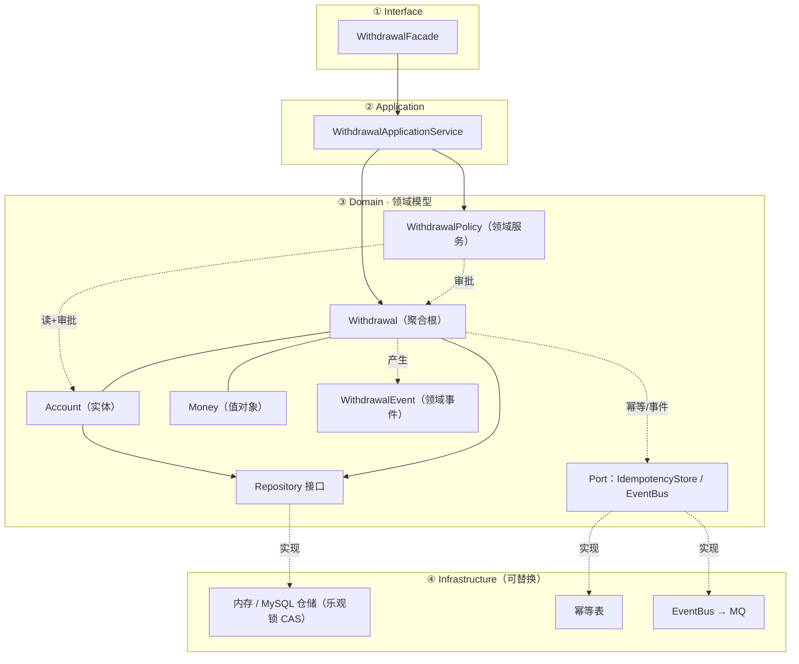
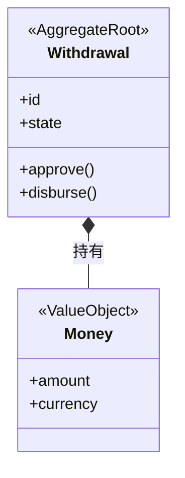
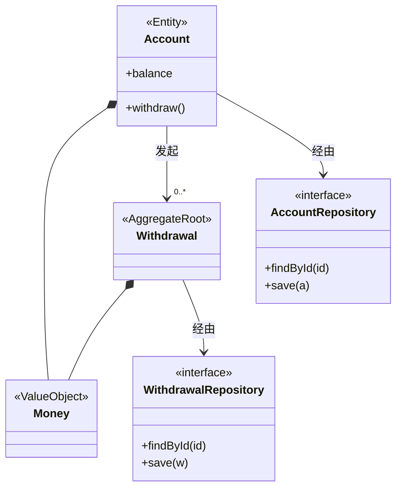
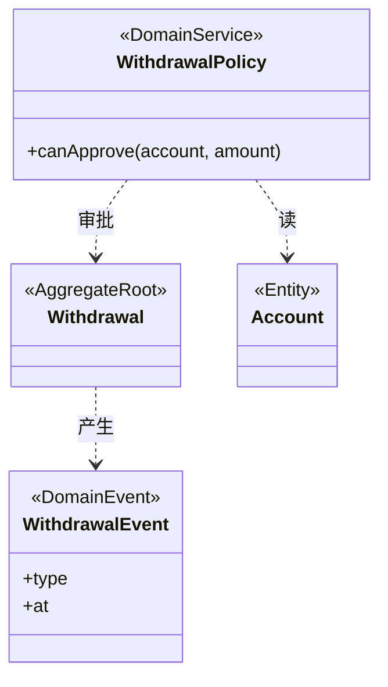
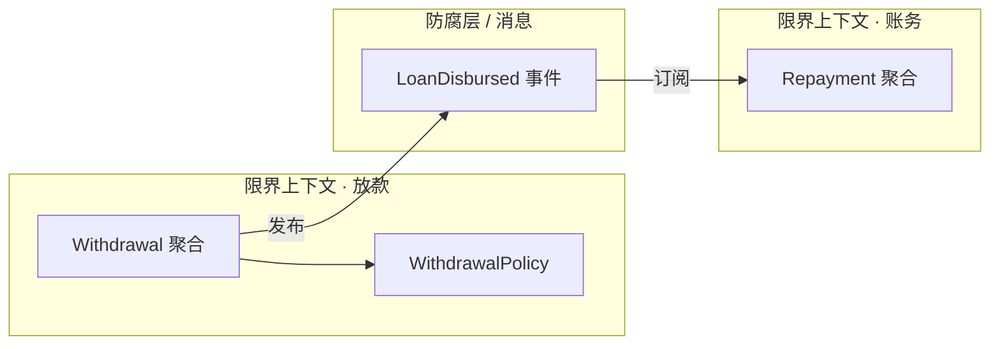
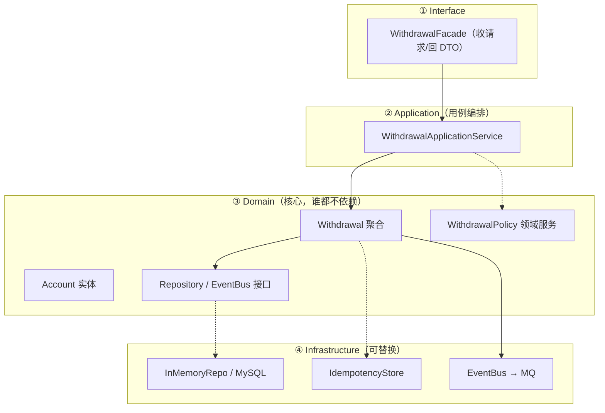
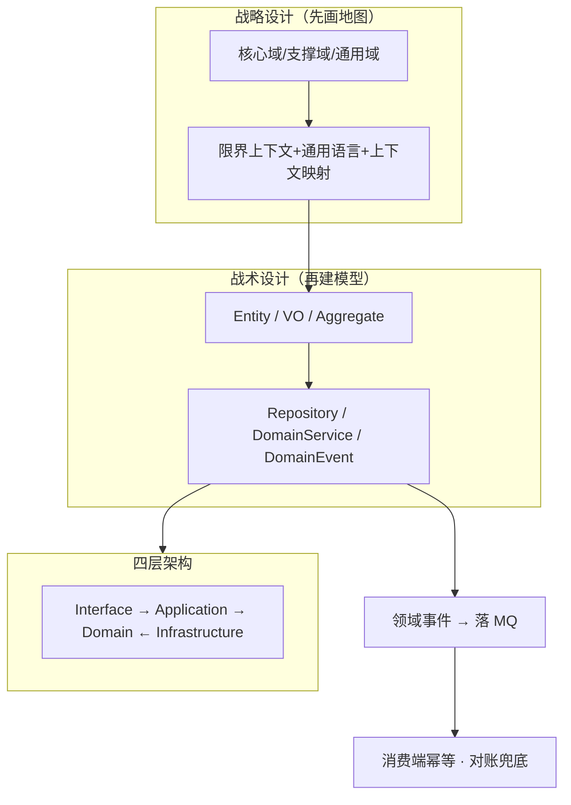

> 目标：理解 DDD 的**战略设计**与**战术设计**，掌握领域模型图的画法，学会用 **DDD 四层架构**落地一个真实业务。
>
> 学习方式：以**现金贷提现**为贯穿例，从「切边界 → 建模型 → 四层落地 → 画图」一路走过来，最后用总结回看全貌。
>
> **系列**：事务 → 锁 → 幂等 → DDD → 查询优化。[数据库事务](/blog/db-transaction) · [乐观锁与悲观锁](/blog/optimistic-pessimistic-lock) · [幂等](/blog/idempotency) · 本文 · [数据库查询性能优化](/blog/db-query-performance)。

---

## 一、背景：DDD 在解决什么

**症状**：很多项目开始很清爽，但随着迭代，出现一个「什么都能干」的上帝类、业务规则散落在一堆 Controller/工具类里——**改一处怕三处**。

**根因**：容易被**数据库表 / 框架 / Controller 牵着走**，而不是被**业务本身**带着长。

**DDD（Domain-Driven Design，领域驱动设计）的核心主张**：把「**业务复杂度**」和「**技术复杂度**」分开，让代码结构跟着**领域模型**走。

一句话：**先做对领域模型，数据库、框架、I/O 只是它的实现细节。**

---

## 二、战略设计：先切边界，再谈代码

> 战略设计回答「**哪些业务最值钱、边界画在哪、边界间怎么协作**」——这是**画地图**，先不写代码。

### 2.0 先立一个贯穿例：现金贷提现

整篇都用这个业务，后面所有概念都往它身上挂：

> **场景**：一个现金贷用户发起「提现 4000 元」——系统要**审批**（余额够不够/超没超限）→ **扣减额度** → **放款** → 通知账务记账。**账户余额 5000，用户在一台设备超时重试了一次。**

先记住这三个「角色」：`Withdrawal`（提现单）、`Account`（账户）、`Money`（金额）。后面全是它们。

### 2.1 第一步：分清主次 —— 核心域 / 支撑域 / 通用域

不是一上来就切边界，而是先问「**哪块业务最值钱**」：

| 子域类型 | 含义 | 投入策略 |
|---|---|---|
| **核心域 Core** | 决定产品竞争力、别人难复制的业务（如现金贷的**风控/授信**） | 建模精力**集中投这里**，做深做强 |
| **支撑域 Supporting** | 支撑核心业务的内部能力（如组织/账号/审批流） | 自有实现，但别过度投入 |
| **通用域 Generic** | 行业通用、有成熟方案（如**支付/消息/ID**） | 能买就买、用通用件，别自己造轮子 |

> **前端类比**：分清 App 里哪块是「主营业务/卖点」，哪块是「注册/头像」这种通用件——**别把建模精力平均撒**。只有核心域才值得上 DDD 的重建模；核心域做深，通用域省力，是战略设计的第一个决策。

### 2.2 第二步：切边界 —— 限界上下文

一个业务里，不同角色对同一个词的理解可能完全不同（「提现」在放款侧和账务侧含义不同）。**限界上下文（Bounded Context）**划定一个**自治边界**：边界内术语统一、模型自洽，**边界彼此不共享模型**。

- 现金贷里：`放款` 上下文、`账务` 上下文是**两个限界上下文**——它们的「余额」「客户」含义不同，不该混用一个类。
- **前端类比**：一个独立维护的**微前端模块**——有自己的 state、自己的接口，不跟别的模块共享内部模型。

**先问 3 个问题**帮自己判断边界：
1. 哪几个概念会各自演进、边界在哪？（`Withdrawal` 别跟账务表绑死）
2. 哪些概念共享同一套规则？（允许多个上下文共用「金额」定义吗）
3. 跨边界的依赖往哪指？（放款依赖账务？还是反过来）

### 2.3 定通用语言 Ubiquitous Language

在**同一个限界上下文内**，让产品、后端、前端说同一套话：代码类名 = 文档词 = 开会嘴里的词。

- 例：这个上下文里没有 `items`，就叫 `Withdrawal`、`Disbursement`，别发明 `WithdrawalMgr`、`UtilService`。
- **前端类比**：团队统一的产品黑话/接口约定名——别你叫「提现」、我叫「cashing」。

### 2.4 定协作 —— 上下文映射 Context Mapping

边界之间怎么协作？几种公认模式：

- **防腐层（Anti-Corruption Layer）**：上游递来一个你不想懂的概念时，在边界放一层翻译/隔离，别让它的模型污染你的领域。
- 共享内核 / 客户-供应商 / 发布语言：刻画「边界间通信契约」的不同强度。
- **前端类比**：两个微前端对接时，各自保留自己的数据结构，只在边界做一次映射。

> **战略四步走完**：拿到一张「哪些业务值钱 + 边界在哪 + 边界内统一语言 + 边界间怎么配合」的**地图**。到此还没写一行代码。

---

## 三、战术设计：领域模型的核心构件

> 地图画完，才开始搭模型。战术设计回答「**地图上的每个格子代码怎么写**」。六件套每一个都对应一个设计压力。

| 构件 | 定义 / 判断口诀 | 现金贷例子 |
|---|---|---|
| **Entity 实体** | 有唯一标识、会变、有生命周期——「它**是**谁」 | `Withdrawal`（有单号，从 申请→审批→放款 变状态） |
| **Value Object 值对象** | 无 id、不可变、靠属性相等——「它**是**什么」 | `Money(金额+币种)`、地址——**余额不该是裸 number** |
| **Aggregate 聚合** | 一组对象 + 根实体唯一入口、内部强一致——「谁**管**着谁」 | `Withdrawal` 聚合根：改状态必须走它的方法 |
| **Repository 仓储** | 聚合的存取抽象、屏蔽底层——「跟数据层说再见」 | `WithdrawalRepository.load(单号)`，不知道存哪 |
| **Domain Service 领域服务** | 不属于单个实体/值对象的业务——「跨聚合的活」 | `WithdrawalPolicy.canApprove()`：审批要同时看账户+单笔额度 |
| **Domain Event 领域事件** | 领域里发生的事、跨聚合解耦——「对外广播」 | `WithdrawalDisbursed`（放款成功）→ 落 MQ → 账务记账 |

> **前端类比（战术六件套）**：Entity ≈ 有 id 的可变数据对象；值对象 ≈ 不可变 props/坐标；聚合 ≈ 组件树根组件（state 唯一入口）；仓储 ≈ 封装的 API 层；领域服务 ≈ 抽出来的跨组件 hooks 逻辑；领域事件 ≈ Redux action / 全局事件总线。
>
> **最重要的一条规则**：外部世界（DB、外部 API、LLM SDK）只能通过 **Repository + Domain Event + Port/Adapter** 进出领域模型，**领域层不 import 任何基础设施**。

---

## 四、四层架构与依赖方向

```
      Interface (Controller / CLI / SDK 适配)
              ↓
     Application (用例编排: 组织一次提现流程)
              ↓
       Domain (领域层: Withdrawal 聚合 / Money / 政策 / 事件)  ← 核心,谁都不依赖
              ↓
   Infrastructure (DB / Redis / MQ  / 外部 SDK 的实现)
```

**铁律：依赖方向永远指向 Domain。** 想让账户从「MySQL」换成「Redis / 文件」，只换 Infrastructure；领域层一行不改。

---

## 五、完整走一遍：现金贷提现的 DDD demo

> 前面三个概念（战略/战术/四层），现在用一个真实例子串起来——**看领域模型怎么从「想法」变成「能跑的代码」，以及锁 / 幂等这些一致性逻辑被隔离到哪一层**。

### 5.1 一次提现走遍四层

| 层 | 干的事 | 代码里的体现 |
|---|---|---|
| **Interface** | 收请求 / 回 DTO | `WithdrawalFacade`：请求参数在门口变 `Money` 领域对象 |
| **Application** | 用例编排（不含业务规则） | `WithdrawalApplicationService`：幂等 → 审批 → 扣款 → 发事件 |
| **Domain** | 领域规则 + 状态机 | `Withdrawal` 聚合的 `approve()`/`disburse()`、`Account.withdraw()`、`WithdrawalPolicy` |
| **Infrastructure** | 可替换的「具体实现」 | 内存仓储（乐观锁 CAS）、幂等表、`EventBus→MQ`（换了实现即可上生产） |

调用链：`Interface → Application → Domain(Withdrawal) → Infrastructure(存储/消息)`，返回再走回来。**Domain 在最里层、不依赖任何上层。**

### 5.2 提现 demo 的领域架构图

先把「提现」的领域架构看清楚，再看 5.3 的代码——**核心是：Domain 里只有领域对象 + 接口，锁 / 幂等 / 消息都是靠接口接出去、由 Infrastructure 实现**：



> **读图要点**：
> - 最中心是 **Domain**，它只依赖**自己内部的接口**（`Repository` / `Port`），不 import 任何实现。
> - `Withdrawal` 是聚合根，是状态的唯一入口（改状态 / 触发事件只能走它）；`Money` 是不可变值对象。
> - 实线 = 聚合内的包含/关联；虚线 = 依赖；`.实现` = Infrastructure 把接口接上。
> - **锁（乐观锁）、幂等、事件落 MQ 全部靠接口「接出去」**——换 MySQL / Redis / Kafka 只改 `④`，Domain 一行不动。

### 5.3 完整代码（对应目录）

```
src/withdrawal/
├── domain/          # Money, Account, Withdrawal, 事件, 仓储接口, 政策, EventBus 端口 —— 不 import 任何基础设施
├── application/     # WithdrawalApplicationService —— 用例编排
├── infrastructure/  # 内存仓储 / 幂等表 / 事件总线（可换成 Redis/MQ/DB）
├── interface/       # WithdrawalFacade —— 收请求 / 回 DTO
└── main.ts          # 装配（组合根）：把实现接到接口上
```

**① Domain —— 值对象 / 实体 / 聚合根**

```ts
// domain/values.ts —— 值对象：不可变、靠内容相等（Money 不裸用 number，规则收进类型）
export class Money {
  constructor(readonly amount: number, readonly currency: string = 'CNY') {}
  equals(o: Money) { return this.amount === o.amount && this.currency === o.currency; }
  subtract(o: Money): Money {
    if (o.amount > this.amount) throw new BusinessError('余额不足');
    return new Money(this.amount - o.amount, this.currency);
  }
}

// domain/account.ts —— 实体 + 乐观锁 version（呼应「乐观锁」一文）
export class Account {
  constructor(readonly id: string, private _balance: Money, private _version = 0) {}
  get balance() { return this._balance; }
  get version() { return this._version; }
  canWithdraw(m: Money) { return m.amount <= this._balance.amount; }
  withdraw(m: Money) {                       // 业务规则写进实体（充血模型）
    if (!this.canWithdraw(m)) throw new BusinessError('余额不足');
    this._balance = this._balance.subtract(m);
    this._version += 1;                      // 版本递增 → 持久化时 CAS
  }
}

// domain/withdrawal.ts —— 聚合根：状态机 + 领域事件，不变量只在聚合内守住
export type WithdrawalState = 'REQUESTED' | 'APPROVED' | 'REJECTED' | 'DISBURSED';
export type WithdrawalEvent =
  | { type: 'WithdrawalRequested'; id: string; amount: Money }
  | { type: 'WithdrawalApproved'; id: string }
  | { type: 'WithdrawalRejected'; id: string; reason: string }
  | { type: 'WithdrawalDisbursed'; id: string };

export class Withdrawal {
  private _state: WithdrawalState = 'REQUESTED';
  private _events: WithdrawalEvent[] = [];
  constructor(readonly id: string, readonly accountId: string, readonly amount: Money) {}

  get state() { return this._state; }

  approve() {
    this.assertState('REQUESTED');
    this._state = 'APPROVED';
    this._events.push({ type: 'WithdrawalApproved', id: this.id });
  }
  reject(reason: string) {
    this.assertState('REQUESTED');
    this._state = 'REJECTED';
    this._events.push({ type: 'WithdrawalRejected', id: this.id, reason });
  }
  disburse() {                               // ⛔ 未审批直接放款 = 被聚合根拦下（状态机不变量）
    this.assertState('APPROVED');
    this._state = 'DISBURSED';
    this._events.push({ type: 'WithdrawalDisbursed', id: this.id });
  }
  pullEvents(): WithdrawalEvent[] { const e = this._events; this._events = []; return e; }
  private assertState(s: WithdrawalState) {
    if (this._state !== s) throw new BusinessError(`状态 ${this._state} 不允许该操作（需 ${s}）`);
  }
}
```

**② Domain —— 仓储接口 + 端口 + 领域服务（都不实现）**

```ts
// domain/repositories.ts —— 接口面向【聚合】、用领域语言，不是 DAO
export interface AccountRepository {
  findById(id: string): Account | undefined;
  save(account: Account): void;              // 乐观锁：version 对不上抛冲突
}
export interface WithdrawalRepository {
  findById(id: string): Withdrawal | undefined;
  save(w: Withdrawal): void;
}
export interface IdempotencyStore {          // 幂等放到领域端口
  tryAcquire(key: string, hash: string): boolean;  // 同一 key 只成功一次
  getResponse(key: string): unknown;
  setResponse(key: string, resp: unknown): void;
}

// domain/message-bus.ts —— 事件端口（Port）：领域只管「发什么」，不管「发去哪」
export interface EventBus { publish(topic: string, event: unknown): void; }

// domain/withdrawal-policy.ts —— 领域服务：跨聚合的审批规则（不属于单个实体）
export interface WithdrawalPolicy {
  canApprove(account: Account, amount: Money): { ok: boolean; reason?: string };
}
export class MaxAmountWithdrawalPolicy implements WithdrawalPolicy {
  constructor(private maxPerTx: number) {}
  canApprove(account: Account, amount: Money) {
    if (amount.amount > this.maxPerTx)         return { ok: false, reason: '超过单笔限额' };
    if (!account.canWithdraw(amount))          return { ok: false, reason: '余额不足' };
    return { ok: true };
  }
}
```

**③ Application —— 用例编排（不写业务规则）**

```ts
// application/withdrawal-service.ts
export class WithdrawalApplicationService {
  constructor(
    private accounts: AccountRepository,
    private withdrawals: WithdrawalRepository,
    private store: IdempotencyStore,
    private policy: WithdrawalPolicy,
    private bus: EventBus,
  ) {}

  // 用例①申请提现：幂等 → 规则 → 扣款(乐观锁) → 发布事件
  apply(cmd: { requestId: string; accountId: string; amount: Money }): WithdrawalState {
    const hash = `${cmd.accountId}:${cmd.amount}`;
    if (!this.store.tryAcquire(cmd.requestId, hash)) {          // 幂等
      return this.store.getResponse(cmd.requestId) as WithdrawalState;
    }
    const account = this.mustAccount(cmd.accountId);
    const w = new Withdrawal(cmd.requestId, cmd.accountId, cmd.amount);
    const d = this.policy.canApprove(account, cmd.amount);
    if (!d.ok) w.reject(d.reason!);
    else {
      w.approve();
      account.withdraw(cmd.amount);                             // 聚合内不变量
      this.accounts.save(account);                              // 乐观锁 CAS
    }
    this.withdrawals.save(w);
    this.publish(w.pullEvents());
    this.store.setResponse(cmd.requestId, w.state);
    return w.state;
  }

  // 用例②放款：状态机挡着——不是 APPROVED 就放不了款
  disburse(cmd: { requestId: string }): void {
    const w = this.mustWithdrawal(cmd.requestId);
    w.disburse();
    this.withdrawals.save(w);
    this.publish(w.pullEvents());
  }

  private publish(es: WithdrawalEvent[]) { for (const e of es) this.bus.publish('withdrawal', e); }
  private mustAccount(id: string) { const a = this.accounts.findById(id); if (!a) throw new BusinessError('账户不存在'); return a; }
  private mustWithdrawal(id: string) { const w = this.withdrawals.findById(id); if (!w) throw new BusinessError('提现单不存在'); return w; }
}
```

**④ Infrastructure —— 具体实现（都可替换）**

```ts
// infrastructure/repos.ts
export class InMemoryAccountRepo implements AccountRepository {
  private rows = new Map<string, Account>();
  findById(id: string) { return this.rows.get(id); }
  save(account: Account) {
    const old = this.rows.get(account.id);
    if (old && old.version !== account.version - 1) throw new ConcurrencyError('乐观锁冲突，请重试');
    this.rows.set(account.id, account);       // 换成 MySQL：UPDATE ... SET version=version+1 WHERE version=?
  }
}
export class InMemoryWithdrawalRepo implements WithdrawalRepository {
  private rows = new Map<string, Withdrawal>();
  findById(id: string) { return this.rows.get(id); }
  save(w: Withdrawal) { this.rows.set(w.id, w); }
}
export class UniqueIdempotencyStore implements IdempotencyStore {
  private keys = new Map<string, { hash: string; resp: unknown }>();
  tryAcquire(key: string, hash: string) { if (this.keys.has(key)) return false; this.keys.set(key, { hash, resp: undefined }); return true; }
  getResponse(key: string) { return this.keys.get(key)?.resp; }
  setResponse(key: string, resp: unknown) { const it = this.keys.get(key); if (it) it.resp = resp; }
}
export class LogEventBus implements EventBus {          // 换 Kafka/RocketMQ 即可
  publish(topic: string, e: unknown) { console.log(`[MQ:${topic}]`, e); }
}
```

**⑤ Interface + 装配 + 运行轨迹**

```ts
// interface/withdrawal-facade.ts —— 收请求/回 DTO（散发的请求参数在门口变领域对象）
export class WithdrawalFacade {
  constructor(private svc: WithdrawalApplicationService) {}
  apply(raw: { requestId: string; accountId: string; amount: number }) {
    const state = this.svc.apply({ requestId: raw.requestId, accountId: raw.accountId, amount: new Money(raw.amount) });
    return { requestId: raw.requestId, state };          // 返回 DTO，不带领域对象出去
  }
}

// main.ts —— 组合根：把「实现」接到「接口」，依赖方向指向 Domain
const accounts = new InMemoryAccountRepo();
accounts.save(new Account('acc-1', new Money(5000)));
const svc = new WithdrawalApplicationService(
  accounts, new InMemoryWithdrawalRepo(), new UniqueIdempotencyStore(),
  new MaxAmountWithdrawalPolicy(20000), new LogEventBus(),
);
const facade = new WithdrawalFacade(svc);

// —— 运行轨迹 ——
facade.apply({ requestId: 'w-1', accountId: 'acc-1', amount: 4000 }); // ✅ APPROVED，余额 5000→1000
facade.apply({ requestId: 'w-1', accountId: 'acc-1', amount: 4000 }); // ⏭ 幂等：返回 APPROVED，不重复扣
svc.disburse({ requestId: 'w-1' });                                   // ✅ DISBURSED
// 控制台： [MQ:withdrawal] { type: 'WithdrawalApproved', ... }
//        [MQ:withdrawal] { type: 'WithdrawalDisbursed', ... }
```

### 5.4 这个 demo 的 DDD 在哪儿

| 你该看到的点 | 对应原理 |
|---|---|
| `Account.withdraw` 把「余额不足」写进实体 | **充血模型**（规则归对象，不是堆 Service） |
| `Withdrawal.disburse()` 拦「未审批就放款」 | **聚合根守不变量**的唯一入口 |
| `AccountRepository` / `IdempotencyStore` 只是**接口** | **依赖倒置**：Domain 不 import 实现 |
| `WithdrawalPolicy` 是类 Service | **领域服务**：跨聚合的活 |
| `Account.version + 1` + repo 的 CAS | **乐观锁**落到 Infrastructure（见[乐观锁与悲观锁](/blog/optimistic-pessimistic-lock)） |
| `tryAcquire(requestId)` | **幂等**落到 Infrastructure（见[幂等](/blog/idempotency)） |
| `EventBus.publish` | **领域事件**出域落 MQ |
| `main.ts` 把实现接上接口 | **组合根**：换存储/换 MQ 只改这里，Domain 一行不动 |

---

## 六、领域模型 vs 数据模型（两个维度，不是宏观微观）

> 一句话：领域模型回答「业务**怎么运转**、规则放哪」；数据模型回答「数据**怎么存**、怎么查」。两者是**不同维度**而非大小关系，且**彼此可以不一致**——DDD 的核心分水岭就是「领域模型是主角，数据库只是它的持久化仆人」。

### 6.1 一张表对照

| | 领域模型设计 | 数据库模型设计 |
|---|---|---|
| 灵魂问题 | 业务**怎么运转**？ | 数据**怎么存**？ |
| 对象 | 活的行为：实体/值对象/聚合/状态机/事件 | 死的结构：表/字段/关系/索引/约束 |
| 语言 | 领域语言 `withdrawal.canWithdraw()` | 存储语言 `withdrawals` / `FOREIGN KEY` |
| 关心 | 规则放哪、不变量怎么保证 | 查得快、不冗余、完整性 |
| 服务 | 业务逻辑 | 持久化与查询 |
| 设计时序 | **先**（领域驱动） | **后**（实现细节） |
| 形态可不同？ | ✅ 一个领域对象可拆多表 | ✅ 一个概念可跨 MySQL/Redis/向量库 |

### 6.2 用 5.2 demo 落地

| 领域对象（5.2 demo） | 落到数据库可能是 |
|---|---|
| `Withdrawal` 聚合（状态机） | `withdrawal` 表 + `state` 列 |
| `Money` 值对象（amount+currency） | 拆成 `amount DECIMAL` + `currency CHAR(3)` **两列** |
| `Account.withdraw()` 「余额不足」规则 | 只有 `balance` 字段 + 表约束，**没有「方法」** |
| `WithdrawalEvent`（领域事件） | **不落库**，直接发布到 MQ |
| 聚合含多个明细 | 拆成 `orders` + `order_items` **两张表** |

> 领域模型的一个对象，库表可能存两张；领域里的一个事件，库表里根本不存——这正是「领域模型 ≠ 数据模型」。

### 6.3 为什么说「不同维度」而非「宏观微观」

- 领域设计本身**既有宏观**（战略：切边界/定子域）**也有微观**（战术：上下文内部建模）。
- 数据库建模同样**既有宏观**（整体 schema/范式）**也有微观**（列/索引）。
- 所以用「宏观/微观」去分这两者是**错位的**；正确的分法是：**一个管「行为」，一个管「存储」，是两个正交维度**。

---

## 七、怎么画领域模型架构图（从简单到复杂）

> 原则：**先画核心，再逐步补全——永远先保证「看得懂」，再追求「画得全」**。下面用同一张「现金贷提现」地图，从最简单一路画到完整版。

### 7.1 符号约定

| 形状 | 表示 |
|---|---|
| 实线框 / `<<AggregateRoot>>` | Entity / 聚合根 |
| 虚线框 / `<<ValueObject>>` | 值对象 |
| `<<interface>>` 接口 | Repository / Port |
| 实线箭头 + `1..*` | 包含/引用关系、多重度 |
| 虚线箭头 / 依赖 | 类图用 `..>`、流程图用 `-.->`（领域服务读对象、聚合产生事件） |
| 独立框 | 限界上下文边界 |

### 7.2 Level 1 —— 只有核心聚合根（先抓住「谁」）

只画**最核心的一个聚合根 + 它直接管的值对象**：



### 7.3 Level 2 —— 补上实体、仓储与关系

在这个上下文里补第二个实体（`Account`）+ 两个 `Repository` 接口，标清多重度：



### 7.4 Level 3 —— 加跨聚合的领域服务 + 领域事件

把「不属于单个实体」的审批规则、和「要让别处知道」的事件画出来：



### 7.5 Level 4 —— 加「边界」：限界上下文 + 上下文映射

不再一个图塞所有类，而是把**上下文画成独立框**，框间只留协作契约（防腐层/消息）：



> 边界原则：框内的模型**不跨框共享**；跨框协作只走「事件 / 防腐层 / 共享内核」。

### 7.6 Level 5 —— 完整版：战略 + 战术 + 分层 + 基础设施

把端口/适配器、四层依赖方向、事件落 MQ 一张图画全（= 项目的「全景图」）：



### 7.7 画图口诀 & 常见坑

- **口诀**：先聚合根 → 再值对象/关系 → 再仓储/领域服务 → 再事件 → 再边界 → 最后补分层/基础设施。
- **别画这些**：❌ 数据表 / ❌ Controller / ❌ 底层框架类名（除非是 Port 的实现，放在 Infrastructure）。
- 一张图放不下就**拆成几张**（Level 1~4 各一张），别硬塞一张巨型图。
- 复杂图可交给 HTML/SVG，**默认先用 Mermaid**：好用、易改。

---

## 八、常见误解 / 反模式（新手最容易踩的坑）

### 8.1 六个高频误解

| # | 误解 | 正解 |
|---|---|---|
| 1 | 「DDD = Entity/Repository/领域服务 那堆战术模式」 | **错**。DDD 的核心是**战略设计（限界上下文 + 通用语言）**；战术只是落地零件。只有战术、没有战略，叫「用着 DDD 名词的 CRUD」。 |
| 2 | 「实体 vs 值对象分不清」 | 口诀：**有唯一标识、会变、有生命周期 → 实体**（`Withdrawal`）；**只看内容、不可变、相等靠属性 → 值对象**（`Money`）。犹豫时优先倾向值对象。 |
| 3 | 「聚合越大越完整」 | **反了**。聚合要**小**——它代表一个**强一致边界**，越大越被并发卡死（锁变粗）。拿不准就拆小。 |
| 4 | 「领域对象 = 只有 getter/setter」（贫血模型） | 否，要**充血模型**：业务规则写在实体/值对象里，别全堆进 Service——否则 Service 越来越肿、变「上帝对象」。 |
| 5 | 「Repository 就是 DAO / 表驱动 CRUD」 | **否**。Repository 面向**聚合**、用领域语言（`findByWithdrawalNo`），不是表字段的增删改查映射。 |
| 6 | 「用了 Spring/依赖注入 就是 DDD」 | 依赖注入是通用常识，不是 DDD 的标识；DDD 看的是领域模型的边界与归属。 |

### 8.2 两个反模式（看到就重构）

- **基础设施漏进领域层**：领域类里 `import` 了数据库 / HTTP SDK / JSON 库 —— 领域层必须与具体实现解耦（靠 Repository / Port）。
- **上帝对象 God Object**：一个 Service 管所有聚合、什么逻辑都往里塞——恰恰是第 1 节「背景」里要治的病。

---

## 九、本章总结 / 一图回顾

### 9.1 一图看完 DDD



### 9.2 三句话带走

1. **DDD 先想「业务怎么运转、边界在哪」（战略），再想「代码怎么写」（战术）；数据库只是实现细节。**
2. **四层铁律：依赖永远指向 Domain；外界只能通过 Repository / Port / 事件进出领域。**
3. **DDD 管「乱不乱」，一致性那套管「错不错」**——领域事件落 MQ → 消费端幂等 → 对账兜底，两者配合，不是替代。

### 9.3 自测

1. **一个「先建表再反推类」的项目，违背了 DDD 的哪个主张？** ——领域驱动：应先想领域模型，表只是持久化实现细节。
2. **聚合为什么要小？** ——它是强一致边界=锁粒度，越大并发越差。
3. **`WithdrawalPolicy` 为什么是领域服务而不是实体的方法？** ——它要跨多个聚合（账户 + 单笔额度）做判断。
4. **一个领域对象可以拆成两张表吗？** ——可以，这就是「领域模型 ≠ 数据模型」；表的拆法是 Infrastructure 的事。

---

## 十、面试速记

- 战略：**限界上下文 + 通用语言 + 上下文映射（先定主次：核心/支撑/通用域）**。
- 战术：**Entity / VO / Aggregate / Repository / DomainService / DomainEvent**。
- 铁律：**依赖指向 Domain；外部世界只从 Repository + 事件进**。
- 领域模型 vs 数据模型：**行为维度 vs 存储维度，不是宏观微观，可以不一致**。
- 一句话答案：「我先分限界上下文定通用语言，再用聚合根封装不变量，外部数据源收敛到 Repository，领域层不依赖任何框架，所以换中间件成本极低。」
- **串链**：DDD 负责「把业务拆清、事件化」——限界上下文切边界；跨边界的 Domain Event 落 MQ，消费端要[幂等](/blog/idempotency)、对账兜底。DDD 管「代码怎么组织」，一致性靠 [事务](/blog/db-transaction)/[锁](/blog/optimistic-pessimistic-lock)/幂等 那套——两者配合。
