> **一句话定义**：Harness 工程是通过 Prompt + Skills + Hooks + 状态机 + DAG + Gate 的协同编排，将 AI 的非确定性输出约束为确定性的、符合人类预期的可靠产出。

---

## 前置知识：Agent 是怎么工作的？

在理解 Harness 之前，需要先理解 AI Agent 的基本工作原理。

### Agent ≠ LLM

- **LLM**（大语言模型）：只会"说话"——你给它文本，它回你文本
- **Agent**：会"干活"——它能调用工具、读文件、执行命令、访问 API

Agent = LLM + 工具调用循环（Agent Loop）

### Agent Loop：核心执行原理

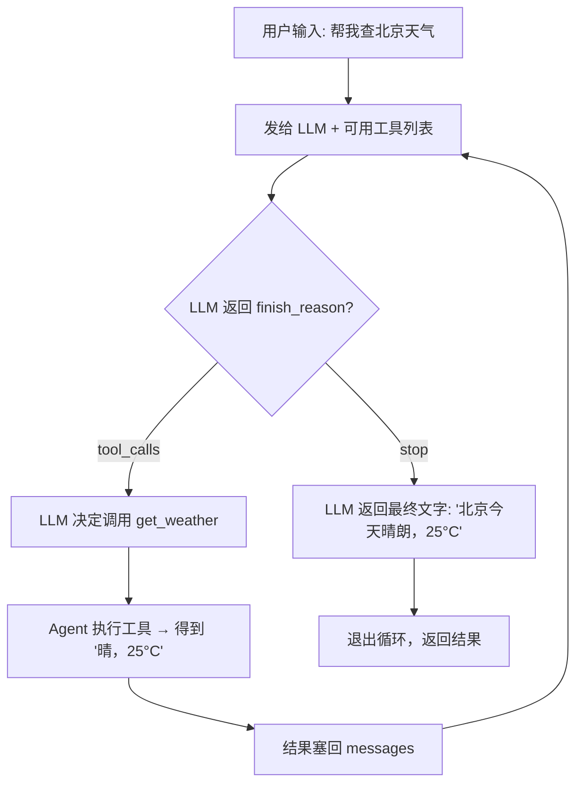

### 三个关键认知

**1. LLM 只负责"决策"，不负责"执行"**

```
LLM 输出的不是代码执行结果，而是一段 JSON：
{
  "tool_calls": [{
    "function": { "name": "get_weather", "arguments": "{\"city\":\"北京\"}" }
  }]
}
```

真正去调 API 的是 Agent 层代码，不是 LLM。

**2. finish_reason 决定循环是否继续**

| finish_reason | 含义 | Agent 的动作 |
|--------------|------|-------------|
| `"tool_calls"` | LLM 想调工具 | 执行工具 → 结果塞回 messages → 继续循环 |
| `"stop"` | LLM 生成了最终回复 | 退出循环，返回结果 |

**3. 工具的 description 是 LLM 的"说明书"**

LLM 完全靠工具的 `description` 字段决定要不要调用、传什么参数。description 写得越清晰，AI 调用越准确。

### 最简 Agent 伪代码

```typescript
async function agentLoop(userMessage: string) {
  const messages = [
    { role: 'system', content: '你是一个助手' },
    { role: 'user', content: userMessage }
  ];

  while (true) {
    // 1. 调用 LLM
    const response = await callLLM(messages, tools);

    // 2. 判断是否需要调用工具
    if (response.finish_reason === 'tool_calls') {
      for (const call of response.tool_calls) {
        // 3. 执行工具
        const result = await executeTool(call.function.name, call.function.arguments);
        // 4. 结果塞回对话
        messages.push({ role: 'tool', tool_call_id: call.id, content: result });
      }
      continue; // 继续循环
    }

    // 5. LLM 返回最终文字 → 退出
    return response.content;
  }
}
```

### 问题来了：这个循环太"自由"了

Agent Loop 本身没有任何约束——LLM 想调什么工具就调什么，想输出什么格式就什么格式，想执行几轮就几轮。

这正是 Harness 要解决的问题：**在这个循环的每一个环节加上引导和约束**。

---

## 为什么需要 Harness？

AI（LLM）的本质是一个概率系统——同样的输入，可能产出不同的输出。这在聊天场景下可以接受，但在工程场景下是致命的：

| 场景 | 没有 Harness | 有 Harness |
|------|-------------|-----------|
| 代码生成 | 缺少 import、格式不一致、逻辑有漏洞 | 自动补全依赖、风格统一、通过编译检查 |
| 文档撰写 | 结构随机、遗漏关键章节 | 严格按模板、逐节校验完整性 |
| 任务执行 | 跳步骤、漏操作、重复执行 | 按 DAG 顺序执行、每步有门禁检查 |
| 多轮交互 | 上下文丢失、前后矛盾 | 状态持久化、一致性保障 |

**Harness 的目标不是限制 AI 的创造力，而是在概率系统上构建确定性保障。**

---

## 核心架构：六大组件协同

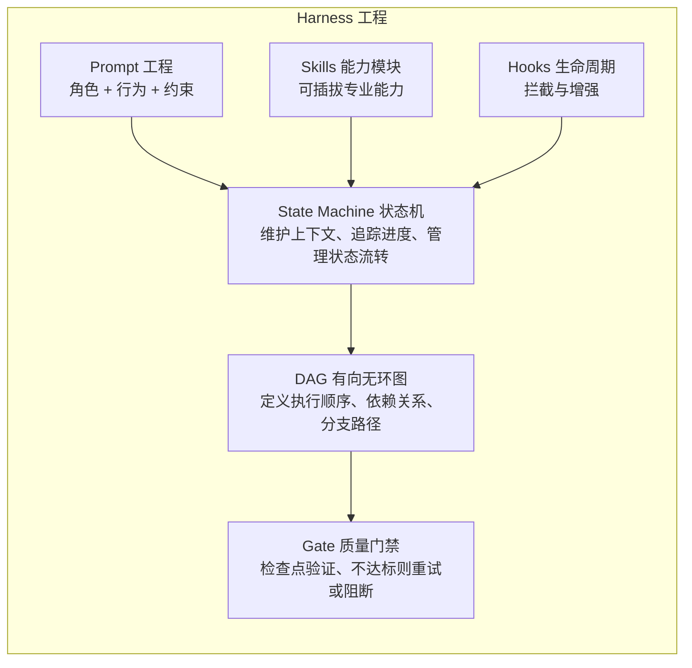

---

## 组件一：Prompt 工程 — 告诉 AI "你是谁、做什么、怎么做"

Prompt 是 Harness 的**基础层**，决定 AI 行为的起点。

### 三个维度

| 维度 | 作用 | 示例 |
|------|------|------|
| **角色定义** | 告诉 AI 它是谁 | "你是一个严谨的代码审查员" |
| **行为指令** | 告诉 AI 怎么做 | "先读文件，再分析，最后给建议" |
| **约束条件（Constraints）** | 告诉 AI 什么不能做 | "禁止猜测文件内容，必须先用工具读取" |

### 工程化管理

在本项目中，Prompt 不是硬编码的字符串，而是通过 **Rules 系统**（第11课）实现模块化管理：

```
rules/
├── safety.md           ← priority: 100，安全规则
├── coding-style.md     ← priority: 50，代码风格
└── response-format.md  ← priority: 30，输出格式
```

每条 Rule 是独立的 Markdown 文件，按优先级动态组合注入 System Prompt。修改一条规则不影响其他规则，支持按场景组合不同的规则集。

### 版本管理

Prompt 像代码一样管理版本（第34课）：
- Git 追踪每次变更
- 支持 A/B 测试不同版本
- 效果下降时一键回滚

---

## 组件二：Skills — 可插拔的能力模块

Skills 是 Harness 的**能力层**，让 AI 拥有领域专家级的执行力。

### 设计理念

一个 Skill = **工具集 + 专业 Prompt + 配置**，打包成独立模块，按需加载。

```
skills/
├── code-review/
│   └── SKILL.md        ← 声明式定义：工具 + Prompt + 触发条件
└── doc-generator/
    └── SKILL.md
```

### 关键特性

- **模块化**：每个 Skill 独立开发、独立测试
- **按需加载**：只有任务需要时才激活，不会污染上下文
- **渐进披露**：避免一次性把所有工具塞给模型（减少混淆）
- **跨语言**：Skill 内部的脚本可以是任意语言（Python、Shell、Node.js）

### 与 Prompt 的协同

Skill 被激活时，会同时注入：
1. 相关的工具定义（让 AI 能调用）
2. 专业的 Prompt 片段（让 AI 知道怎么用好这些工具）

---

## 组件三：Hooks — 生命周期拦截与增强

Hooks 是 Harness 的**切面层**，在 AI 执行流程的关键节点注入控制逻辑。

### 核心机制

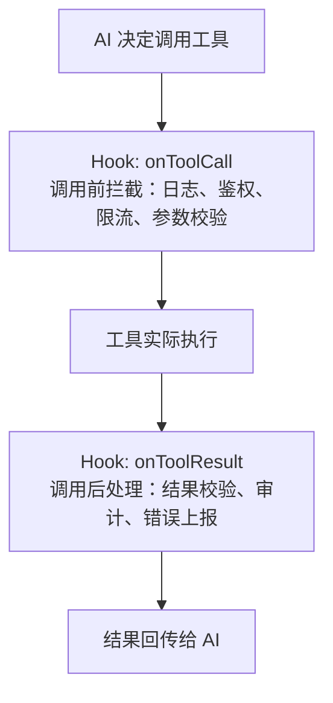

### 典型应用

| Hook | 场景 | 作用 |
|------|------|------|
| **日志中间件** | 所有工具调用 | 记录入参、出参、耗时 |
| **白名单中间件** | 安全控制 | 只允许调用指定工具 |
| **限流中间件** | 防止死循环 | 同一工具短时间内最多调用 N 次 |
| **Human-in-the-Loop** | 高风险操作 | 暂停执行，等人确认后继续 |

### Human-in-the-Loop（人类介入）

这是 Hooks 最重要的应用——在关键决策点暂停 AI 执行，交由人类判断：

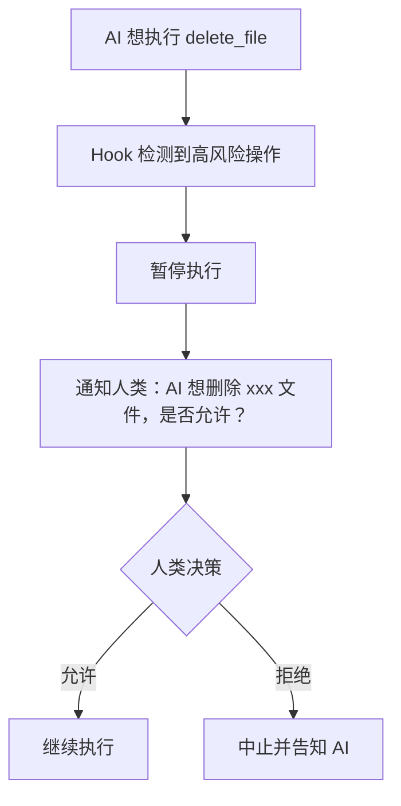

### Hooks 在 Agent 生命周期中的完整位置

以下是一个典型 Agent SDK 支持的全部 Hook 事件，以及它们在执行流程中的精确触发位置：

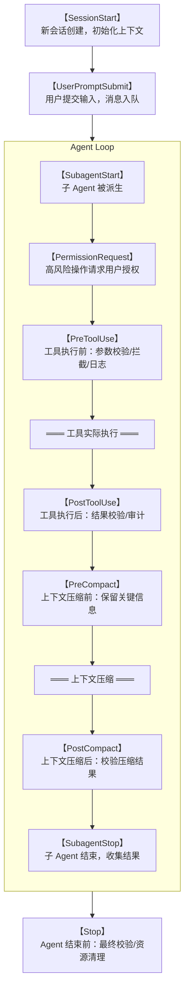

各 Hook 按职责分为五层：

| 层级 | Hook | 作用 |
|------|------|------|
| **会话层** | `SessionStart` / `Stop` | 生命周期边界，初始化与清理 |
| **输入层** | `UserPromptSubmit` | 拦截/增强用户输入 |
| **工具层** | `PreToolUse` / `PermissionRequest` / `PostToolUse` | 工具调用的完整切面控制 |
| **上下文层** | `PreCompact` / `PostCompact` | 上下文压缩前后的干预 |
| **协作层** | `SubagentStart` / `SubagentStop` | 多 Agent 协作的编排节点 |

---

## 组件四：State Machine（状态机） — 维护上下文与进度

状态机是 Harness 的**记忆层**，解决 AI "无状态" 的本质缺陷。

### 解决的问题

LLM 本身是无状态的——每次调用都是独立的。状态机负责：

1. **上下文持久化**：跨轮次、跨会话保持信息一致性
2. **进度追踪**：复杂任务执行到哪一步了
3. **断点续传**：中断后能从上次完成的步骤继续
4. **状态流转**：任务从 pending → running → completed 的规范化流转

### 实现方式

```
TaskState {
  status: "running" | "completed" | "failed" | "paused"
  currentStep: 3
  completedSteps: [step1_result, step2_result, step3_result]
  context: { ... }      ← 累积的上下文信息
  checkpoint: { ... }   ← 最新检查点，用于恢复
}
```

### 与 Memory 系统的区别

| | State Machine | Memory |
|---|---|---|
| **关注点** | 当前任务的执行状态 | 跨任务的长期知识 |
| **生命周期** | 任务结束即可清除 | 永久保存 |
| **内容** | 步骤进度、中间结果 | 用户偏好、历史决策 |

两者协同：Memory 为状态机提供历史上下文（"用户上次偏好 X 方案"），状态机为 Memory 提供新的事实（"本次任务选择了 Y 方案"）。

---

## 组件五：DAG（有向无环图） — 定义执行顺序与依赖

DAG 是 Harness 的**编排层**，将复杂任务分解为有依赖关系的步骤网络。

### 为什么需要 DAG？

简单的线性执行（Step1 → Step2 → Step3）无法表达真实任务的复杂性：

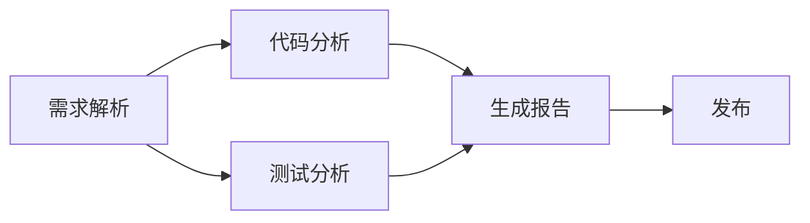

- "代码分析"和"测试分析"可以**并行**
- "生成报告"必须等两个分析都完成后才能开始
- 任何一个分析失败，后续节点都不应执行

### DAG 的核心要素

| 要素 | 说明 |
|------|------|
| **节点（Node）** | 一个原子执行单元（一次 LLM 调用 + 工具调用） |
| **边（Edge）** | 依赖关系：A → B 表示 B 依赖 A 的结果 |
| **无环** | 禁止循环依赖，确保任务必然终止 |
| **并行** | 无依赖关系的节点可并行执行 |
| **汇聚** | 多个前置节点完成后才触发后续节点 |

### 与 Planning 的关系

- **Planning**（第20课）：AI 自己制定计划（动态、灵活、但不确定）
- **DAG**：人预定义的执行拓扑（静态、确定、可验证）

Harness 中两者结合：**人定义 DAG 骨架，AI 在每个节点内自主执行**。

---

## 组件六：Gate（质量门禁） — 不达标不放行

Gate 是 Harness 的**质量层**，在关键节点设置检查点，确保每一步的输出都符合预期。

### 核心理念

**永远不要相信 AI 的"第一次输出"就是正确的。** Gate 在每个关键节点插入验证：

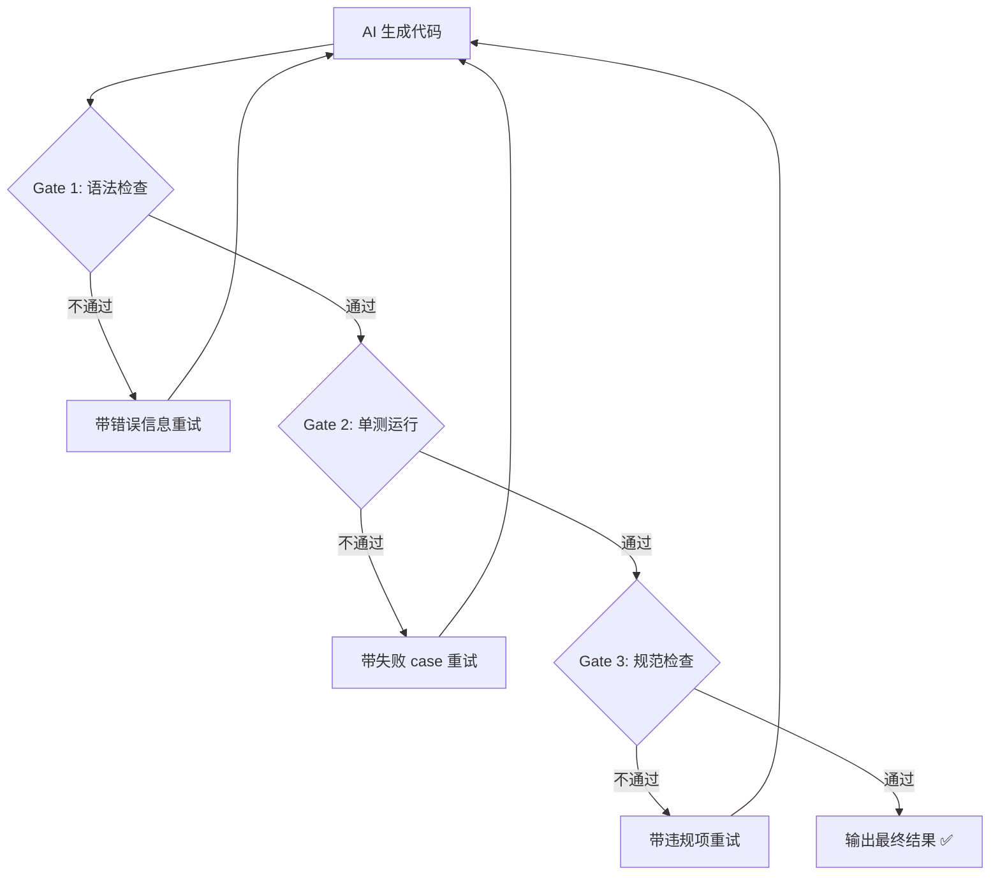

### Gate 的类型

| 类型 | 实现方式 | 适用场景 |
|------|---------|---------|
| **规则 Gate** | 正则匹配、Schema 校验 | 格式检查、字段完整性 |
| **工具 Gate** | Lint、编译器、测试框架 | 代码质量 |
| **模型 Gate** | 用另一个 LLM 评审 | 语义质量、逻辑一致性 |
| **人工 Gate** | 人类确认 | 高风险决策、最终发布 |

### Feedback Loop：Gate 不通过时的处理

Gate 不是简单的"通过/拒绝"，而是构成完整的反馈闭环：

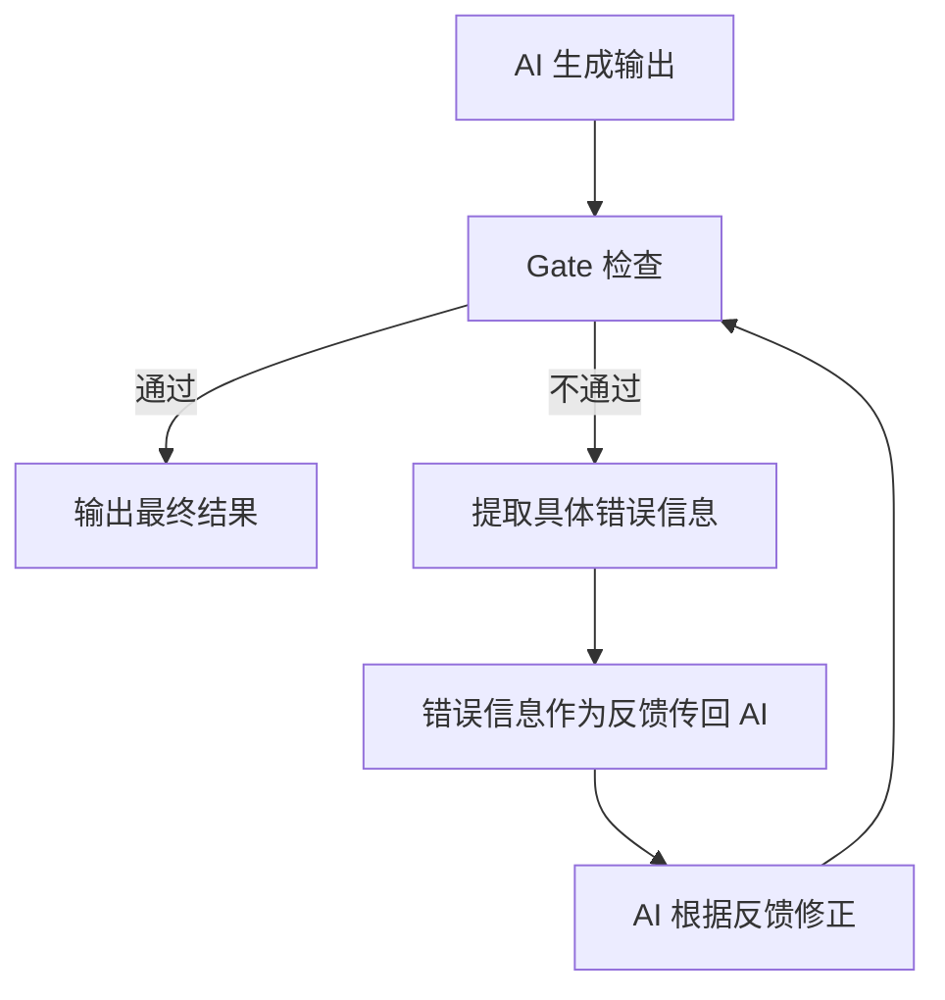

**关键设计**：
- 反馈信息要**具体**（不是"错了重来"，而是"第3行缺少分号"）
- 重试次数有**上限**（通常 2-3 次，超过则降级或求助人工）
- 每次重试带上**历史尝试**（避免重复犯同一个错）

---

## 六大组件的协同关系

单独看每个组件都不复杂，Harness 工程的核心在于**协同**：

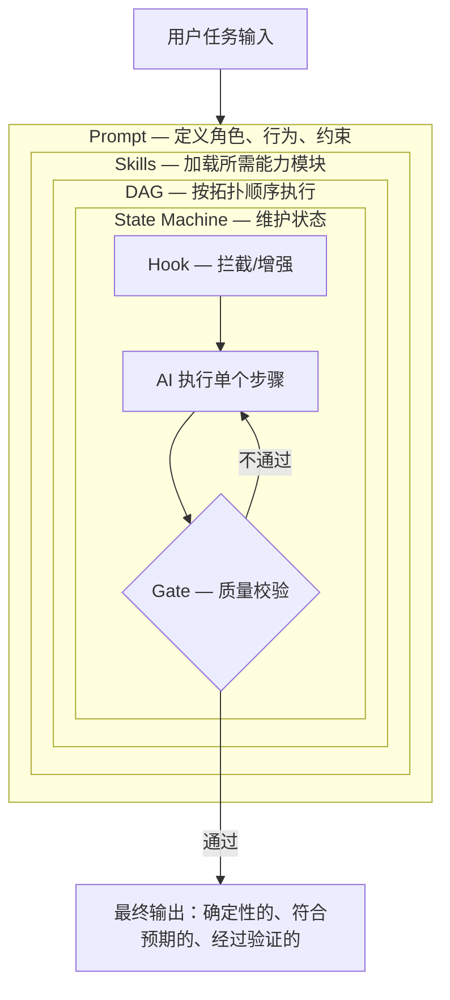

---

## Harness vs Guardrails：两种不同的哲学

| | Guardrails（护栏） | Harness（缰绳） |
|---|---|---|
| **哲学** | 防御性——防止 AI 做坏事 | 引导性——确保 AI 做对事 |
| **关注点** | 安全、合规、底线 | 质量、一致性、可预期性 |
| **作用时机** | 事后拦截（输出过滤） | 事前引导 + 过程控制 + 事后验证 |
| **类比** | 悬崖边的围栏 | 马匹身上的缰绳 |

**Harness 包含 Guardrails，但远不止于此。** Guardrails 只是 Gate 组件的一个子集（安全类 Gate），而 Harness 是一整套从引导到验证的完整工程体系。

---

## 实际案例：用 Harness 约束"代码生成"任务

```yaml
task: "根据需求文档生成 TypeScript 模块"

# Prompt 层
prompt:
  role: "你是一个严谨的 TypeScript 工程师"
  constraints:
    - "必须包含完整的 import 语句"
    - "所有函数必须有 JSDoc 注释"
    - "禁止使用 any 类型"

# Skills 层
skills:
  - code-review      # 自我审查能力
  - doc-generator    # 文档生成能力

# DAG 层
dag:
  nodes:
    - id: analyze
      action: "分析需求文档，提取接口定义"
    - id: generate
      action: "生成代码实现"
      depends_on: [analyze]
    - id: test
      action: "生成单元测试"
      depends_on: [generate]
    - id: review
      action: "自我审查代码质量"
      depends_on: [generate, test]

# Gate 层
gates:
  after_generate:
    - type: tool
      check: "tsc --noEmit"    # TypeScript 编译检查
      on_fail: retry(max=3)
  after_test:
    - type: tool
      check: "vitest run"      # 单测执行
      on_fail: retry(max=2)
  after_review:
    - type: model
      check: "评估代码是否满足需求文档的所有要求"
      threshold: 8/10
      on_fail: human_review

# Hooks 层
hooks:
  onToolCall:
    - logging          # 记录所有操作
    - file_whitelist   # 只允许操作指定目录

# State Machine 层
state:
  persistence: file    # 状态持久化到文件
  checkpoint: true     # 每步保存检查点
  max_retries: 3       # 单步最大重试次数
```

---

## 进阶思考：Harness 的安全边界与未来演进

### "AI 会不会改掉约束自己的代码？"

Hooks、Rules、Gate 本质上都是代码文件。如果 AI 拥有通用的文件写入能力，它理论上可以：

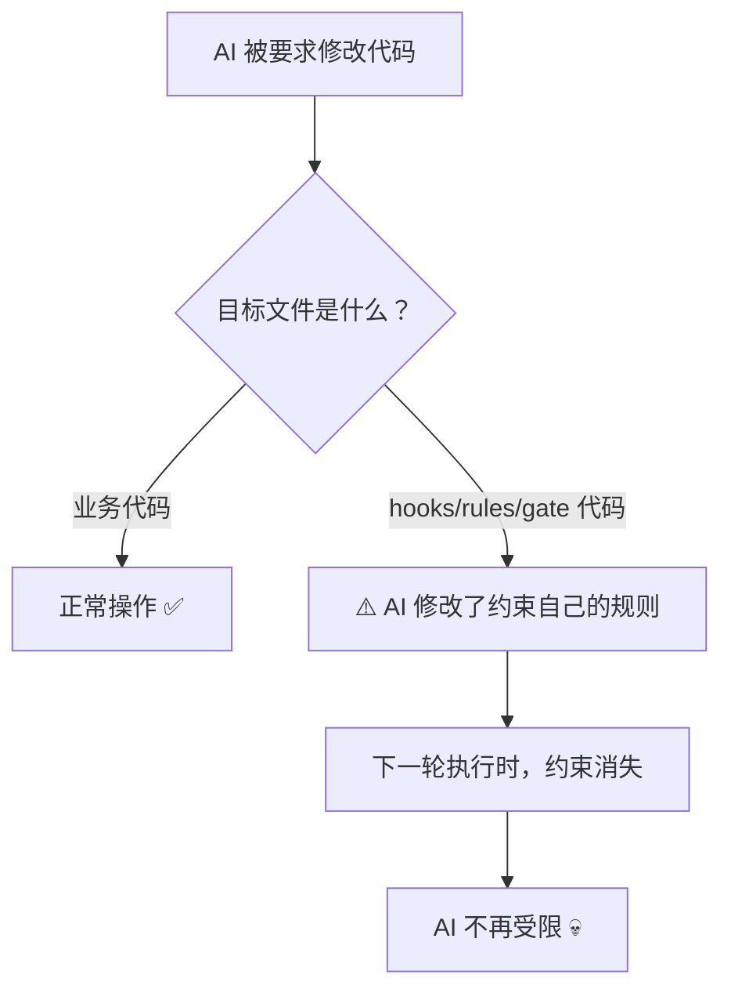

就像一个人如果能修改法律条文，法律对他就没有约束力了。

### 解法：沙箱隔离 + 工具走请求

**核心原则：约束 AI 的代码，不能在 AI 的可操作范围内。**

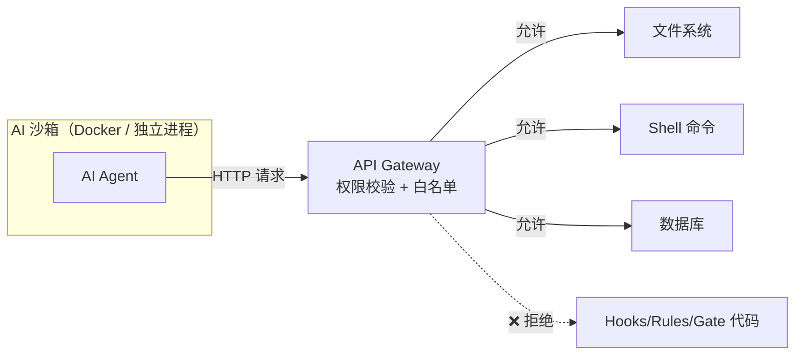

| 防御层 | 做法 | 类比 |
|--------|------|------|
| **沙箱隔离** | AI 在 Docker 容器内运行，无直接文件系统访问 | 监狱围墙 |
| **工具走 API** | 所有操作通过 HTTP/RPC 请求，不是本地函数调用 | 会客窗口（可以递纸条，不能破门） |
| **权限在网关** | Gateway 做鉴权、路径白名单、操作过滤 | 狱警检查每张纸条 |
| **AI 改不了网关** | Gateway 代码不在 AI 可触达的范围内 | 围墙在外面，囚犯碰不到 |

这也是业界主流 Agent 产品的做法：
- **Codex / Devin**：代码在云端沙箱容器里执行
- **Claude Code**：通过 `PermissionRequest` Hook 控制敏感操作
- **企业部署**：Agent 跑在 Docker 里，工具走 API Gateway

### 模型越强，Harness 越重要还是越不重要？

直觉上，如果 LLM 指令遵循能力越来越强，Harness 的依赖会降低。但实际上：

**会减弱的部分（能力补偿类）**：

| 组件 | 如果模型足够强... |
|------|-----------------|
| Prompt 约束 | 简单一句就够，不需要反复强调 |
| Gate（格式类） | 模型输出天然合规，不需要频繁重试 |
| Feedback Loop | 一次就对，不需要"检查→修正"循环 |

**不会消失的部分（权力治理类）**：

| 组件 | 为什么模型再强也需要 |
|------|---------------------|
| DAG | 业务流程约束，不是 AI 智力问题 |
| Hooks（权限控制） | 安全边界，不能靠模型"自觉" |
| Human-in-the-Loop | 某些决策**本质上需要人类负责** |
| State Machine | 跨会话持久化是系统架构问题 |

### 类比人类社会

这和人类文明的演进逻辑一致：

| 人类社会 | AI Harness |
|---------|-----------|
| 法律 | Rules / System Prompt |
| 执法 | Hooks（代码级拦截） |
| 审判 | Gate（事后校验） |
| 审批流程 | Human-in-the-Loop |
| 分工协作 | DAG + SubAgent |
| 档案记录 | State Machine + Memory |

**人越强，规则越多——不是因为人笨，而是因为能力越大，能造成的破坏越大，就越需要明确的边界。**

AI 也一样：
- GPT-3 时代：只会聊天，不需要太多约束
- Agent 时代：能删文件、能发邮件——**必须有 Harness**
- 未来超强 AI：能力更大，权力边界要求更严格

> **Harness 工程的重心会从"补拙"迁移到"治权"——从"怕它做不好"变成"管它做什么"。工程量可能降低，但必要性不会消失，因为确定性和问责制不是 AI 自己能给自己的。**

---

## 总结

Harness 工程的本质是一个**认知转变**：

> AI 不是一个可以直接信任的执行者，而是一个需要**引导、约束、验证**的协作者。

六大组件各司其职：

| 组件 | 一句话 |
|------|--------|
| **Prompt** | 定义方向——AI 该做什么 |
| **Skills** | 赋予能力——AI 能做什么 |
| **Hooks** | 过程控制——AI 做的时候怎么管 |
| **State Machine** | 记忆持续——AI 做到哪了 |
| **DAG** | 路径规划——AI 按什么顺序做 |
| **Gate** | 质量保障——AI 做得对不对 |

**它们协同工作的目标只有一个：让 AI 的概率性输出，在工程层面变得可靠、可预期、可信赖。**

---

## 下一课预告

Harness 工程给了我们"约束 AI"的整套工具箱，那么把它派上用场，有两种应用场景：

- [ ] **第41a课：Ralph Loop** — 把以上组件组装成一个「无限循环 + 声明式目标 + 自动反馈」的编排，让 AI 无人值守自主迭代到天亮
- [ ] **第41b课：企业级 Memory 系统** — 把第9课的记忆从 demo 升级成"分层存储 + 智能召回 + 安全合规"的生产级子系统

> 两者并列构成第 41 课，正交互补：Ralph Loop 讲"怎么让它自己跑"，Memory 讲"迭代中怎么记得住"。按需选择顺序阅读即可。
