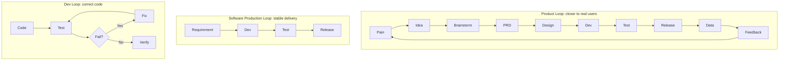

しばらく、自分のプロダクトを作っている。**Arrange Life**、スケジュールカレンダーだ。

最初のとても単純なカレンダー要件から、凡例、AI Agent、Skills を足し、Web、App、テスト、リリース、データ分析まで進むうち、はっきりしてきたことがある。

> **AI が本当に変えるのは、コードを書く速さだけではない。一人がソフトウェア生産の全ライフサイクルを通せる可能性だ。**

以前、本番に耐えるプロダクトを出すには、多くの役割が要った。プロダクト、デザイン、フロント、バック、テスト、運用。

今、一人が Coding Agent、Skills、成熟したクラウドサービスを持てば、その仕事の大部分をカバーできる。

このやり方を、**OPC（One Person Company）ソフトウェア開発** として理解している。

この記事は理論枠ではない。自分のプロダクトで穴に落ちたあと、沈殿した経験だ。

---

## 1. OPC の起点：先に Idea を探さない。自分の痛点を探す

Arrange Life を作った最初の理由は、とても単純だった。

**市場のカレンダープロダクトに不満だった。**

とても小さな機能でも、既存プロダクトが解けず、自分を困らせ続けるなら、自分で解く価値があるかもしれない。

たとえば欲しかったのは：

* 月ビューと年ビューが、予定をもっと直感的に表すこと
* カレンダーが凡例を持ち、日付が冷たい数字だけではないこと
* 予定と生活を本当に理解する Agent
* 将来は、カレンダー能力そのものを、他の Agent が呼べる Skills にすること

これらは伝統的なカレンダーが最優先で気にすることではないかもしれない。だが **自分の本物の需要** ではある。

OPC では、これが特に大事だ。

会社は KPI、予算、組織目標に押されてプロダクトを作る。一人で作るとき、最終的に稼げるかどうかさえ分からないことが多い。

長く続けさせるのは、たいてい：

> **この問題は本当に自分を困らせる。ユーザーがまだいなくても、良くし続けたい。**

興味と本物の痛点は、OPC にとっていちばん安く、いちばん長持ちする燃料だ。

---

## 2. 最初の OPC で、新しい市場を気軽に発明しない

本物の痛点を持ったあと、もう1つビジネス判断が要ると思う。

**この需要に、すでに誰かがお金を払っているか？**

初めて OPC をする人には、**市場で検証済みの領域** を勧める。

カレンダー、ToDo、ノート、生産性ツールには、成熟したプロダクトと安定した有料ユーザーがいる。

それはとても大事な事実を意味する。

**需要そのものを、自分が証明する必要はない。**

証明すべきは：

> 既存市場の中で、誰もよく解けていない一片を見つけ、より良くできるか？

ゼロから新しいカテゴリを作るのとは、リスクがまったく違う。

経験はこうだ。

**成熟市場 + 検証済みの支払い意思 + 自分の実痛点 + 明確な差別化** は、しばしば良い OPC の起点になる。

本当に良い新しい需要を見つけたら、もちろん行けばいい。

ルールではない。プロダクトを作ったあとの経験だ。

**最初は創造性をできるだけ守れ。存在しないかもしれない市場の検証に、早すぎる燃焼をしない。**

---

## 3. OPC でもっとも足りない資源は Token ではない

プロダクトを決めたあと、最初に考えたのは技術の先進さではなかった。

**システム全体を、できるだけ安く、単純に、保守少なくするにはどうするか。**

OPC の最大の問題は技術不足ではない。時間と気力の不足だ。

成熟した基盤があるなら自作しない。コミュニティとクラウドの低コストサービスを、できるだけ使う。

自分の実践では、成熟したホスティング、デプロイ、CDN、ドメイン基盤を厚く使い、DevOps をできるだけ外に出している。

同じ原則は Coding Agent にも当てはまる。

条件が許すなら、本当に大事なソフトウェア仕事には、より強く安定したモデルを使う。

理由はリーダーボードではない。とても実務的な問題だ。

> **半日もがいて解けないと、失うのは数時間だけではない。続けたいという興味そのものかもしれない。**

OPC は正のフィードバックに強く依存する。

**要件が終わる → 嬉しい → 最適化したくなる → ユーザー反応が良い → 続く。**

このループが、価値の低い Debug で途切れると、疲れやすい。

だから OPC のコスト最適化は、「全部いちばん安いものを選ぶ」ことではない。

本当に最適化すべきは：

> **単位時間で、使える結果を得るコスト。**

---

## 4. Coding Agent を裸で走らせない：ソフトウェア開発を Skills にする

Idea、開発環境、Coding Agent を持ったあと、人を分けるものが現れ始める。

**Skills。**

毎回その場で AI に言わない。

> この要件を実装して。

代わりに、ソフトウェア開発のやり方を Skills に蒸留し、要件が現れてから公開されるまでに何を通るべきかを Agent に知らせる。

今認めているライフサイクルは、だいたいこうだ。

> **Idea → Brainstorm → PRD → UED → 技術設計 → 開発 → テスト → 結合 → リリース → データ観察 → 次のイテレーション**

だが、これらのステップを Skills にするだけでは足りない。

**最終的に達成すべきは Loop Engineering だ。**

つまり、要件からコードへの一方通行パイプラインを Agent に実行させるのではない。渡すのは：

> **開発 → テスト → 問題を見つける → 直す → 再テスト → 検証**

という、自己収束する工学ループだ。

Skills が答えるのが：

**「Agent はどうソフトウェア開発をすべきか？」**

なら、Loop Engineering が答えるのは：

**「Agent はどうやって正しくできたかを知り、間違えたあと自分を直すのか？」**

これが、Coding Agent が「コード生成器」から「エンジニア」へ移る鍵の一歩だ。

---

## 5. Brainstorm：要件が来た瞬間にコードへ走らない

これはフロー全体でとても大事な一歩だ。

要件が来たら、最初にすべきはコーディングではない。**Brainstorm** だ。

少なくとも3つ。

第一に、**競合を調べる**。

他者はどう解いているか。成熟プロダクトはなぜこう設計しているか。

第二に、**オープンソースの解を探す**。

コミュニティに成熟実装があるなら、Agent に車輪の再発明をさせない。

時間を節約し、より大事なのは安定性が上がること。

第三に、**AI に思考を広げさせる**。

人間のアイデアは、しばしば一文だ。

良いモデルはその一文を広げられる。

どのシナリオが欠けているか。エッジケースは何か。別のインタラクションはあるか。成熟プロダクトは普通どう解くか。

だから Brainstorm が本質的にやることは1つ。

> **いちばん安い段階で、誤りと漏れをできるだけ露出する。**

コードを書いたあとに方向が違うと分かるのが、いちばん高い。

---

## 6. PRD：User Stories は必須

Brainstorm のあと、PRD に入る。

モデルが PRD を書くこと自体は、もう難しくない。本当に大事なのは：

**PRD を、AI が AI のために書いた長文にしない。**

AI は特に、数千語・数十節の文書を生成したがる。

内容は正しくても、読んだあと「何をすべきか」が分からなくなる。

だから PRD に **User Stories** を残すことを、特に勧める。

たとえば：

> 月ビューをよく見る人として、日付詳細に毎回入らず、月ビューでその日の重要な予定を直接見たい。

こういう一文は、ときに数百語の要件説明より価値がある。

一目で分かるからだ。

**誰の、何の問題を解いているか。**

User Story は、長い AI 文書の認知負荷と戦う、私のやり方だ。

---

## 7. UED：最初は真剣に設計し、あとはシステムに働かせる

UED は面白い段階だ。

プロダクトが「見栄えがいいか」は、実は2人に効く。

**ユーザーと、開発者自身。**

毎回開いて自分の作ったものが醜いと感じると、続ける欲望は時間とともに落ちる。

だからプロダクトの初期、自分のデザインシステムを作るコストは払ってよい。

専門の AI デザインツールでも、成熟した UI/UX Skills と Design System でもいい。

だが本当に大事なのは特定のツールではない。できるだけ早く答えることだ。

> **自分のプロダクトは、実際どう見えるべきか？**

主色、フォント、角丸、余白、コンポーネントのスタイル、プロダクトが伝えたい感じ。

たとえば Arrange Life はティール寄りの視覚システムを使い、カレンダーを開いたとき「未完了タスクの山」の圧ではなく、リラックスした自然さを出したかった。

このシステムが立ったら、App、PC、Web は揃えるべきだ。

より大事なのは：

**Design System が安定したら、後続の要件は再設計しなくてよい。**

Agent に、既存のデザインシステムの中で伸ばさせる。

OPC の長期保守コストは、それでかなり下がる。

---

## 8. プロトタイプのためのプロトタイプをしない：ASCII で足りることが多い

ここに、とても陥りやすい罠がある。

AI は今、HTML プロトタイプをとても簡単に出せる。だから PRD 段階で、とても完成度の高いインタラクティブページを作りたくなる。

だんだん感じている。

**たいてい、要らない。**

高忠実度プロトタイプは、色、アニメーション、余白、ボタン位置のような細部に、早すぎる時点で引きずる。

要件そのものが焦点を失う。

多くの要件では、単純な ASCII スケッチで足りる。

```text
┌──────────────────────────┐
│        September         │
├────┬────┬────┬────┬─────┤
│  1 │  2 │  3 │  4 │  5  │
│    │Meeting│  │Trip│    │
├────┴────┴────┴────┴─────┤
│ Today                     │
│ 10:00 Product discussion  │
│ 15:00 Gym                  │
└──────────────────────────┘
```

本当に確認したいのは：

**情報はどこか。ユーザーはどう操作するか。ページはどう遷移するか。**

それが確認できたら、本物のページ開発へ飛び、本物の環境でインタラクションを直すほうが、しばしば速い。

これは大事な OPC 原則だ。

> **各段階では、「ちょうど足りる」表現精度を使う。**

不要なトークン、時間、注意を先払いしない。

---

## 9. 技術設計：Agent に、毎回あなたの基準で考えさせる

開発の前に、技術設計を出す側にいる。

フロントとバックは一緒でも、分けてもよい。

複雑な要件では分けたい。Agent の焦点が保ちやすい。

より大事なのは：

**自分の技術設計テンプレートを作ること。**

最低限、はっきりさせる。

* この変更は何か
* どのモジュールに関わるか
* データ構造はどう変わるか
* インタフェースはどう調整するか
* 例外はどう扱うか
* 互換性はどう保証するか
* リスクは何か
* どうテストするか
* どうリリースするか

これらはだんだん、自分の Skills になる。

また、技術文書はコードと同じリポジトリに残すべきだ。

何年後、本当に価値があるのはコードだけではない。

**なぜこう設計したか。**

コードは将来の Agent に「今何か」を伝える。文書は「なぜこうなったか」を伝える。次の Agent セッションへ知識が渡る基盤だ。

---

## 10. テストは後付けではない。Loop Engineering の核だ

これは、ますます重視している点だ。

Coding Agent が強くなるほど、**コードを書くこと自体が、プロセス全体の相対的に安い部分になっていく。**

本当に時間を食いはじめているのは：

**検証。**

コードは正しいか。

既存ロジックを壊したか。

フロントとバックは合うか。

ビジネスチェーン全体はまだ動くか。

だからテストを、「開発のあと一度チェックする」と理解してはいけない。

実際には **Loop Engineering を可能にする基盤** だ。

いちばん単純なループ：

```text
        ┌──────────────┐
        │  Requirement │
        └──────┬───────┘
               ↓
        ┌──────────────┐
        │ Implementation│
        └──────┬───────┘
               ↓
        ┌──────────────┐
        │     Test      │
        └──────┬───────┘
               ↓
           Pass ?
          ↙      ↘
        No        Yes
        ↓          ↓
      Fix       Verify
        │
        └──────────────→ Test
```

以前、このループでいちばん高かったのは「人間」だった。

テストが問題を見つけたあと、エンジニアはログを読み、箇所を特定し、コードを変え、再実行する。

今、これらのステップは Agent がやり始められる。

だから要件を Coding Agent に渡したあと、こうできる。

**実装 → テスト → 失敗を見つける → 原因を分析する → コードを変える → 再テスト → 通るまで。**

自動テストの価値は、もはや「品質保証」だけではない。

実際にはこうなる。

> **Agent のフィードバック信号。**

テストが無いと、Agent はこう思うことしかできない。

**「コードは書き終わった。」**

テストがあれば、こう知れる。

**「正しいことをした。」**

この2つの状態は、とても違う。

---

## 11. ループが完走するほど、OPC のイテレーションは速くなる

だから成熟した OPC プロジェクトは、異なる層のテストをだんだん埋めるべきだ。

含むのは：

**ユニットテスト、API テスト、UI 自動化、そして最後にエンドツーエンドテスト。**

それらは異なる層で、Agent にフィードバックを渡す。

ユニットテストが伝えるのは：

> この関数は正しく書けたか？

API テストが伝えるのは：

> サービス間の契約は壊れたか？

UI 自動化が伝えるのは：

> 本物のユーザー操作はまだ完了できるか？

エンドツーエンドが最後に答えるのは：

> **ユーザーストーリー全体はまだ成り立つか？**

これらの能力がだんだん立つと、面白い結果が出る。

### プロジェクトが成熟するほど、新しい要件の開発は速くなることがある。

Agent が毎回「推測」に頼らなくなるからだ。

大胆に変え、既存のテストシステムに言わせる。

**何が壊れたか。**

それから自分で直す。

だから良いテストシステムは、OPC にとってコストではない。

むしろ逆だ。

> **後期 OPC の、いちばん大事な加速装置の1つ。**

---

## 12. だが毎回フルテストスイートを走らせない

Loop Engineering には、とても現実的な問題がある。

**コスト。**

プロジェクトに数千のテストが溜まり、ボタン1つの変更で全部再実行させたら、ループはすぐに遅くなる。

だから Agent には、もう1つ能力が要る。

**Impact Analysis。**

この Change Set に基づいて判断する。

**何を変えたか → どのモジュールが影響を受けるか → どのテストがそれらのモジュールに関係するか → 今回どれを走るべきか。**

より妥当なフローは：

> **変更 → Impact Analysis → 関連テスト → 失敗分析 → 修正 → 再テスト → 検証**

ではなく：

> **変更 → 全部走る**

ではない、ということだ。

これが、Loop Engineering と伝統的 CI の大事な違いだとも見ている。

**単純な自動化ではない。Agent に変更を理解させ、検証戦略を動的に決めさせること。**

そうして初めて、ループは十分速くなる。

ループが十分速いときだけ、人間の創造性は長い待ちで削られない。

---

## 13. 結合：Computer Use を Agent に渡す

Browser Use と Computer Use が成熟するにつれ、以前は人を大きく食っていた結合フェーズも、Agent に渡し始められる。

理想の状態：

> **ローカル環境 → 自動テスト → ローカル結合 → preprod 環境 → 全鎖結合**

ローカルはいちばん速いフィードバックをくれる。問題はそこで先に解く。

安定したら preprod へ出す。

もう1つ見るべきことがある。

**現代のプロダクトに、アプリは1つだけということは少ない。**

Web、App、API、Agent サービス、データベース、その他サービスが同時にあるかもしれない。

だからテストは、こう聞いてはいけない。

> 「今日変えたアプリは正常か？」

聞くべきは：

> **「この変更の影響を受ける鎖全体は正常か？」**

これも Impact Analysis だ。

Agent はテストを実行するだけではない。システム間の依存をだんだん理解する。

---

## 14. リリース：「出荷して」と Agent に言わない

リリースも Skill になるべきだ。

Agent に：

> 出荷して。

と言われて、すぐ操作し始めてほしくない。

正しいやり方は：

**先に Release Plan を生成する。**

この Change Set がどのアプリに関わるか、依存は何か、リリース順は何か、どのサービスを一緒に上げなければならないか、リリース後に何を検証するかを分析する。

確認のあと、自動リリースを実行する。

つまり：

> **Plan → Review → Release → Verify**

ではなく：

> **Release → Pray**

ではない。

システムが複雑になるほど、これは特に大事だ。

本当に危ないのは、しばしばコードが間違っていることではない。

A は出した、B は忘れた。データベースは変わったがサービスは同期していない。クライアントが依存する新しい API がまだ生きていない。

OPC には、後ろを拾う人がいない。だから：

> **プロセスそのものが、安全網でなければならない。**

---

## 15. 公開は終わりではない：本物のユーザーをループに入れる

公開のあと、ソロ開発者が見落としやすい部分がある。

**データ。**

Day 1 からとても複雑に作る必要はない。

だが本物のユーザーが付いたら、だんだん知るべきだ。

ユーザーは何人か。

DAU はだいたいどれくらいか。

どのページが使われているか。

どの機能は触られていないか。

ユーザーはどこで落ちるか。

Web、PC、App は、プロダクト分析システムをだんだん入れられる。

要件を決めるとき、もうこれだけではない。

> 「この機能は良いと思う。」

代わりに持ち始める。

> **自分の痛点 + ユーザーフィードバック + 行動データ。**

ここで、先に話したループがもう1層広がる。

最初にあったのは **開発ループ**：

> **Code → Test → Fix → Verify**

外へ、**ソフトウェア生産ループ**：

> **Requirement → Development → Test → Release**

最後に本物の **プロダクトループ**：

> **Pain → Idea → Brainstorm → PRD → Design → Development → Test → Release → Data → Feedback → New pain**

この3層のループが、今 OPC を理解する大事なモデルだ。



**内側のループが、コードの正しさを保証する。**

**中間のループが、安定した納品を保証する。**

**外側のループが、プロダクトを本物のユーザーへ動かし続ける。**

---

## 16. まだ終わっていない一片：支払い

プロダクトは最終的に、1つの問いを避けられない。

**どう稼ぐか。**

サブスク、買い切り、付加サービス、AI トークンパック、それとも別のモデルか。

支払いシステムはどう設計するか。

プラットフォーム横断の支払いをどう揃えるか。

無料ユーザーと有料ユーザーの境界はどこか。

これらの問いは、まだ十分に掘っていない。

だからこの記事は、「完成度」のために正しそうな答えを出さない。

OPC を深くやるほど感じていることもある。

**プロダクトを出すことは卒業ではない。入学かもしれない。**

ソフトウェア生産の問題が AI で大きく減ったあと、残るのはユーザー、成長、商用化、信頼、コンプライアンス……

それらが、OPC の本当に難しい部分かもしれない。

---

## 結び：本当に大事なのは、自分のループを作ること

Arrange Life をこのあいだやって、ますますはっきりしたことがある。

AI がもたらす最大の変化は、コードをどれだけ速く書くかではない。

以前は多くの役割が揃わないとできなかったことを、一人が初めて串に通せる可能性を持ったことだ。

Idea を持てる。

AI と Brainstorm できる。

PRD と User Stories にできる。

UI を設計できる。

技術設計を出せる。

コードを書ける。

テストを書ける。

ブラウザを開いて自分で結合できる。

問題を見つけて自分で直せる。

テストを再実行できる。

preprod に出せる。

影響を分析できる。

Release Plan を出せる。

本番に出せる。

最後に本物のデータで、ユーザーが本当に好きかを観察できる。

**AI はプロダクトそのものを単純にはしなかった。**

ただ普通の人に、以前は会社だけが持てた「仮想ソフトウェアチーム」を、初めて持たせた。

だが今、ますます感じている。OPC だと本当に残すべきなのは：

**「どの AI ツールを使ったか」ではない。**

ツールは変わる。モデルも変わる。

本当に残すべきは3つ。

**Skills、Context、Loop。**

Skills が Agent に伝えるのは：

> **どうやるべきか。**

Context が Agent に伝えるのは：

> **このプロダクトが、なぜこう作られたか。**

Loop が Agent に伝えるのは：

> **正しくできたかをどう知るか。間違えたあと、どう自分を直すか。**

この3つがだんだん溜まると、持っているのは Coding Agent だけではない。

自分の **ソフトウェア生産システム** を持っている。

そのシステムは、プロダクトを増やし、穴に落ち、Skills が厚くなるほど強くなる。

**最初のプロダクトは遅いかもしれない。**

**2つ目は、かなり速くなる。**

**3つ目は、もうゼロから始まらないかもしれない。**

本当に再利用されるのは、コードだけではなかったからだ。

過去のソフトウェア工学の経験が、AI が実行できる能力になり始めている。

AI 時代の OPC が、本当に楽しみな理由はそこだと思う。
