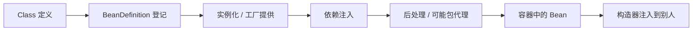

> **Bean 进阶篇**。夹在 [框架篇](/blog/spring-boot-for-frontend/) 和 [契约篇](/blog/api-contract-for-frontend/) 之间：上一篇教你「会用 Bean」，这篇讲「Bean 到底是什么」。
>
> 一句话总纲：**你写的是类（图纸）；容器里拿出来的是 Bean（被管理的对象实例）。**
>
> 下面的 `BenefitClient` / `BenefitManager` / `OrderController` 是**脱敏教学示例**，不是某个内部仓库的源码记录，也没有扫描过私有项目。

---

## 0. 这一篇深在哪

框架篇已经给过 Bean 的够用版。这里只挖三个最容易「以为懂了」的点：

1. Bean 不是 Class。
2. 容器不是「没有 `new` 就变出对象」的魔法，是登记 → 创建或工厂提供 → 注入 → 按名字/类型分发。
3. `@Component` 是登记标签，真正 `new`（或代理）的是容器；普通接口上贴它不会变成实例。

主线：**语言 → 框架 → Bean → 契约**。不再使用「三部曲 2.5」这种计数。

---

## 1. 一句话

**Bean = Spring 容器负责生命周期的对象**：创建（或由工厂给实例）、注入依赖、按作用域缓存、按名字或类型交给别人。

你不手 `new`，是为了装配可测、实现可替换，不是因为 `new` 非法。

---

## 2. Bean 到底是什么

### 2.1 类 → 登记 → 实例 → 引用

```
Class（字节码里的定义）
   → BeanDefinition（容器里的元数据：怎么造、作用域、依赖）
   → 实例（普通对象，或工厂/代理包过的对象）
   → 注入到别人的构造器参数
```

前端接近的类比是模块里导出的**那一份 store 实例**：

```js
// 教学对照：模块导出的是实例，不是类
import { store } from "./store.js";
```

对照到此为止。Spring 还要处理多实现、作用域、代理，比「一个文件一份单例」复杂。

### 2.2 词源：JavaBeans ≠ Spring Bean

历史上 JavaBeans 指带约定的可复用组件。Spring Bean **没有**「必须无参构造 + getter/setter」这条死规矩。今天常见的是：有参构造器 + 不可变依赖。咖啡豆比喻能帮记忆，**不是规范**。

容器也不限于「自己反射 `new`」：

- `@Bean` 方法里你可以手 `new` 再返回
- 编程式 `registerBean`
- `FactoryBean` / RPC / MyBatis 这种**工厂给出的代理**
- 暴露类型可以是**接口**

所以：**不能绝对说「接口不能当 Bean」。** 不能当的是「对一个普通接口只贴 `@Component`、还指望扫描出实例」。接口作为 **Bean 的类型**（注入点、`@Bean` 返回类型、工厂注册的类型）完全合法。

### 2.3 容器不是一张 Map，但可以先当 Map 想

心智简化：

- `beanName →` 元数据 / 单例实例
- `type →` **可能多个**候选

不是「一个接口永远唯一映射到一个实例」。并发结构、三级缓存、循环依赖是源码课，这里不展开。

真正还有：`BeanDefinition` 注册表、单例缓存、`BeanPostProcessor`、作用域、代理包装。

### 2.4 完整示例（脱敏）

```java
public interface BenefitClient {
    BenefitDto fetch(String benefitId);
}

@Component
public class RemoteBenefitClient implements BenefitClient {
    @Override
    public BenefitDto fetch(String benefitId) {
        // 教学示例：调用下游的门面
        return downstream.get(benefitId);
    }
}

@Service
public class BenefitManager {
    private final BenefitClient benefitClient;

    public BenefitManager(BenefitClient benefitClient) {
        this.benefitClient = benefitClient;
    }
}
```

只有一个 `BenefitClient` 候选时：

```java
BenefitClient a = context.getBean("remoteBenefitClient", BenefitClient.class);
BenefitClient b = context.getBean(BenefitClient.class);
// 默认单例：a == b == 注入进 BenefitManager 的那一份
```

多候选时 `getBean(BenefitClient.class)` 会炸，要用名字、`@Primary` 或 `@Qualifier`。

**普通接口**不会被组件扫描实例化。**具体类**可以登记。抽象类不要说「绝对不行」——极少见的工厂/配置场景会碰到，日常当不能扫描即可。

```java
@Configuration
public class ClientConfig {
    @Bean
    public BenefitClient benefitClient() {          // 返回接口：合法
        return new RemoteBenefitClient();
    }
}
```

MyBatis Mapper、RPC 代理都是「工厂往容器里放了一个接口类型的 Bean」。

### 2.5 多个实现

```java
@Component
@Primary
public class RemoteBenefitClient implements BenefitClient { }

@Component
@Qualifier("local")
public class LocalBenefitClient implements BenefitClient { }

public BenefitManager(
        BenefitClient primary,
        @Qualifier("local") BenefitClient local,
        Map<String, BenefitClient> all) { }
```

业务侧按类型做路由（活动类型 → 哪个 client）是**你写的分发**，不是容器自动长出一个「路由器代理」。**不要把「选候选」和「动态代理类型」混为一谈**：代理是调用拦截；`@Primary` 是注入时选哪一个定义。

---

## 3. 注解家族

`@Component` / `@Service` / `@Repository` / `@Controller` / `@RestController` 都带 `@Component` 元注解，所以都能被扫描。额外行为不同：

- `@Repository` 的异常翻译要配合持久化基础设施，不是贴了就翻译。
- `@RestController` 带 `@ResponseBody`。
- **事务切面靠 `@Transactional` + 代理是否生效**，**不是「只有 Service / Repository 才能有事务」**。Controller、普通 `@Component` 只要走代理、切点匹配，一样能织进去。框架篇里写错过这一点的话，以本段为准。

Bean 还可以来自：`@Bean`、`@Import`、`ImportBeanDefinitionRegistrar`、编程 API。**不只是那五个注册注解。**

---

## 4. 作用域

| 作用域 | 含义 |
|---|---|
| singleton（默认） | **每个容器、每个 Bean 定义** 1 份，不是全球 1 份 |
| prototype | 每次向容器要，新一份。已经注入进单例里的那次**不会**每次方法调用再 new |
| request / session | 需要 Web 应用、作用域代理或 `ObjectProvider`。**prototype 不是「每请求一份」** |

`@Scope` **本身不注册 Bean**，旁边还要有 `@Component` 或 `@Bean`。

无状态、依赖不可变，**有助于**单例线程安全；**不是**「只要没有成员变量，任何逻辑都线程安全」（静态变量、外部可变单例、非线程安全的 Map 都仍会出事）。可变字段不绝对禁止：用并发结构、局限在初始化。**不要把当前请求的业务数据放进共享字段。**

`@PostConstruct` / `@PreDestroy`：初始化与销毁。懒加载（`@Lazy`）可以迟到第一次使用。prototype 的销毁要调用方管。

---

## 5. 一个示例 BFF 怎么分工（无真实仓库统计）

教学里的中后台门面（BFF）常常是：

| 角色 | 干什么 |
|---|---|
| Controller | 接 HTTP、校验、返回信封 |
| Manager / Service | 编排用例 |
| Client | 调下游 RPC / HTTP |
| Repository / Mapper | **仅当本进程直接访问数据库时**才常见 |

**没有 `@Repository` 不能证明系统一定不访问数据库。** 数据可能在下游服务里。也没有「扫描到 N 个某注解」这种内部统计——那些数字不属于公开教程。

---

## 6. 一张图



---

## 7. 术语表

| 术语 | 一句话 |
|---|---|
| Class | 类型定义 |
| BeanDefinition | 容器里「怎么造这个对象」的说明 |
| Bean | 被容器管理的对象（可能是代理） |
| `@Component` | 扫描登记标签，不是咖啡机 |
| `@Bean` | 用方法把返回值交给容器 |
| `@Primary` / `@Qualifier` | 多候选时的选择 |
| singleton / prototype / request | 作用域 |
| FactoryBean / Mapper 代理 | 工厂把接口类型的对象放进容器 |
| BFF | 前端只打一个 HTTP 门面 |

---

## 8. 自测

<details>
<summary>1. Bean 等于 Class 吗？</summary>

不等于。Class 是定义；Bean 是容器按定义拿出来的对象（或代理）。
</details>

<details>
<summary>2. <code>@Service</code> 和 <code>@Component</code> 是不是同一个东西换皮？</summary>

扫描层面都是组件。语义和部分框架钩子不同，不能任意互换当规范。
</details>

<details>
<summary>3. 默认单例为什么能共享？</summary>

每容器每定义一份。无状态时多线程共用同一份是常见选择。有请求态字段就会串。
</details>

<details>
<summary>4. 单例里可变字段绝对禁止吗？</summary>

不绝对。风险是并发写。请求级数据不要放共享字段；要用并发工具或别的作用域。
</details>

<details>
<summary>5. 一个项目没有 <code>@Repository</code>，能推断它不访问数据库吗？</summary>

不能。可能是 BFF，库在下游。
</details>

<details>
<summary>6. <code>@Component</code> 会把类磨成 Bean 吗？</summary>

不会。它只登记。创建实例的是容器（或 <code>@Bean</code> / 工厂）。
</details>

<details>
<summary>7. 为什么 <code>@Component</code> 写在 <code>RemoteBenefitClient</code> 上，注入却用 <code>BenefitClient</code>？</summary>

扫描要能实例化的具体类（或工厂）。注入按类型匹配接口。接口也可以是 <code>@Bean</code> 的返回类型。
</details>

<details>
<summary>8. 容器就是 HashMap 吗？</summary>

心智上像「名字/类型 → 对象」的登记表。实现上还有定义、缓存、后处理、代理、作用域，不是一张 Map。
</details>

---

## 9. 学习路径

1. 先记住登记 → 造实例 → 注入 → 派发。
2. 再看事务 / AOP：代理和自调用，回到 [框架篇](/blog/spring-boot-for-frontend/) 第 7、8 节。**不要记「事务只对 Service/Repository 生效」。**
3. 然后读 [契约篇](/blog/api-contract-for-frontend/)，看 HTTP 信封怎么从 Controller 出去。

---

## 10. 联读

- 前置：[Java 语言](/blog/java-language-for-frontend/) 的多态、接口、依赖倒置；[Spring 框架](/blog/spring-boot-for-frontend/) 的 IoC 够用版。
- 本篇：Bean / 容器 / 作用域。
- 后置：契约。专栏里的 [数据库事务](/blog/db-transaction/) 补本地事务细节。

主线：**语法 → 框架会用 → Bean 懂透 → 前后端契约**。
